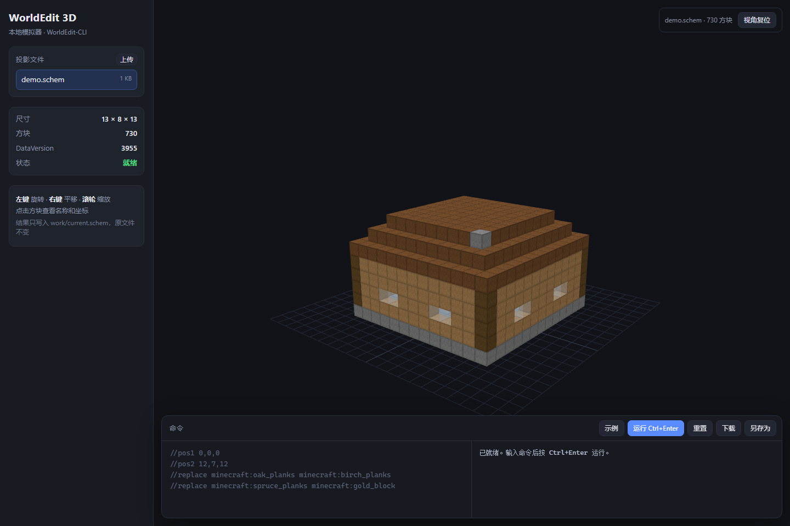

# WorldEdit 3D 模拟器

不启动 Minecraft，在浏览器里对 `.schem` 投影执行 WorldEdit 命令并实时查看 3D 结果。



## 快速开始

```bat
cd /d D:\worldedit-simulator
web.cmd
```

从 GitHub 克隆时，先运行一次 `setup.cmd` 下载 CLI 和 JRE 25：

```bat
git clone git@github.com:Hcachild/worldedit-simulator.git
cd worldedit-simulator
setup.cmd
web.cmd
```

浏览器会自动打开 <http://127.0.0.1:8777/>。左侧选投影（默认 `demo.schem`，13×8×13 小屋），
点 **示例** 再点 **运行**，就能看到墙、屋顶、窗户被替换后的 3D 结果。

只想用命令行：

```bat
copy schematics\demo.schem schematics\my.schem
we.cmd schematics\my.schem scripts\demo.txt
python tools\inspect_schem.py schematics\my.schem
```

## 3D 页面

| 操作 | 说明 |
|---|---|
| 左键拖动 / 右键拖动 / 滚轮 | 旋转 / 平移 / 缩放 |
| 点击方块 | 查看方块 ID 和坐标 |
| 左侧文件列表 | 切换 `schematics/` 下的投影 |
| 上传 / 拖入 `.schem` | 导入新投影 |
| 命令框 + `Ctrl+Enter` | 执行 WorldEdit 命令并刷新 3D |
| 重置 | 回到载入时的原始投影 |
| 下载 / 另存为 | 导出当前结果到 `schematics/` |

命令由后台的官方 WorldEdit-CLI 真正执行，结果写入 `work/current.schem`，**原文件不会被修改**。
每次运行需要启动一次 JVM，通常 1–2 秒。

渲染说明：所有方块按立方体绘制，使用按方块类型着色的程序纹理（带方块网格线），
水、玻璃、冰等半透明；楼梯、台阶、门等不做精细建模。大型投影（几十万方块以上）会变慢。
运行日志写到 `%TEMP%\worldedit-simulator-web.log`（后台模式），项目目录不产生日志。

## 目录

| 路径 | 内容 |
|---|---|
| `web.cmd` | 启动 3D 页面（Python 服务 + 自动开浏览器） |
| `we.cmd` | 纯命令行入口 |
| `setup.cmd` | 首次安装：下载 CLI jar 和 Temurin JRE 25 |
| `web/server.py` | 本地 HTTP 服务 + WorldEdit-CLI 调用 |
| `web/static/` | 前端（Three.js 本地化，无需联网） |
| `work/current.schem` | 当前编辑副本（运行时生成） |
| `bin/worldedit-cli-7.4.7-SNAPSHOT-dist.jar` | EngineHub 官方 WorldEdit-CLI |
| `bin/log4j2.xml` | 只输出到控制台，避免在项目里生成 `logs/` |
| `jdk-25.0.4.1+1-jre/` | 便携版 Temurin JRE 25（7.4.7 用 Java 25 编译） |
| `schematics/demo.schem` | 13×8×13 小屋（DataVersion 3955 / MC 1.21.1） |
| `scripts/demo.txt` | 示例命令脚本 |
| `worldedit/` | CLI 运行目录：配置、语言缓存、方块表，以及自动生成的 assets/sessions/schematics |
| `tools/make_schem.py` | 生成测试用实心 `.schem` |
| `tools/make_demo.py` | 生成 demo 小屋 |
| `tools/inspect_schem.py` | 不开游戏查看 `.schem` 方块统计 |
| `tools/ensure_data.py` | 预下载方块数据（带超时，避免 CLI 联网卡死） |
| `tools/retarget_schem.py` | 把投影 DataVersion 改到受支持版本（自动备份） |

## 命令行用法

```bat
we.cmd schematics\my.schem scripts\demo.txt
```

不带脚本时进入交互模式，逐行输入命令，`stop` 保存退出：

```
//pos1 0,0,0
//pos2 12,7,12
//replace minecraft:oak_planks minecraft:birch_planks
//hollow
stop
```

常用命令：

| 命令 | 作用 |
|---|---|
| `//pos1 x,y,z` / `//pos2 x,y,z` | 设置选区（CLI 没有玩家，必须带坐标） |
| `//set <方块>` | 填充选区 |
| `//replace <原方块> <新方块>` | 替换 |
| `//walls` / `//hollow` / `//outline` | 墙壁 / 挖空 / 外壳 |
| `//copy` / `//paste` / `//rotate` / `//flip` | 剪贴板操作 |
| `//sphere` / `//cyl` / `//pyramid` | 生成形状 |
| `//deform` / `//generate` | 表达式变形 / 生成 |
| `//schem list` / `//schem load` | 查看/载入 `worldedit/schematics/` 下的文件 |
| `//undo` / `//redo` | 撤销 / 重做 |

完整列表见 <https://worldedit.enginehub.org/en/latest/commands/>。

## 注意

- **原地保存（CLI）**：`we.cmd` 会把命令结果写回载入的 `.schem`，改之前先复制备份；3D 页面用的是
  `work/current.schem` 副本，不动原文件。
- **格式**：网页只接受 1.13+ 的 Sponge `.schem`（v1/v2/v3）；旧 MCEdit `.schematic`
  没有官方 DataVersion 数据，不再支持。
- **没有玩家实体**：`//wand`、笔刷（brush）、传送（`/up`、`/thru`）等依赖玩家的命令不可用；
  选区、生成、剪贴板、撤销等命令正常。
- **level.dat**：7.4.7 尚未实现整世界编辑，只能处理投影文件。
- **Java**：必须用目录里的 JRE 25；系统 Java 17 会报 `UnsupportedClassVersionError`。
- **端口**：3D 页面只监听 `127.0.0.1:8777`，不对外网开放。

## DataVersion 与旧投影

CLI 按投影里的 `DataVersion` 下载方块表，目前 EngineHub 只发布了这些版本：

```
3698 (1.20.3)  3700 (1.20.4)  3837 (1.20.5)  3953 (1.21)    3955 (1.21.1)
4080 (1.21.2)  4189 (1.21.4)  4325 (1.21.5)  4435/4438/4440 (1.21.6-1.21.8)
```

如果投影是 1.20.1（3465）等未发布版本，先改 DataVersion 再用（会生成 `.bak`）：

```bat
python tools\retarget_schem.py schematics\old.schem
we.cmd schematics\old.schem scripts\demo.txt
```

`retarget_schem.py` 默认选最接近的已发布版本；也可以显式指定，例如 `... 3955`。
改版本只改元数据，不改方块数据。

## 更新 CLI

1. 打开 <https://builds.enginehub.org/job/worldedit?branch=version/7.4.x>，选最新成功构建。
2. 下载 `worldedit-cli-*-dist.jar` 放进 `bin/`。
3. 修改 `we.cmd` 和 `web/server.py` 里的 jar 文件名。

WorldEdit 采用 GPLv3，jar 为官方原版未修改；Temurin JRE 采用 GPLv2+CE；Three.js 采用 MIT。
