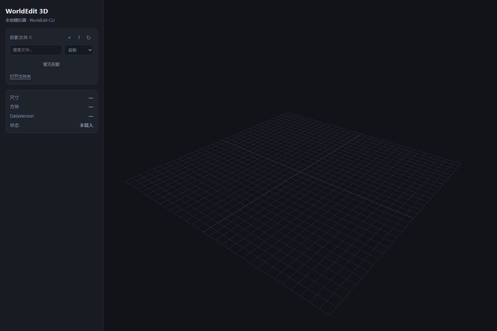
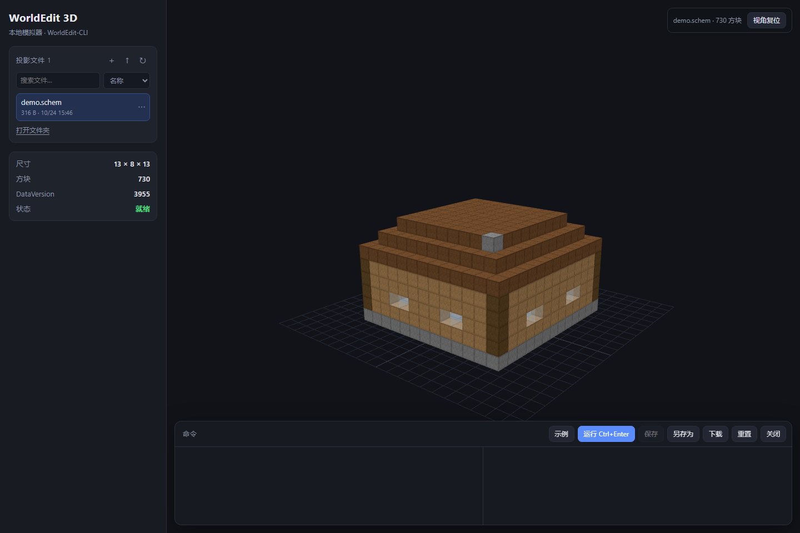

# WorldEdit 3D 模拟器

不启动 Minecraft，在浏览器里对 `.schem` 投影执行 WorldEdit 命令并实时查看 3D 结果。
打开页面默认为空；示例和操作说明见本文档，界面只保留必要控件。

完整文档见 **[docs/README.md](docs/README.md)**：部署、架构、API、渲染、排错和 WorldEdit 用法。

128³ 艺术生成示例见 **[docs/worldedit/advanced-generation.md](docs/worldedit/advanced-generation.md)** 与 **[examples/advanced](examples/advanced/README.md)**；图像作品集见 **[docs/portfolio/README.md](docs/portfolio/README.md)**。256³ 三叶草结/烟花见 **[docs/portfolio/256](docs/portfolio/256/README.md)**；结由 `tools/make_trefoil.py` 生成，烟花为 `//gen` 表达式。

右上角提供**等轴测/前/后/左/右/顶/底**正交视角，按实际方块包围盒自动取景；“截图”保存 PNG 与机位 JSON 到 `work/shots/`。



## 快速开始

环境要求：Windows 10/11 x64、Python 3.10+、`curl.exe`（系统自带）；浏览器用 Edge/Chrome。
`setup.cmd` 会下载官方 WorldEdit-CLI 和便携版 JRE 25，不需要单独装 Java。

从 GitHub 克隆：

```bat
git clone git@github.com:Hcachild/worldedit-simulator.git
cd worldedit-simulator
setup.cmd
web.cmd
```

浏览器会自动打开 <http://127.0.0.1:8777/>，左侧文件列表初始为空。

## 示例

示例不参与默认界面。需要时把 `examples/demo.schem` 复制到 `schematics/`：

```bat
copy examples\demo.schem schematics\demo.schem
```

然后在左侧点击 `demo.schem`。也可以直接用命令行：

```bat
we.cmd schematics\demo.schem examples\demo.txt
python tools\inspect_schem.py schematics\demo.schem
```



## 3D 页面

| 操作 | 说明 |
|---|---|
| 空状态 | 只显示 3D 网格；用侧栏的 `＋` / `↑` 新建或上传 |
| 左键拖动 / 右键拖动 / 滚轮 | 旋转 / 平移 / 缩放 |
| 点击方块 | 查看方块 ID 和坐标 |
| 命令框 + `Ctrl+Enter` | 执行 WorldEdit 命令并刷新 3D |
| 新建 | 文件名 + X/Y/Z（默认 16×16×16，上限 256）；可勾选 128³ 或 256³ 快捷画布 |
| 上传 / 拖入 | 导入 `.schem`；同名文件自动编号 |
| 文件行 `⋯` | 重命名、复制、删除、下载 |
| 打开文件夹 | 在资源管理器中打开 `schematics/` |
| 保存 / 另存为 | 覆盖原文件 / 保存为新文件（支持覆盖同名） |
| 重置 / 关闭 | 恢复到原文件 / 放弃当前编辑并回到空状态 |
| 下载 | 导出当前编辑结果 |
| 真实材质/模型 | 1.21.1 方块模型与贴图；台阶、楼梯、玻璃、植物、朝向、流体和方块实体按原版模型渲染 |
| 外部 Agent | 调用 /api/run 修改当前投影，页面通过 SSE 自动刷新 |

文件列表支持按名称搜索，以及按名称/修改时间排序；当前文件高亮，有未保存修改时显示橙色圆点。
删除是不可恢复的，执行前会二次确认；删除当前文件会自动关闭投影。

命令由后台的官方 WorldEdit-CLI 真正执行，结果写入 `work/current.schem`，**原文件不会被修改**。
每次运行需要启动一次 JVM，通常 1–2 秒。

渲染说明：使用原版 1.21.1 client jar 的 blockstates/models/textures（block-model-renderer），
非完整方块、朝向、玻璃/植物/流体和方块实体按原版模型渲染；材质缺失时回退为颜色方块。大型投影（几十万方块以上）会变慢。
运行日志写到 `%TEMP%\worldedit-simulator-web.log`（后台模式），项目目录不产生日志。

## 渲染与性能

- 隐藏面剔除、面合并/少量 draw call、纹理图集、cutout/translucent 分类和动画纹理由 block-model-renderer 处理。
- prepared assets 缓存复用；只有状态变更才重建场景；新状态会取消旧构建并释放旧 handle。
- 拾取使用不可见的实例网格，不参与绘制；命令执行与模型构建分离，Java 子进程隐藏运行。
- 渲染器限制 pixel ratio 为 2，关闭阴影和后处理；使用世界面光照但关闭 light volume（light: false），省去 flood fill。
- 当前实测：1,736 方块球体 = 1 draw call / 1,522 triangles；730 方块 demo = 1 / 286；512 方块玻璃立方体 = 1 / 12（贪婪面合并）；19 种不同方块 = 3 / 288。
- 剩余瓶颈：每次 AI/命令更新重建整个场景（超大投影会慢）；没有额外的分块视锥裁剪（依赖库的合批）；拾取射线逐实例；无 LOD；材质固定 1.21.1。需要火把照明/平滑 AO 时可改开 light volume，但构建成本更高。

## 外部 Agent 接口

本机 AI Agent 可以直接调用现有的命令接口，不需要额外的建筑编辑 API：

```http
POST http://127.0.0.1:8777/api/run
Content-Type: application/json

{"commands":"//pos1 0,0,0\n//pos2 12,7,12\n//set minecraft:gold_block","actor":"agent"}
```

先通过界面或 `POST /api/load` 载入一个 `.schem`；也可以 `POST /api/new` 新建。

- 返回 `{ok, actor, log, state}`；`state.revision` 是当前版本号。
- `actor` 默认 `user`；传 `agent` 时页面会提示「AI 已更新」。不传也会自动刷新，只是不提示。
- 浏览器通过 `GET /api/events`（SSE）接收 `{revision, actor, state, files}`；命令、文件操作都会推送，无需刷新页面。
- `GET /api/state` 返回当前 `revision` 和 `state`；也支持 `/api/files`、`/api/load`、`/api/upload`、`/api/new` 等现有接口。
- 命令行助手：`python tools\agent_run.py --command "..."` 或 `--file commands.txt`；默认 `--actor agent`。
- 服务只监听 `127.0.0.1`；远程 Agent 需要自行加隧道和鉴权，不要把端口直接暴露到公网。

## 项目结构

```
core/                共享 Python 核心（不依赖 HTTP/UI）
  nbt.py             NBT 读写
  schematic.py       Sponge .schem 读取/写入/空白生成/重定向
  worldedit.py       方块数据缓存 + WorldEdit-CLI 调用
  workspace.py       工作区状态、文件操作、脏标记、revision/actor
web/
  server.py          HTTP 路由、SSE 事件流与静态文件，只调用 core.workspace
  static/
    index.html
    style.css
    js/
      main.js        页面流程与事件
      api.js         API 封装
      viewer.js      Three.js 场景、实例化渲染、拾取
      colors.js      方块颜色和透明规则
      files.js       文件列表、搜索/排序、行菜单
      ui.js          状态栏、日志、toast、空状态
      dialogs.js     新建/重命名/确认弹窗
      live.js        EventSource 实时同步
      mc-renderer.js block-model-renderer 适配（真实模型/材质/实例化）
    vendor/          Three.js、block-model-renderer 及 wasm
    assets.zip       block-model-renderer 内置的方块实体覆盖包
docs/                部署、架构、API、渲染、排错、WorldEdit 用法
tools/               CLI 小工具（inspect/make/retarget/ensure/agent_run/fetch_assets/make_trefoil）
assets/              下载的 1.21.1 client.jar（本地材质，不入库）
examples/            示例投影和命令脚本
schematics/          用户投影目录（初始为空）
work/                运行时编辑副本（自动生成，不入库）
worldedit/           CLI 配置、语言缓存、方块表（自动生成，不入库）
bin/                 官方 CLI jar 和 log4j 配置
setup-assets.cmd     单独下载 Minecraft 1.21.1 材质
```

`core` 不感知 HTTP，`web/server.py` 只负责路由；前端按视图、API、文件、弹窗拆成独立模块。
运行时产物（`work/`、`worldedit/`、`logs/`、`__pycache__`）和下载的 jar/JRE 都已加入 `.gitignore`。

## 命令行用法

```bat
we.cmd schematics\my.schem examples\demo.txt
```

不带脚本时进入交互模式，逐行输入命令，`stop` 保存退出：

```
//pos1 0,0,0
//pos2 12,7,12
//replace minecraft:oak_planks minecraft:birch_planks
//hollow
stop
```

常用命令：

| 命令 | 作用 |
|---|---|
| `//pos1 x,y,z` / `//pos2 x,y,z` | 设置选区（CLI 没有玩家，必须带坐标） |
| `//set <方块>` | 填充选区 |
| `//replace <原方块> <新方块>` | 替换 |
| `//walls` / `//hollow` / `//outline` | 墙壁 / 挖空 / 外壳 |
| `//copy` / `//paste` / `//rotate` / `//flip` | 剪贴板操作 |
| `//sphere` / `//cyl` / `//pyramid` | 生成形状 |
| `//deform` / `//generate` | 表达式变形 / 生成 |
| `//schem list` / `//schem load` | 查看/载入 `worldedit/schematics/` 下的文件 |
| `//undo` / `//redo` | 撤销 / 重做 |

完整列表见 <https://worldedit.enginehub.org/en/latest/commands/>。

## 注意

- **原地保存（CLI）**：`we.cmd` 会把命令结果写回载入的 `.schem`，改之前先复制备份；3D 页面用的是
  `work/current.schem` 副本，点「保存」才会覆盖原文件。
- **格式**：网页只接受 1.13+ 的 Sponge `.schem`（v1/v2/v3）；旧 MCEdit `.schematic`
  没有官方 DataVersion 数据，不支持。
- **没有玩家实体**：`//wand`、笔刷（brush）、传送（`/up`、`/thru`）等依赖玩家的命令不可用；
  选区、生成、剪贴板、撤销等命令正常。
- **level.dat**：7.4.7 尚未实现整世界编辑，只能处理投影文件。
- **Java**：必须用目录里的 JRE 25；系统 Java 17 会报 `UnsupportedClassVersionError`。
- **端口**：3D 页面只监听 `127.0.0.1:8777`，不对外网开放。
- **进程**：网页模式的 Java/curl 子进程使用无窗口方式启动，不会弹 CMD；命令串行执行，
  超时或异常会结束对应进程。`we.cmd` 本身是控制台程序，只在命令行模式出现。

## DataVersion 与旧投影

3D 材质包固定为 1.21.1（DataVersion 3955）；CLI 方块表支持下面这些版本，但其他版本的模型/贴图可能不同，渲染以 1.21.1 资源为准。

CLI 按投影里的 `DataVersion` 下载方块表，目前 EngineHub 只发布了这些版本：

```
3698 (1.20.3)  3700 (1.20.4)  3837 (1.20.5)  3953 (1.21)    3955 (1.21.1)
4080 (1.21.2)  4189 (1.21.4)  4325 (1.21.5)  4435/4438/4440 (1.21.6-1.21.8)
```

如果投影是 1.20.1（3465）等未发布版本，先改 DataVersion 再用（会生成 `.bak`）：

```bat
python tools\retarget_schem.py schematics\old.schem
we.cmd schematics\old.schem examples\demo.txt
```

`retarget_schem.py` 默认选最接近的已发布版本；也可以显式指定，例如 `... 3955`。
改版本只改元数据，不改方块数据。

## 更新 CLI

1. 打开 <https://builds.enginehub.org/job/worldedit?branch=version/7.4.x>，选最新成功构建。
2. 下载 `worldedit-cli-*-dist.jar` 放进 `bin/`。
3. 修改 `core/worldedit.py` 里的 jar 文件名和 `setup.cmd` 里的下载地址。

WorldEdit 采用 GPLv3，jar 为官方原版未修改；Temurin JRE 采用 GPLv2+CE；Three.js 采用 MIT；block-model-renderer 采用 MPL-2.0（许可文件在 web/static/vendor/）。Minecraft 客户端资源仅本地渲染使用，不随仓库分发。
