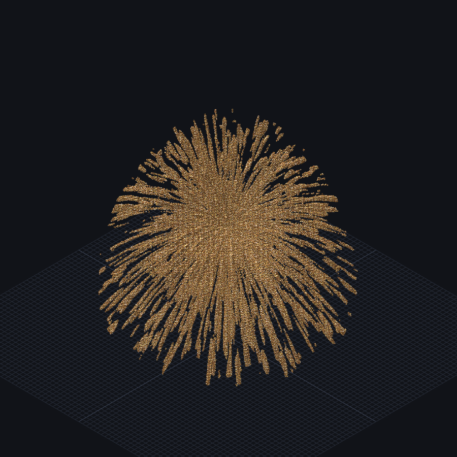

# 256³ Images — Trefoil Knot & Firework

| Trefoil Knot | Firework |
|---|---|
|  |  |

Two 256×256×256 reproductions of **imhols** pieces. The trefoil is a Python
sweep because 16.7M cells would make a per-cell `//gen` sweep very slow; the
firework is the author's compact `//gen` expression with 256-cube coordinates.

## 19 — Trefoil Knot

A 256³ reproduction of the trefoil-knot sweep shared by imhols. The author's Lua
builds the knot from a square cross-section transported along a parametric
curve; this version ports the same sweep to a deterministic Python voxelizer.

```bat
python tools\make_trefoil.py --out schematics\portfolio_19_trefoil_256.schem ^
  --frame frenet --rotation 75
```

The browser's **＋ → 256 × 256 × 256 超大画布** option can create the blank
canvas, but the generated file is already a ready-to-open `.schem`.

### Curve and sweep

```text
hx = S * (cos(t) + 2*cos((n-1)*t))
hy = 2*S*a*sin(n*t)
hz = S * (sin(t) - 2*sin((n-1)*t))
```

With `n=3`, `a=0.5`, this is the trefoil projection. At each segment the
generator builds a moving frame and a square cross-section:

```text
T = normalize(P(t+dt) - P(t))
frame = Frenet N/B  (default), parallel transported, or --frame projected
R' = N*cos(twist) + B*sin(twist)
U' = B*cos(twist) - N*sin(twist)
|lx| <= thickness && |ly| <= thickness && -0.5 <= lz <= seg_len+0.5
```

The original Lua uses a **projected** frame with one axis kept horizontal; that
is why its square can look axis-aligned. The default here is **Frenet**, which
uses the curve's curvature normal so the square turns with the actual 3D path.
`--frame parallel` minimizes twist instead, and `--frame projected` reproduces
the Lua frame.

| Parameter | Value |
|---|---:|
| size | 256³ |
| knot order `n` | 3 |
| vertical ratio `a` | 0.5 |
| scale `S` | 30 |
| thickness | 8 blocks (square half-width) |
| step | 0.04 rad |
| rotation | 75° |
| full twists | 0 |
| frame | `frenet` |
| material | `minecraft:stone` |
| blocks | 221,143 |

The output is 180 × 80 × 179 blocks inside the 256 cube. `scale=30` is larger
than the author's 20 so the knot fills the bigger canvas; use `--scale 20
--thickness 8` for a closer-to-source 128-ish footprint.

## 20 — Firework


The author's original `//generate 251` is a normalized-coordinate field. This
256 version maps world coordinates back to `[-1, 1]` and uses **glowstone** for
the warm, self-lit burst. `g` is gravity, `a` controls thickness, and Perlin
frequency `20` controls how many fine trails survive.

```text
nx=(x-127.5)/127.5; ny=(y-127.5)/127.5; nz=(z-127.5)/127.5;
t=sqrt(nx²+nz²); r=sqrt(nx²+ny²+nz²);
yy=ny+t²/2;
q=perlin(1,nx/r,yy/r,nz/r,20,1,1);
q*r<0.05 && nx²+yy²+nz²<1
```

Run [`examples/advanced/20_firework_256.txt`](../../../examples/advanced/20_firework_256.txt)
on a 256³ canvas, or use `we.cmd` with a blank 256³ `.schem`. The command takes
about 35–45 seconds in the CLI and produces 117,090 glowstone blocks; the
browser render is 1 draw call / 446k triangles.

## Camera

`19_trefoil_256_iso.json` and `20_firework_256_iso.json` record the exact
orthographic cameras. Both images are app canvas captures, not viewport
screenshots with HUD or sidebar.
