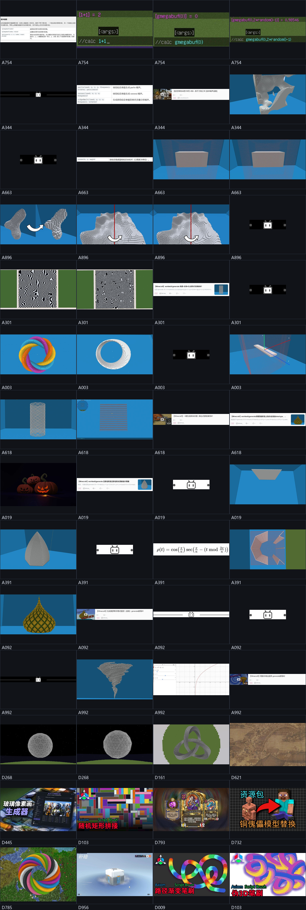

# imhols — WorldEdit 进阶作品集

作者：[**imhols**](https://space.bilibili.com/632698683/dynamic)（UID `632698683`）

这是现有 18 个 `//gen` 作品集的**进阶版**：作者用 `gmegabuf/gclosest`、Voronoi、Perlin/ridged 噪声、`//deform` 二次体素化、`data/type` 上色、旋转体、正多边形通式等做了更复杂的程序化建模。

> 抓取范围：B站公开接口可见的 **11 篇 WorldEdit 专栏** + **12 条近期动态**（未登录状态；更早动态需要登录，接口没有返回）。图片为 760px 缩略图；未下载到的图请点原文链接。

## 专栏

| # | 标题 | 日期 | 指令数 | 本地图 | 页面 | 原文 |
|---|---|---|---:|---:|---|---|
| 01 | 【Minecraft】worldedit\|generate 深入解析gmegabuf()缓冲函数——从原理到应用 | 2023-08-07 | 13 | 60 | [articles/25579754_Minecraft_worldedit_generate_深入解析gmegabu.md](articles/25579754_Minecraft_worldedit_generate_深入解析gmegabu.md) | [B站](https://www.bilibili.com/read/cv25579754) |
| 02 | 【Minecraft】worldedit\|generate 探索神奇的噪声——从原理到应用 | 2023-03-15 | 27 | 33 | [articles/22408344_Minecraft_worldedit_generate_探索神奇的噪声_从原理.md](articles/22408344_Minecraft_worldedit_generate_探索神奇的噪声_从原理.md) | [B站](https://www.bilibili.com/read/cv22408344) |
| 03 | 【Minecraft】worldedit&FAWE 你可能需要知道的指令 | 2022-12-31 | 11 | 15 | [articles/20869663_Minecraft_worldedit_FAWE_你可能需要知道的指令.md](articles/20869663_Minecraft_worldedit_FAWE_你可能需要知道的指令.md) | [B站](https://www.bilibili.com/read/cv20869663) |
| 04 | 【Minecraft】worldedit\|deform&generate 利用floor函数实现“二次体素化” | 2022-12-12 | 6 | 12 | [articles/20436896_Minecraft_worldedit_deform_generate_利用fl.md](articles/20436896_Minecraft_worldedit_deform_generate_利用fl.md) | [B站](https://www.bilibili.com/read/cv20436896) |
| 05 | 【Minecraft】worldedit\|表达式蒙版 噪声+条纹=人造摩尔纹？ | 2022-11-27 | 11 | 15 | [articles/20073301_Minecraft_worldedit_表达式蒙版_噪声_条纹_人造摩尔纹.md](articles/20073301_Minecraft_worldedit_表达式蒙版_噪声_条纹_人造摩尔纹.md) | [B站](https://www.bilibili.com/read/cv20073301) |
| 06 | 【Minecraft】worldedit\|generate 莫比乌斯旋转模型 | 2022-11-12 | 10 | 13 | [articles/19720003_Minecraft_worldedit_generate_莫比乌斯旋转模型.md](articles/19720003_Minecraft_worldedit_generate_莫比乌斯旋转模型.md) | [B站](https://www.bilibili.com/read/cv19720003) |
| 07 | 【Minecraft】worldedit\|generate 角度+求余=生成网状支撑结构？ | 2022-11-08 | 6 | 11 | [articles/19601618_Minecraft_worldedit_generate_角度_求余_生成网状支.md](articles/19601618_Minecraft_worldedit_generate_角度_求余_生成网状支.md) | [B站](https://www.bilibili.com/read/cv19601618) |
| 08 | 【Minecraft】worldedit\|generate 旋转体\|实例：万圣节南瓜 | 2022-10-31 | 6 | 16 | [articles/19424019_Minecraft_worldedit_generate_旋转体_实例_万圣节南.md](articles/19424019_Minecraft_worldedit_generate_旋转体_实例_万圣节南.md) | [B站](https://www.bilibili.com/read/cv19424019) |
| 09 | 【Minecraft】worldedit\|generate 正多边形及正多边形尖顶的设计思路 | 2022-10-26 | 6 | 23 | [articles/19333391_Minecraft_worldedit_generate_正多边形及正多边形尖顶.md](articles/19333391_Minecraft_worldedit_generate_正多边形及正多边形尖顶.md) | [B站](https://www.bilibili.com/read/cv19333391) |
| 10 | 【Minecraft】worldedit\|generate洋葱顶进阶及上色办法\|包含data/type、atan2、min | 2022-10-25 | 7 | 24 | [articles/19312092_Minecraft_worldedit_generate洋葱顶进阶及上色办法_包.md](articles/19312092_Minecraft_worldedit_generate洋葱顶进阶及上色办法_包.md) | [B站](https://www.bilibili.com/read/cv19312092) |
| 11 | 【Minecraft】worldedit\|generate 一键生成旋风2.0 | 2022-10-23 | 3 | 10 | [articles/19256992_Minecraft_worldedit_generate_一键生成旋风2_0.md](articles/19256992_Minecraft_worldedit_generate_一键生成旋风2_0.md) | [B站](https://www.bilibili.com/read/cv19256992) |

## 动态

| # | 动态 | 日期 | 类型 | WorldEdit | 指令 | 页面 | 原文 |
|---|---|---|---|---:|---:|---|---|
| 01 | 测地多面体 | 6月7日 | DRAW | — | 0 | [dynamics/1211123852009013268_测地多面体.md](dynamics/1211123852009013268_测地多面体.md) | [B站](https://www.bilibili.com/opus/1211123852009013268) |
| 02 | 三叶草结（Trefoil Knot） | 6月7日 | DRAW | 是 | 0 | [dynamics/1210891056222044161_三叶草结_Trefoil_Knot.md](dynamics/1210891056222044161_三叶草结_Trefoil_Knot.md) | [B站](https://www.bilibili.com/opus/1210891056222044161) |
| 03 | ⸮ ! 图图 ! ? | 5月27日 | AV | — | 0 | [dynamics/1206780566349807621_图图.md](dynamics/1206780566349807621_图图.md) | [B站](https://www.bilibili.com/video/BV1pDVT6bEYZ) |
| 04 | 【Minecraft】多层玻璃像素画生成器 | 5月17日 | AV | 是 | 0 | [dynamics/1203360879020605445_Minecraft_多层玻璃像素画生成器.md](dynamics/1203360879020605445_Minecraft_多层玻璃像素画生成器.md) | [B站](https://www.bilibili.com/video/BV19KLn6XEUj) |
| 05 | 更新了斜向查看图片 | 3月19日 | FORWARD | — | 0 | [dynamics/1181188045930496008_动态_1181188045930496008.md](dynamics/1181188045930496008_动态_1181188045930496008.md) | [B站](https://www.bilibili.com/opus/1181188045930496008) |
| 06 | 【Minecraft】随机矩形拼接  \| Axiom script brush #7 | 3月12日 | AV | 是 | 0 | [dynamics/1178796578067972103_Minecraft_随机矩形拼接_Axiom_script_brush.md](dynamics/1178796578067972103_Minecraft_随机矩形拼接_Axiom_script_brush.md) | [B站](https://www.bilibili.com/video/BV1epc6z9EjK) |
| 07 | 【酒馆战旗】沃金伙伴+迷雾幼龙+技能=？ | 3月4日 | AV | — | 0 | [dynamics/1175949736325152793_酒馆战旗_沃金伙伴_迷雾幼龙_技能.md](dynamics/1175949736325152793_酒馆战旗_沃金伙伴_迷雾幼龙_技能.md) | [B站](https://www.bilibili.com/video/BV18uPqz2EBH) |
| 08 | 【Minecraft】我把铜傀儡替换成了玩家模型 \| 资源包 | 2月5日 | AV | — | 0 | [dynamics/1165846315335155732_Minecraft_我把铜傀儡替换成了玩家模型_资源包.md](dynamics/1165846315335155732_Minecraft_我把铜傀儡替换成了玩家模型_资源包.md) | [B站](https://www.bilibili.com/video/BV1kxFYzyE5T) |
| 09 | 任意数量圆柱围成的莫比乌斯 | 1月22日 | DRAW | 是 | 1 | [dynamics/1160618193394335785_任意数量圆柱围成的莫比乌斯.md](dynamics/1160618193394335785_任意数量圆柱围成的莫比乌斯.md) | [B站](https://www.bilibili.com/opus/1160618193394335785) |
| 10 | 108箱 | 2025年4月18日 | AV | — | 0 | [dynamics/1057137982949031956_108箱.md](dynamics/1057137982949031956_108箱.md) | [B站](https://www.bilibili.com/video/BV1eD5jzWEMu) |
| 11 | 【Minecraft】路径彩色渐变笔刷 HSB \| Axiom script brush #6 | 2025年3月18日 | AV | 是 | 0 | [dynamics/1045397969043456009_Minecraft_路径彩色渐变笔刷_HSB_Axiom_script.md](dynamics/1045397969043456009_Minecraft_路径彩色渐变笔刷_HSB_Axiom_script.md) | [B站](https://www.bilibili.com/video/BV1aEXMY7ExA) |
| 12 | 【Minecraft】伪3D艺术笔刷 \| Axiom script brush #5 | 2025年3月7日 | AV | 是 | 0 | [dynamics/1041536789140996103_Minecraft_伪3D艺术笔刷_Axiom_script_brus.md](dynamics/1041536789140996103_Minecraft_伪3D艺术笔刷_Axiom_script_brus.md) | [B站](https://www.bilibili.com/video/BV1j19yYbEVv) |

## 目录

- `articles/`：11 篇专栏的索引页（摘要 + 指令 + 本地关键图）
- `dynamics/`：12 条动态的索引页（正文/图片/指令）
- `commands/articles/`、`commands/dynamics/`：纯文本指令，方便复制到页面/CLI
- `images/articles/`、`images/dynamics/`：已下载的关键图（原图未全量下载）
- `manifest.json`：完整元数据、图片路径、指令

## 重点文章

- `gmegabuf/gclosest`：全局数组缓冲、固定随机数、参数方程、Voronoi 边缘检测
- `探索神奇的噪声`：Perlin/ridged 噪声的地形与纹理
- `二次体素化`：`floor` + `//deform` 把体素放大成建筑尺度
- `莫比乌斯旋转模型`：`atan2`/旋转/`data` 分区
- `正多边形及尖顶`：`cos(pi/n)` 通式
- `洋葱顶进阶`：`min/sin` 叠加 + `data/type` 上色

## 使用

先看每篇页面的「指令摘录」；指令是作者原文中的写法，部分针对旧版 WorldEdit/FAWE，复制到本模拟器前先建小选区测试。图片只用于学习索引，版权归 imhols；转载/商用请先联系作者。

