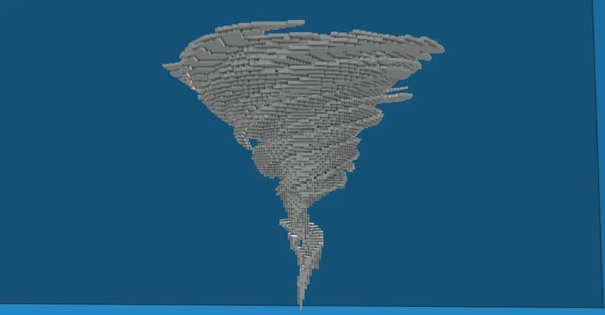
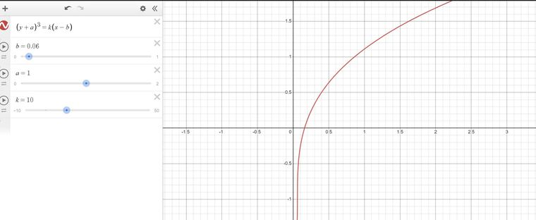
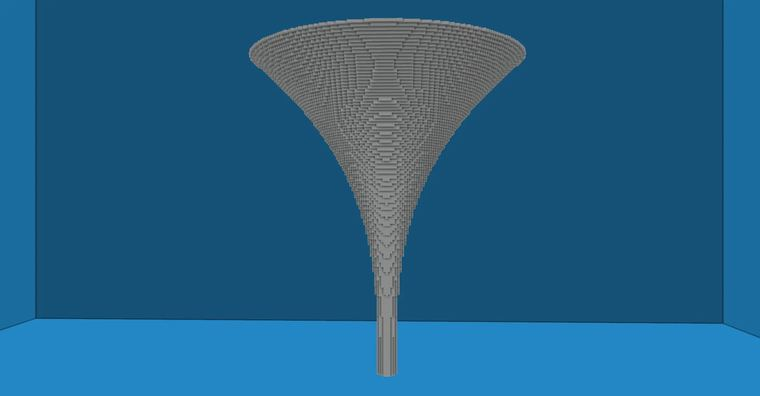
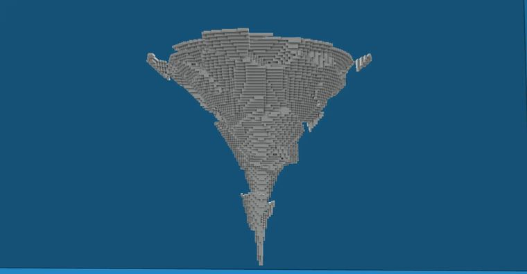
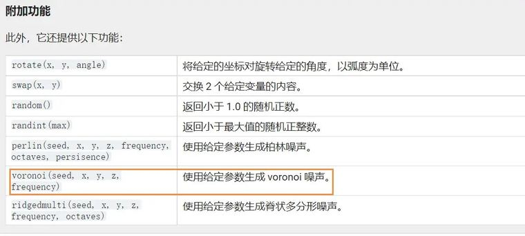
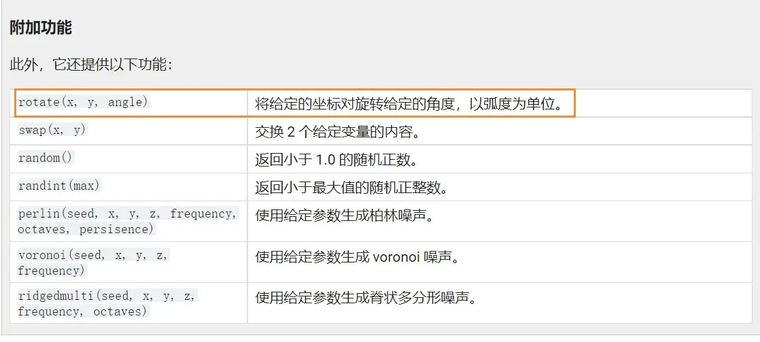
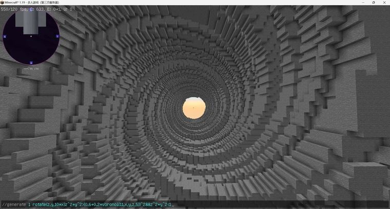

# 【Minecraft】worldedit|generate 一键生成旋风2.0

> 作者：**imhols**（UID 632698683） · 发布：2022-10-23 · 原文：[B站专栏](https://www.bilibili.com/read/cv19256992)

## 摘要

首先你得有generate的基础认识废话少说，看成品成品图下面是设计思路包括包括基础轮廓加噪声旋转模拟轮廓desmos模拟x,y在-1到1的图像网站：https://www.desmos.com/这里用了三次方的曲线，和之前视频的一样生成轮廓//generate 35 r=sqrt(x^2+z^2);10*(r-0.06)<(y+1)^3正方体选区，选一点后//outset 70r为点到原点的距离，代替模拟时的x加噪声//generate 35 r=sqrt(x^2+z^2);10*(r-0.0

## 图片


















## 指令摘录

> 从原文正文/代码块中提取，可能包含作者当时的版本差异；先在测试选区运行。

```text
//generate 35 r=sqrt(x^2+z^2);10*(r-0.06)<(y+1)^3
//generate 35 r=sqrt(x^2+z^2);10*(r-0.06)+2.5*voronoi(1,x,y,z,5)<(y+1)^3
//generate 35 r=sqrt(x^2+z^2);rotate(x,z,10*(1+y));10*(r-0.06)+2.5*voronoi(1,x,y,z,5)<(y+1)^3
```

---

图片与正文版权归 **imhols** 所有；本页只做学习索引，原文链接见上。
