# 【Minecraft】worldedit|generate洋葱顶进阶及上色办法|包含data/type、atan2、min

> 作者：**imhols**（UID 632698683） · 发布：2022-10-25 · 原文：[B站专栏](https://www.bilibili.com/read/cv19312092)

## 摘要

成品如下//generate 35 G=min(sin(18*atan2(x,z)+20*(y+1)),sin(18*atan2(x,z)-20*(y+1)));data=(G>(-0.7))?4:13;i=sqrt(x^2+z^2);k=0.9;a=6.5;b=0.9;m=0.6;i<k*a^(-b*(y+m)^2)+0.02*G之前在视频里演示的不是很详细，这次将其进行了改进一第一步就是先有个大致的轮廓，上个专栏也提过，视频里也有演示，就先跳过这一步了//generate 35 i=sqrt

## 作者补充说明

- sin(10*x)
- 因为desmos网站没找到atan2(),就先用arctan()代替，注意两者并不一样
- 第一步就是先有个大致的轮廓，上个专栏也提过，视频里也有演示，就先跳过这一步了
- 第二步就是在一边加上sin或者cos（下面以sin为例，其实与cos的相位就差个pi/2），对原始形状周期性地调整半径的大小。
- 怎么加呢？这里先了解下atan2()这个函数
- 具体用法就是atan2(x,z)获取该点对于x,z中心原点位置的极坐标角度，范围是-pi~pi，一周是2pi
- sin大家都熟悉，注意观察其不同频率在-pi~pi的形状
- 那么如果用sin套上这个角度，sin(atan2(x,z)),以下用圆的半径加上这一项演示
- 关键是最后的+0.05*G，其中G=sin(18*atan2(x,z))，调整前面的系数可以控制隆起程度
- 如果上面的懂了，下面你可以选择进行旋转，或者已经足够了就可以跳到下一步的上色了
- 和上个专栏的旋风相似，只不过没用到rotate(),而是在sin(18*atan2(x,z))括号里加个相位，在平面内表现就是其图像向左或向右移动，在sin(18*atan2(x,z))里就是旋转了起来（为做交叉效果做准备）
- 这个相位一般取与y的值相关，sin(18*atan2(x,z)+10*(y+1))，和上个专栏的旋风思路一样，每个y值对应的相位都不相同但是连续变化，就有从下到上的旋转效果，旋转的程度与前面的系数相关
- 我们知道我的世界里的方块有类型之分（type），每种类型不止一种方块，同一类型有不同data（比如羊毛下的35:1,35:2...），上色要解决的问题就是在凸起和凹陷的部分用不同的方块
- 这里先以最简单的来举例讲解，如果我们打出//generate 35 data=1 y>0,就会在y>0的位置，生成35类型下data=1的方块，即35:1 橘色羊毛
- 好，下面我们想一下，sin有什么特点，如果我们把sin()>0的部分用一种方块<0的用另一种方块，是不是就分开了！我们再想一下，也不一定以0为分界线，也可以是-0.5、-0.8、0.5。
- 这里就出现了另一个问题，具体怎么实现呢？没关系，worldedit也给准备了，如下
- 如果学过c语言的都知道，第一个是判断条件，第二个是判断为真执行的语句，最后冒号后的是判断为假执行的语句。我们试一下data=sin(18*atan2(x,z)+10*(y+1))>-0.6?4:13
- 下面就是最后一步了，如果前面的已经足够了，可以忽略这一步
- 这一步做的是交叉效果，办法也很简单，就是再加一个反方向的旋转sin，然后用min(,)结合起来
- 这个应该不难理解吧先拿一个直观的例子
- 套用在上一步的表达式内就是
- 调整下系数以获得不同效果
- 好了！恭喜你看了下来，希望能够启发你做出更多的效果

## 图片

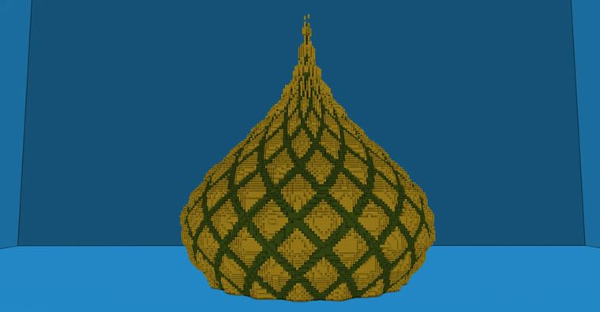

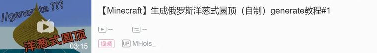


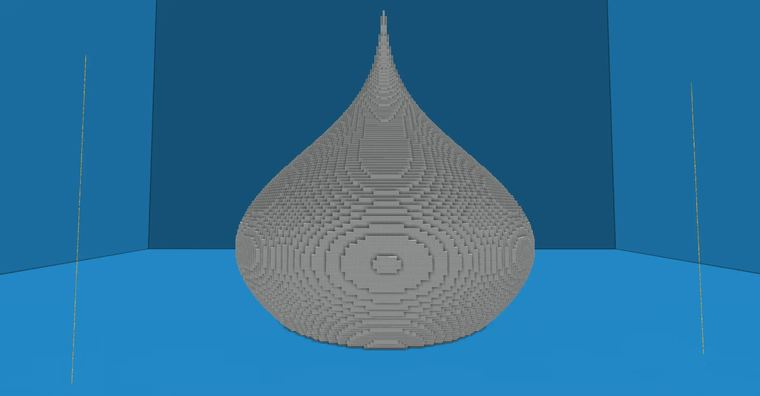

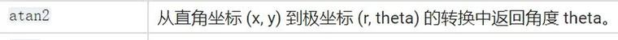

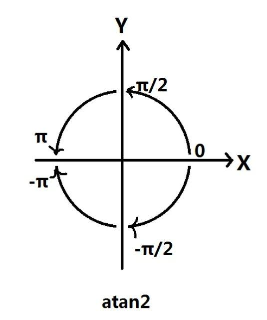

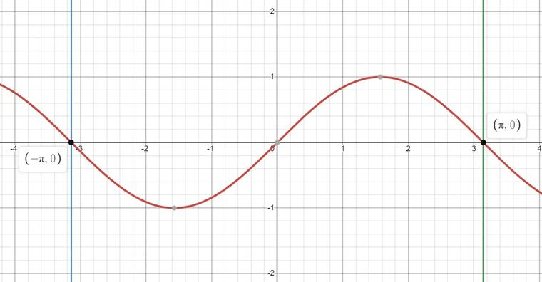

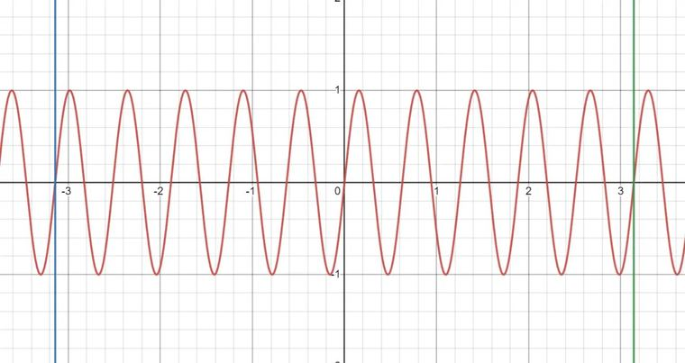

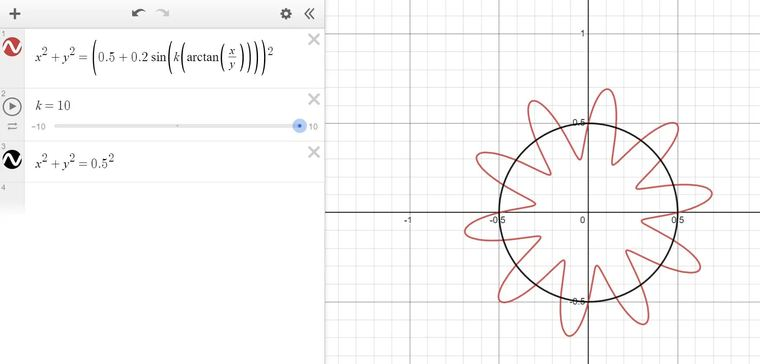

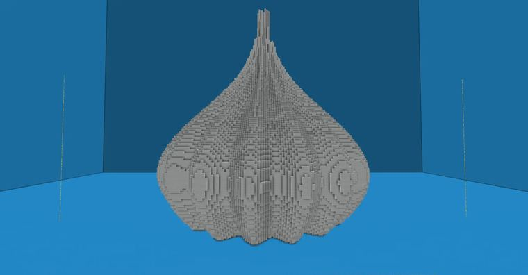

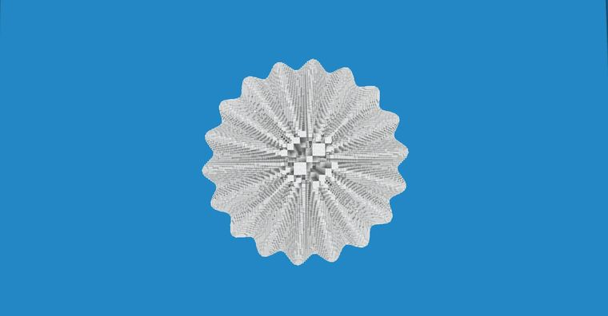

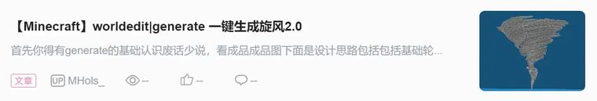

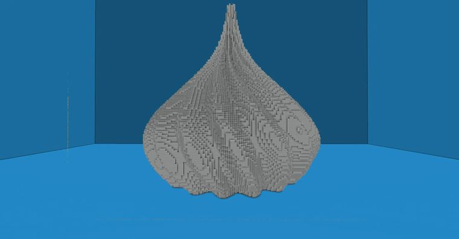

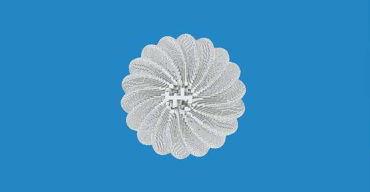

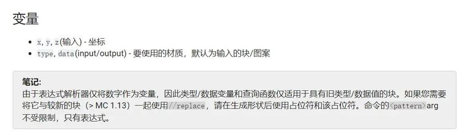

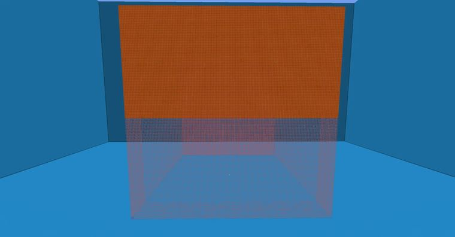

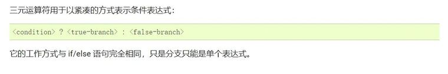

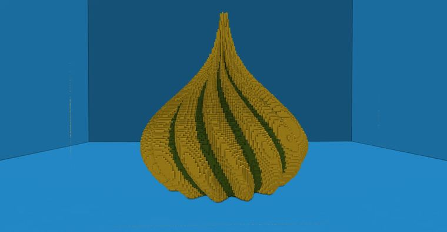


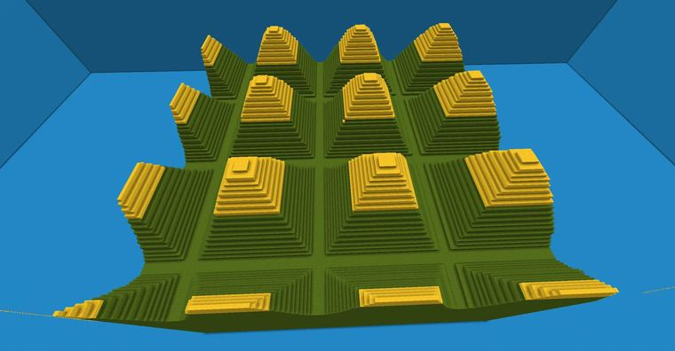

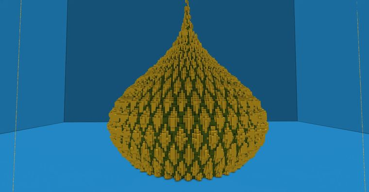

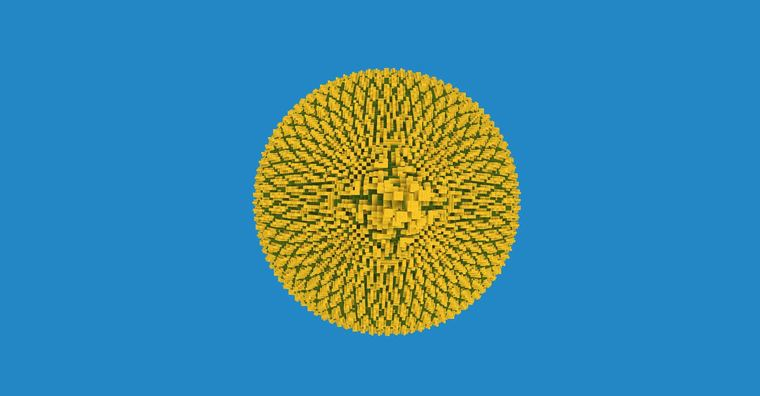


## 指令摘录

> 从原文正文/代码块中提取，可能包含作者当时的版本差异；先在测试选区运行。

```text
//generate 35 G=min(sin(18*atan2(x,z)+20*(y+1)),sin(18*atan2(x,z)-20*(y+1)));data=(G>(-0.7))?4:13;i=sqrt(x^2+z^2);k=0.9;a=6.5;b=0.9;m=0.6;i<k*a^(-b*(y+m)^2)+0.02*G
//generate 35 i=sqrt(x^2+z^2);k=0.9;a=6.5;b=0.9;m=0.6;i<k*a^(-b*(y+m)^2)
//generate 35 G=sin(18*atan2(x,z));i=sqrt(x^2+z^2);k=0.9;a=6.5;b=0.9;m=0.6;i<k*a^(-b*(y+m)^2)+0.05*G
//generate 35 G=sin(18*atan2(x,z)+10*(y+1));i=sqrt(x^2+z^2);k=0.9;a=6.5;b=0.9;m=0.6;i<k*a^(-b*(y+m)^2)+0.05*G
//generate 35 data=1 y>0
//generate 35 G=sin(18*atan2(x,z)+10*(y+1));data=(G>-0.6?4:13)i=sqrt(x^2+z^2);k=0.9;a=6.5;b=0.9;m=0.6;i<k*a^(-b*(y+m)^2)+0.05*G
//generate 35 data=(y>0?4:13) min(0.2*sin(10*x),0.2*sin(10*z))>y
```

---

图片与正文版权归 **imhols** 所有；本页只做学习索引，原文链接见上。
