# 【Minecraft】worldedit|generate 正多边形及正多边形尖顶的设计思路

> 作者：**imhols**（UID 632698683） · 发布：2022-10-26 · 原文：[B站专栏](https://www.bilibili.com/read/cv19333391)

## 摘要

成品：八角尖顶//generate 35 -h r=1-(y+1)^2/4;n=8;sqrt(x^2+z^2)/cos(pi/n)*cos(pi/n-((atan2(x,z)+pi)%(2*pi/n)))<r一做这种涉及正多边形的形状问题，我们首先要找到一个能画出正多边形的通式或办法，目前我能想到的和找到的有两种办法：1、一种是能够画出边是绝对平直的正多边形，这是在知乎上找到的zhuanlan.zhihu.com/p/522197221调节n的大小就会呈现n正多边形但如果直接带入到MC中，会出现x负半轴不

## 作者补充说明

- 图中使用的arctan(x/y)对应与mc中的是atan(x/z),但实际应用中最好使用atan2(x,z)
- 调到sin最大值刚好与半径相等
- 负数，有点像月饼
- 有点冰淇凌的感觉//generate 35 -h rotate(x,z,(1+y));r=1-(y+1)^2/4;sqrt(x^2+z^2)/(0.8-0.1*abs(sin(5*atan2(x,z))))<r
- 调节n的大小就会呈现n正多边形
- 但如果直接带入到MC中，会出现x负半轴不正确的问题，另一半正常，如图
- 这是因为atan2(x,z)的范围是-pi~pi，因为后面有取余的操作，所以会出现错误，这里只需要把它+pi，让它取值范围变成0~2*pi，即把atan2(x,z)换成(atan2(x,z)+pi)，重新带入原式子，如图
- 2、另一种办法就是之前讲过的，用一个圆加上一圈的sin()（或cos()），细调两者的系数，尽力达到所想要的效果
- 如果你是想要有圆角的效果，可直接用sin()，如图
- 游戏中调节atan(x,z)前的系数可获得对应的多边形形状，同时也要适当调节sin前的系数和圆原始半径大小，如图圆角三角形
- 题外话，如果把系数调得大一点呢？就会有放射状花瓣的效果，依个人需求进行调节
- 如果你想要的是比较接近于正多边形、不是圆角的效果，那就把sin()取绝对值，用圆去减去abs(sin())，如图
- 我调的这个边有点向内缩，到时候做尖顶的时候可能会有别样的效果，甚至可以做伞了
- 如果继续调大或调成负数呢？看图吧
- 可以自己试一试调一调，我是不可能展示完全的
- 看吧，和第一种做的差别也不是很大，所以我比较推荐这种方法，但还是要看具体情况
- 我们进入第二步，以八角为例，经过第一步我们可以得到
- 不知道你发现没有，我们还不能控制这个多边形大小或者说半径的大小，观察以上的表达式，把左边的sqrt(x^2+z^2)和右边的那一大串放在一边会怎么样，让右边的除过去，留下一个1，这个1是不是就是我们想要的半径r？
- 我们暂且称左边的为 多边形距离公式 ，sqrt(x^2+z^2)/cos(pi/n)*cos(pi/n-((atan2(x,z)+pi)%(2*pi/n)))，同理另一个做多边形的方法也是
- 这步我们要解决的问题就是怎么让它从下到上收缩为一点，我们只需要控制r的大小即可，让它与y相关，如下图的函数曲线，x作为r，y作为y
- 以此为底，如果再旋转一下？
- 最关键的是这个距离公式

## 图片

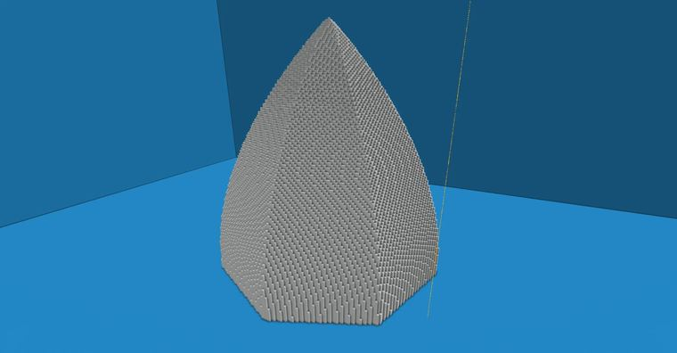


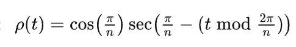

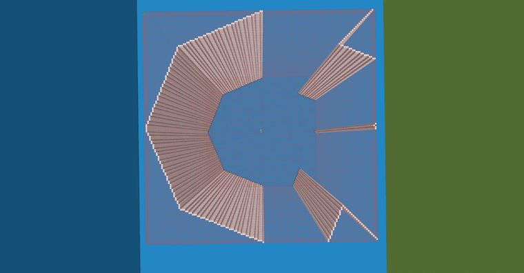

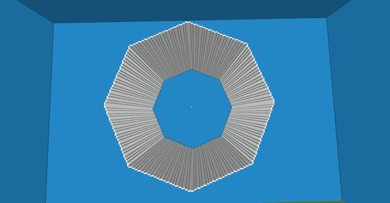

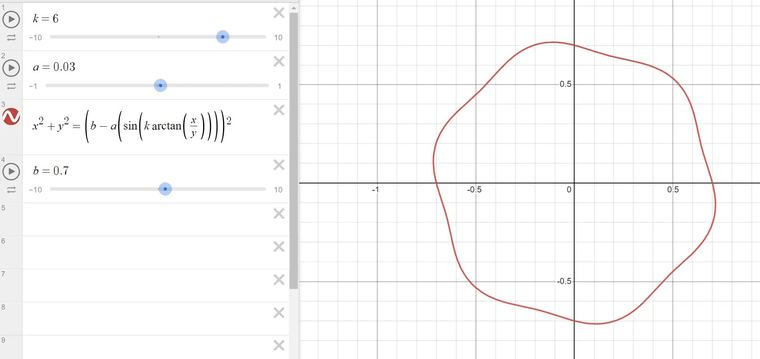

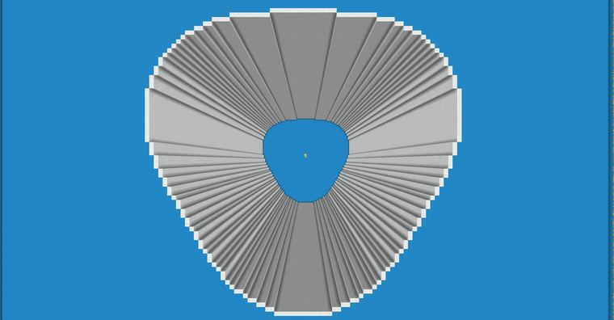

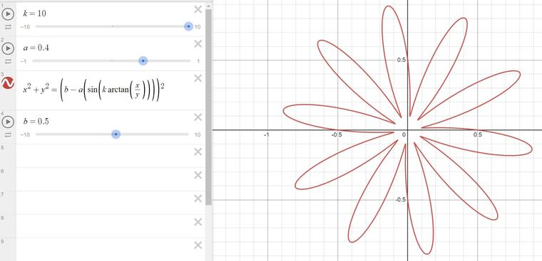

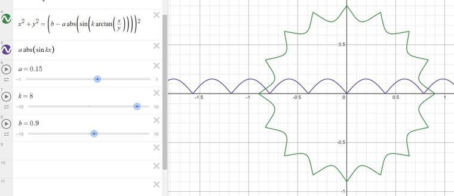

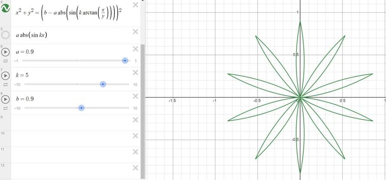

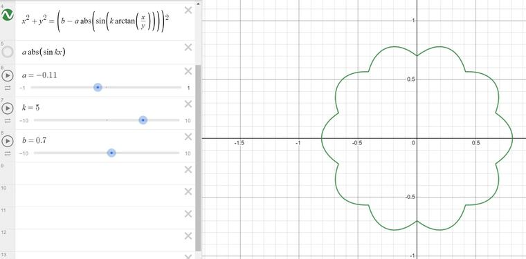

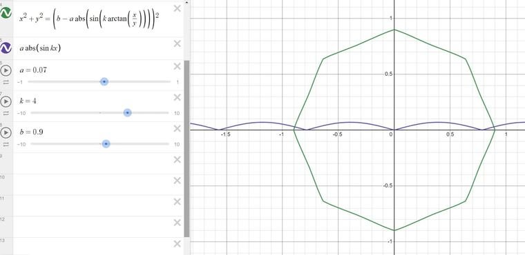

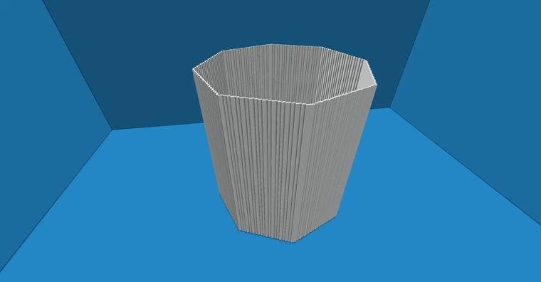

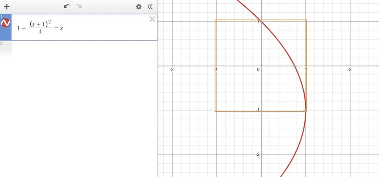

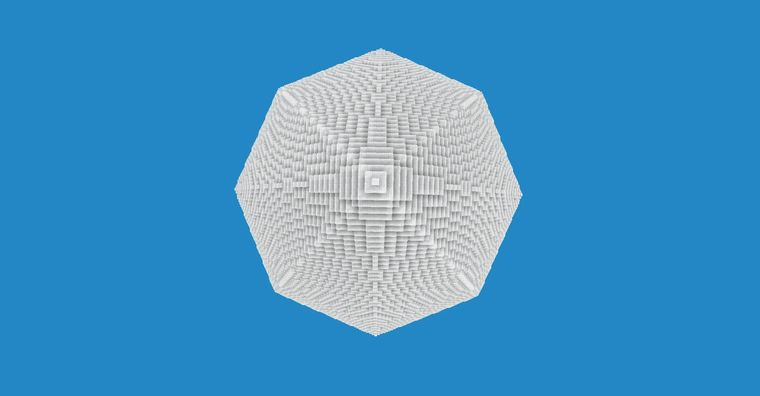

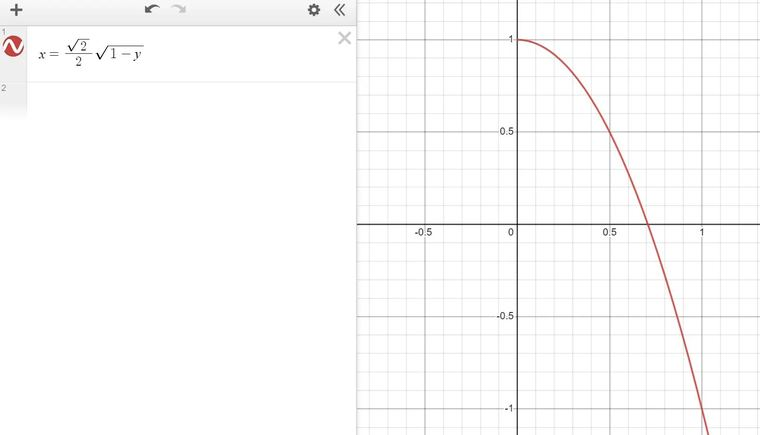

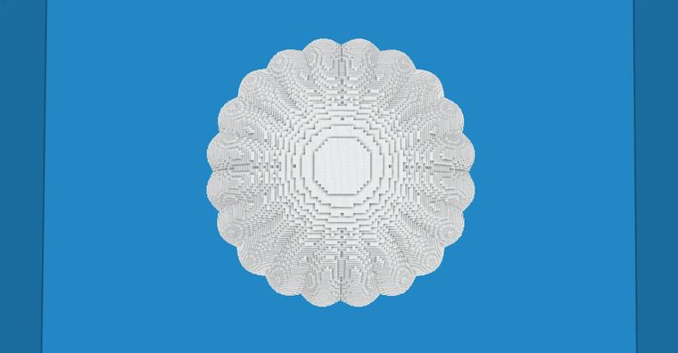

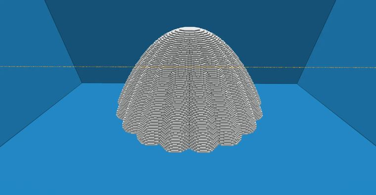

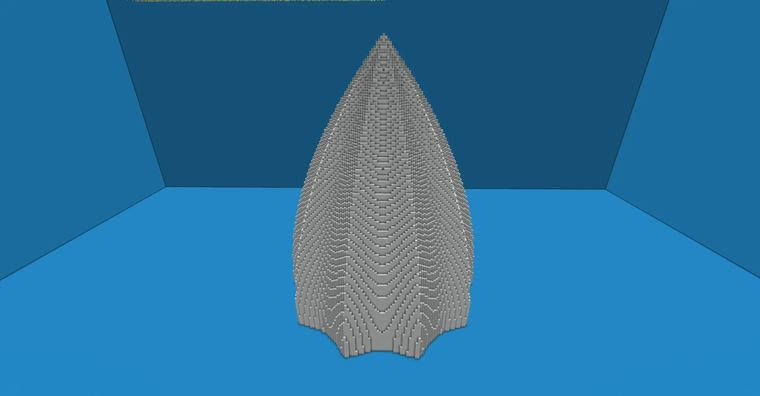

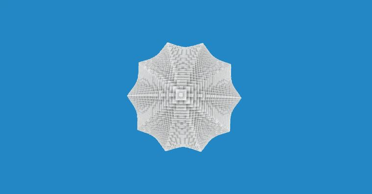

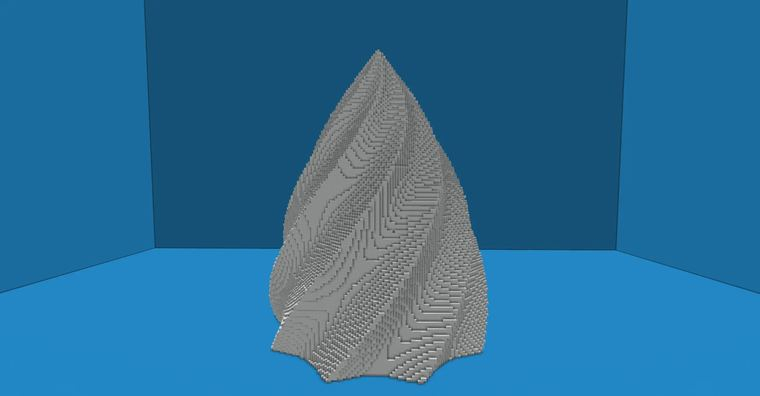


## 指令摘录

> 从原文正文/代码块中提取，可能包含作者当时的版本差异；先在测试选区运行。

```text
//generate 35 -h r=1-(y+1)^2/4;n=8;sqrt(x^2+z^2)/cos(pi/n)*cos(pi/n-((atan2(x,z)+pi)%(2*pi/n)))<r
//generate 35 -h n=8;sqrt(x^2+z^2)<cos(pi/n)/cos(pi/n-(atan2(x,z)%(2*pi/n)))
//generate 35 -h n=8;sqrt(x^2+z^2)<cos(pi/n)/cos(pi/n-((atan2(x,z)+pi)%(2*pi/n)))
//generate 35 -h x^2+z^2<(0.5+0.05*sin(3*atan2(x,z)))^2
//generate 35 -h r=sqrt((1-y)/2);sqrt(x^2+z^2)/(0.8+0.05*abs(sin(10*atan2(x,z))))<r
//generate 35 -h r=1-(y+1)^2/4;sqrt(x^2+z^2)/(0.8-0.1*abs(sin(5*atan2(x,z))))<r
```

---

图片与正文版权归 **imhols** 所有；本页只做学习索引，原文链接见上。
