# 【Minecraft】worldedit|generate 旋转体|实例：万圣节南瓜

> 作者：**imhols**（UID 632698683） · 发布：2022-10-31 · 原文：[B站专栏](https://www.bilibili.com/read/cv19424019)

## 摘要

成品渲染：borbibiborbi首先是整体思路，找出一个曲线，以y轴做旋转体，一边加上一圈周期函数思路和之前专栏的都是一样的，无非是使用的具体的函数曲线不同这里先讲一下怎么让一条在二维平面x正半轴的曲线如何在mc的三维空间中绕着一轴旋转成一个封闭图形，就比如何让x=1的曲线绕y轴做成旋转体，思路就是把x到原点的值换成与z轴相关的值，如果x与z的权值是1:1的话，就是把x换成sqrt(x^2+z^2)，即求x,z平面上的点到原点的距离//generate 35 -h x<1//generate

## 作者补充说明

- 渲染：borbibiborbi
- 同时这个也是可以做蛋形的
- 0.2*(sin(6*x))^10
- 首先是整体思路，找出一个曲线，以y轴做旋转体，一边加上一圈周期函数
- 思路和之前专栏的都是一样的，无非是使用的具体的函数曲线不同
- 这里先讲一下怎么让一条在二维平面x正半轴的曲线如何在mc的三维空间中绕着一轴旋转成一个封闭图形，就比如何让x=1的曲线绕y轴做成旋转体，思路就是把x到原点的值换成与z轴相关的值，如果x与z的权值是1:1的话，就是把x换成sqrt(x^2+z^2)，即求x,z平面上的点到原点的距离
- 同样的，如果把一个平面圆做旋转体，就是一个球sqrt(x^2+z^2)^2+y^2<1即x^2+z^2+y^2<1
- 如果是个sin(y)呢？
- 如果是个高斯函数，就是之前讲的洋葱顶了
- 南瓜的形状的设计思路我就不罗嗦了，本来就是个实例的应用专栏教程，我就直接给出来了
- 我们只关注右半平面的部分
- 鬼脸可以先在一个平面上绘制，接着//stack 距离 -m 0，把空气stack过去，雕刻南瓜
- 然后造个场景就可以 Happy Halloween 了

## 图片


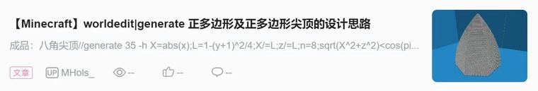


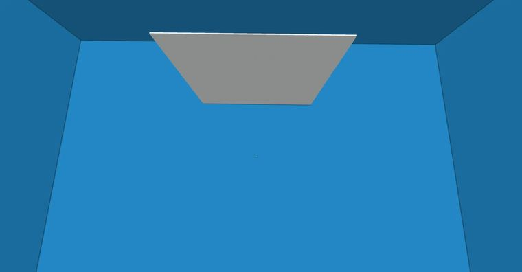

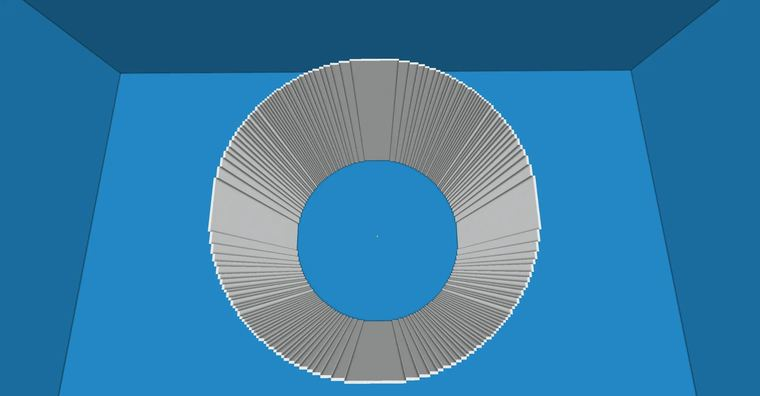

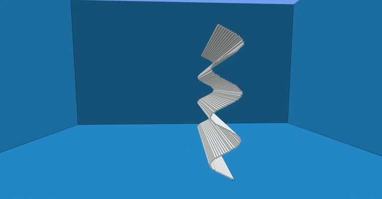

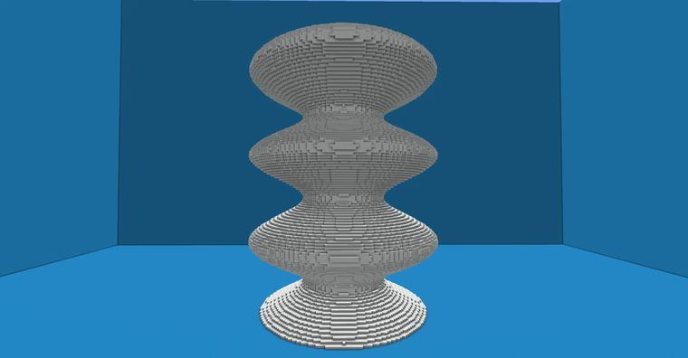


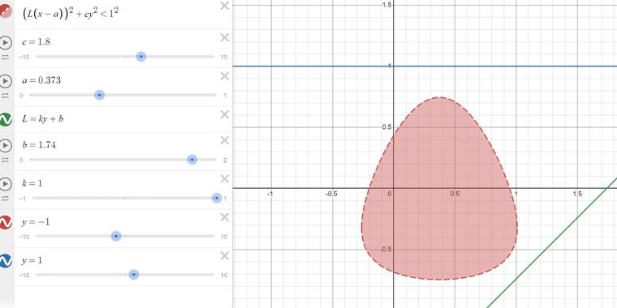

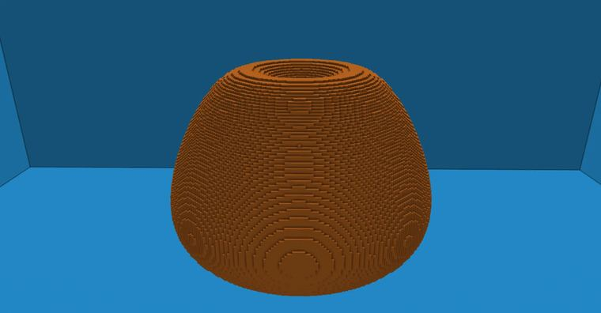

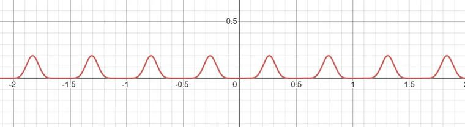

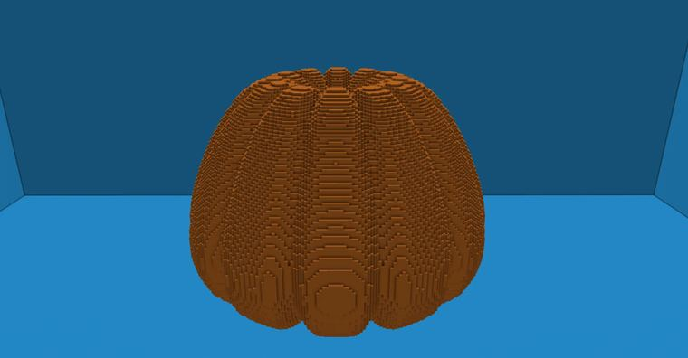

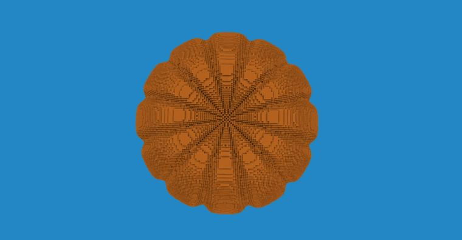

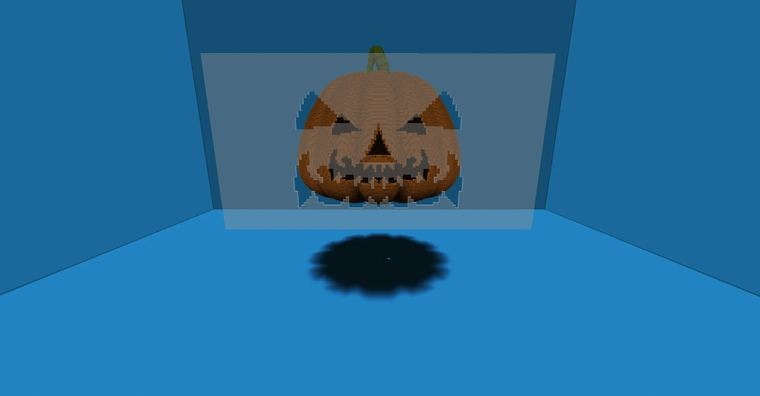


## 指令摘录

> 从原文正文/代码块中提取，可能包含作者当时的版本差异；先在测试选区运行。

```text
//generate 35 -h x<1
//generate 35 -h sqrt(x^2+z^2)<1
//generate 35 -h 0.2*sin(10*y)<z-0.5
//generate 35 -h 0.2*sin(10*y)<sqrt(x^2+z^2)-0.5
//generate hand k=1;b=1.74;a=0.373;L=k*y+b;c=1.8;(L*(sqrt(x^2+z^2)-a))^2+c*y^2<(0.9)^2
//generate hand k=1;b=1.74;a=0.373;L=k*y+b;c=1.8;(L*(sqrt(x^2+z^2)-a))^2+c*y^2<(0.9-0.1*(sin(6*atan2(x,z)))^10)^2
```

---

图片与正文版权归 **imhols** 所有；本页只做学习索引，原文链接见上。
