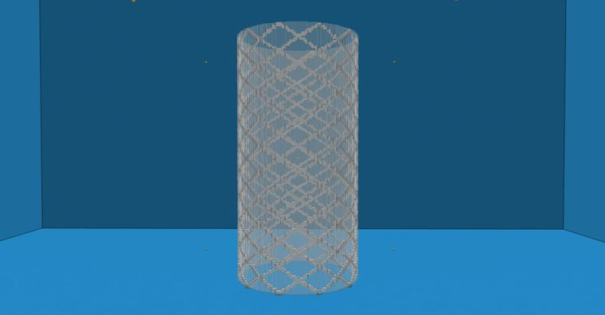
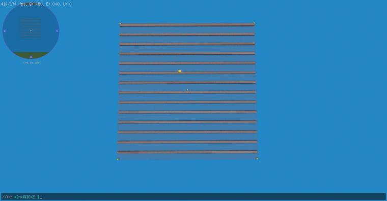
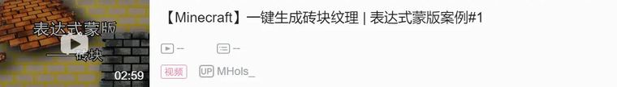
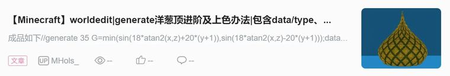
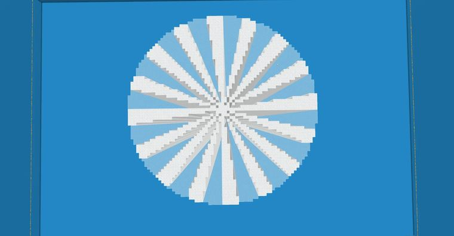
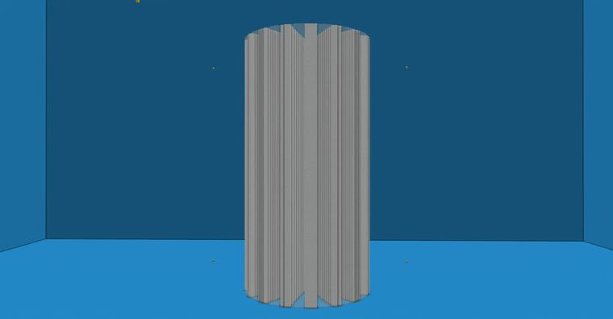
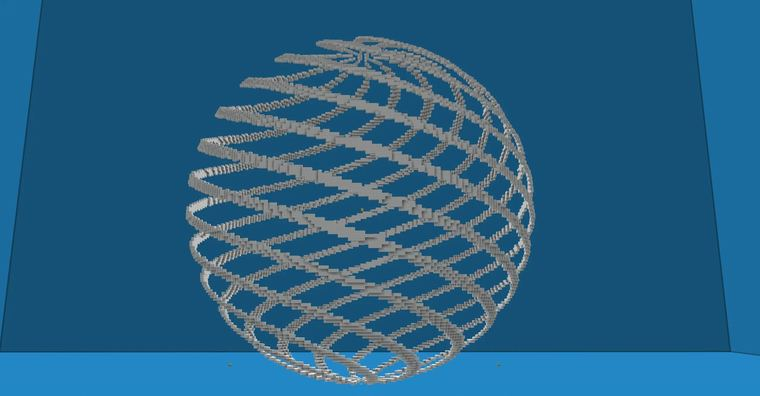
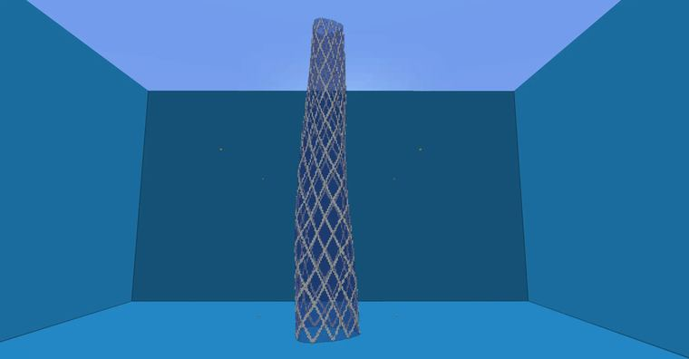

# 【Minecraft】worldedit|generate 角度+求余=生成网状支撑结构？

> 作者：**imhols**（UID 632698683） · 发布：2022-11-08 · 原文：[B站专栏](https://www.bilibili.com/read/cv19601618)

## 摘要

成品//generate 35 -h A=(atan2(x,z)+pi)/pi;type=((((A+(1+y))*40)%8<1)||(((A+(1-y))*40)%8<1))?35:95;x^2+z^2<0.5^2求余很好理解，就是一个除数一个被除数，求出余数，比如5%3=2，如果放入到we中，可以用在判断语句中，比如在表达式蒙版中，如果要做出相隔a距离（这里指的是空白区域）的且有b宽度的格栅的图案就可以用 //re =x%(a+b)<b 1 来实现，如图//re =(-x)%10<2 1还

## 作者补充说明

- 求余很好理解，就是一个除数一个被除数，求出余数，比如5%3=2，如果放入到we中，可以用在判断语句中，比如在表达式蒙版中，如果要做出相隔a距离（这里指的是空白区域）的且有b宽度的格栅的图案就可以用 //re =x%(a+b)<b 1 来实现，如图
- 还要注意的是，做求余时，被除数（如上图的(-x)）一定要是个正数，因为负数求余数永远小于一个正数，会永远满足表达式的条件，就起不到效果。因为表达式蒙版里的坐标是世界坐标，这里看小地图，我的x坐标是个负一千多的数，比起换做(x+100000)，加个负号会简便些，当然，在坐标0附近就可以在坐标或者原有的被除数上加一个很大的数，确保它在求余时是正数
- 进阶一点甚至可以做出砖块的图案
- 好了，接下来进入这次的generate主题，在之前的专栏中，已经分析了关于atan2的用法，类似与极坐标中的极角
- 我们用atan2(x,z)求出一点在x,z平面上的“极角”θ，范围是-pi到pi，然后求余。当然，在求余前我们还要对atan2(x,z)做些变换：
- 1、首先就是改成正数的范围——atan2(x,z)+pi 范围：0 ~ 2pi
- 2、接着，为了方便控制，改成整数范围——(atan2(x,z)+pi)/pi 范围：0 ~ 2
- 3、为了有更多空间求余，扩大范围——((atan2(x,z)+pi)/pi)*40 范围：0~80
- 接下来就是做旋转的工作了，两个相反方向的条形相交叉就出现了网状结构
- 在后面配合一个y轴的旋转体的表达式，就会有很不错的效果哦
- 当然，如果不想交叉，只用一个方向的也是可以的
- 生成后替换下材质，效果是不是还可以
- 表达式里的都是知识点，在前几次的专栏都有介绍
- 虽然很好用，但不建议在做还原现实建筑时用，因为不好匹配，如果你不介意的话。
- 就当是一点小技巧，当然是可以用在各种场景中，不一定是在现代建筑中

## 图片



















## 指令摘录

> 从原文正文/代码块中提取，可能包含作者当时的版本差异；先在测试选区运行。

```text
//generate 35 -h A=(atan2(x,z)+pi)/pi;type=((((A+(1+y))*40)%8<1)||(((A+(1-y))*40)%8<1))?35:95;x^2+z^2<0.5^2
//re =(-x)%10<2 1
//generate 35 type=( (((atan2(x,z)+pi)/pi)*40)%5<2 )?35:95 x^2+z^2<0.5^2
//generate 35 -h A=(atan2(x,z)+pi)/pi;type=(((A+(1+y))*40)%8<2)?35:0;x^2+z^2+y^2<1
//generate 35 -h A=(atan2(x,z)+pi)/pi;type=((((A+(1+y))*40)%8<1)||(((A+(1-y))*40)%8<1))?35:95;z/=sqrt((1.8-y)/2);x/=sqrt((1.8-y)/2);rotate(x,z,-(1+y)*pi/3);x^2+z^2<(0.5+0.13*cos(3/2*atan2(x,z))^4)^2
//re =x%(a+b)<b 1 来实现，如图
```

---

图片与正文版权归 **imhols** 所有；本页只做学习索引，原文链接见上。
