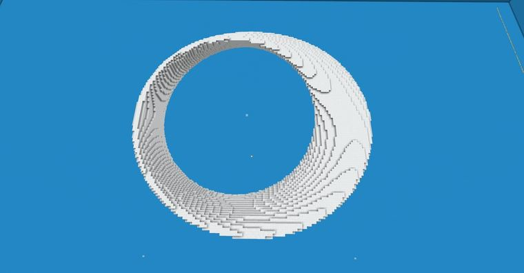
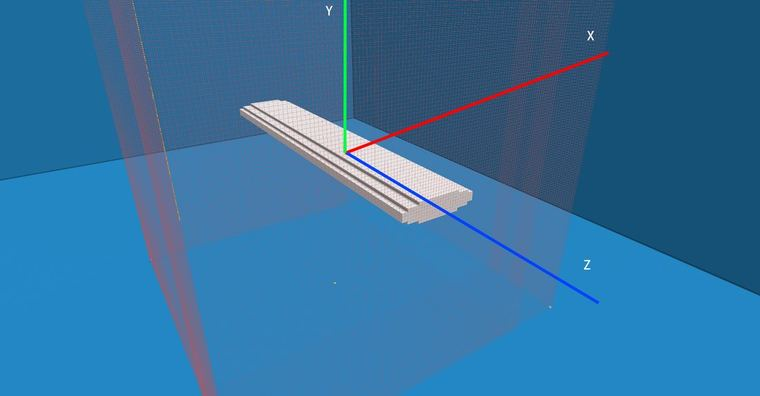
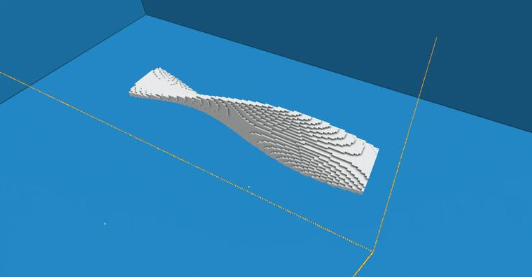
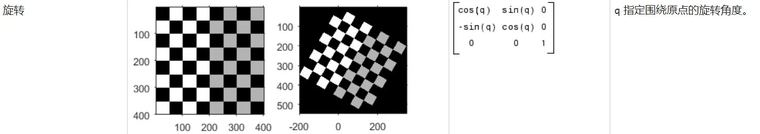
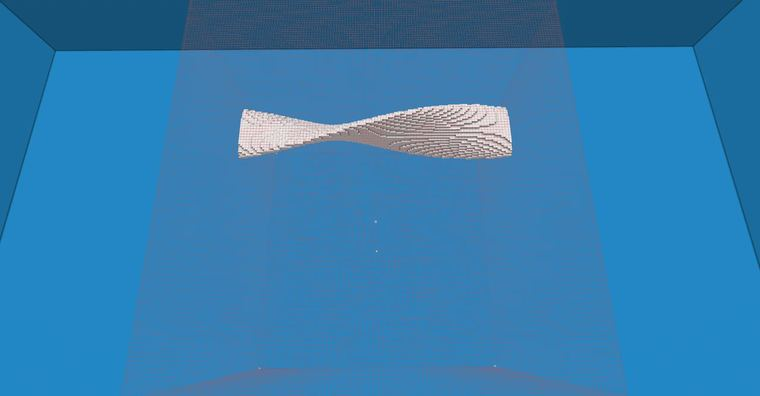
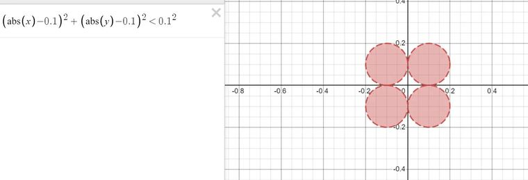
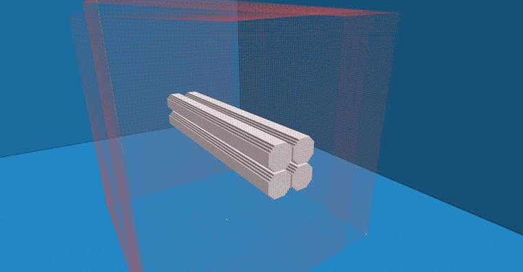
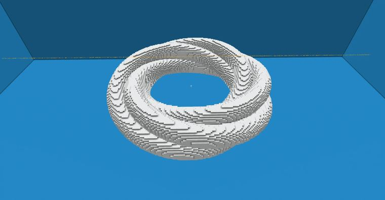

# 【Minecraft】worldedit|generate 莫比乌斯旋转模型

> 作者：**imhols**（UID 632698683） · 发布：2022-11-12 · 原文：[B站专栏](https://www.bilibili.com/read/cv19720003)

## 摘要

成品//generate 35 a=atan2(x,z)*2;x1=sqrt(x^2+z^2)-0.7;X=x1*cos(a)-y*sin(a);Y=x1*sin(a)+y*cos(a);data=(X<0)?(Y>0?1:2):(Y<0?3:4);(abs(X)-0.1)^2+(abs(Y)-0.1)^2<0.1^2//generate 35 a=atan2(x,z)/2;x1=sqrt(x^2+(z)^2)-0.7;X=x1*cos(a)-y*sin(a);Y=x1*sin(a)+y*cos

## 图片





















## 指令摘录

> 从原文正文/代码块中提取，可能包含作者当时的版本差异；先在测试选区运行。

```text
//generate 35 a=atan2(x,z)*2;x1=sqrt(x^2+z^2)-0.7;X=x1*cos(a)-y*sin(a);Y=x1*sin(a)+y*cos(a);data=(X<0)?(Y>0?1:2):(Y<0?3:4);(abs(X)-0.1)^2+(abs(Y)-0.1)^2<0.1^2
//generate 35 a=atan2(x,z)/2;x1=sqrt(x^2+(z)^2)-0.7;X=x1*cos(a)-y*sin(a);Y=x1*sin(a)+y*cos(a);(X)^2+15*Y^2<0.2^2
//generate 35 x^2+15*y^2<0.2^2
//generate 35 a=(1+z)*pi/2;X=x*cos(a)-y*sin(a);Y=x*sin(a)+y*cos(a);X^2+15*Y^2<0.2^2
//generate 35 a=(1+z)*pi/2;x1=x-0.7;X=x1*cos(a)-y*sin(a);Y=x1*sin(a)+y*cos(a);X^2+15*Y^2<0.2^2
//generate 35 a=atan2(x,z)/2;x1=sqrt(x^2+z^2)-0.7;X=x1*cos(a)-y*sin(a);Y=x1*sin(a)+y*cos(a);X^2+15*Y^2<0.2^2
//generate 35 (abs(x)-0.1)^2+(abs(y)-0.1)^2<0.1^2
//generate 35 a=atan2(x,z);x1=sqrt(x^2+z^2)-0.7;X=x1*cos(a)-y*sin(a);Y=x1*sin(a)+y*cos(a);(abs(X)-0.1)^2+(abs(Y)-0.1)^2<0.1^2;
//generate 35 a=atan2(x,z)*2;x1=sqrt(x^2+z^2)-0.7;X=x1*cos(a)-y*sin(a);Y=x1*sin(a)+y*cos(a);data=(X<0)?(Y>0?1:2):(Y<0?3:4);(abs(X)-0.1)^2+(abs(Y)-0.1)^2<0.1^2;
//generate 35 a=atan2(x,z)/2;x1=sqrt(x^2+z^2)-0.7;X=x1*cos(a)-y*sin(a);Y=x1*sin(a)+y*cos(a);X^10+Y^10<0.001^2;
```

---

图片与正文版权归 **imhols** 所有；本页只做学习索引，原文链接见上。
