# 【Minecraft】worldedit|表达式蒙版 噪声+条纹=人造摩尔纹？

> 作者：**imhols**（UID 632698683） · 发布：2022-11-27 · 原文：[B站专栏](https://www.bilibili.com/read/cv20073301)

## 摘要

成品//re =(x+50*perlin(1,x,y,z,0.02,1,1))%10<5 251//re =x-=528;z-=-176;(sqrt(x^2+z^2)+80*perlin(1,x,y,z,0.02,1,1))%4<2 hand表达式蒙版里使用的是世界坐标，在之前的专栏里也提到过求余的操作，可以先看一下这一篇保证被除数是大于0的，我目前所选区范围内x始终是正数，就不用做调整下面我先示范一下基础的条纹制作轴向：//re =x%10<5 251求余使得沿着x方向出现条形纹理，其中10可

## 作者补充说明

- 表达式蒙版里使用的是世界坐标，在之前的专栏里也提到过求余的操作，可以先看一下这一篇
- 保证被除数是大于0的，我目前所选区范围内x始终是正数，就不用做调整
- 求余使得沿着x方向出现条形纹理，其中10可以理解为间距（指黑色部分）加上线宽的总长，5可以理解为 线宽。调节这两个值以获得你想要的效果
- 径向其实就是把上述的x换成了半径（或者说平面上距离原点的距离）sqrt(x^2+z^2)
- 其中最主要的是前两个式子 x-=528;z-=-176，因为上面也说了，表达式蒙版里的表达式使用的是世界坐标，如果直接使用sqrt(x^2+z^2)，此时圆心在世界的(0,0)处，为了将其移到我们所期望的位置，比如选区的中心，选区中心的坐标是(528,-176)，我们就需要让x，z分别减去这个坐标，即 x-=528;z-=-176，此时相当于把世界坐标的原点移到了选区中心 (528,-176)，这样，之后的任何操作都将在此时的环境下进行
- 参数里单词就不用过多解释了，seed是种子，懂得都懂，我们只需要关心frequency频率，其他的一律填1就够用了，噪声我们之前也用过
- 我们只需要知道，这三个噪声函数的返回值的范围是在0~1之间，显然不够在世界坐标系下运行，我们用在表达式蒙版上时，一般在前面乘以个比较大的系数，可以理解为幅值，控制噪声影响的程度，比如80*perlin(1,x,y,z,0.02,1,1)，就把范围扩充到0~80了，效果就是我们想要的
- 还有重要的一点就是频率的选取，频率值越大，震动的程度或扰动程度就越大，反之就会月小，我个人认为都可以把这个理解为噪声的缩放了，在世界坐标下，根据我的测试，一般就取0.02左右就行了，你也可以自己试试，根据需求选择
- 然后就是在轴向或径向的条纹的被除数的一边加上噪声了
- 为了不与成品重复，我这里试一下其他的噪声，并调整一下参数
- 做到这里我有了大胆的想法，因为我做这些就是为了给地形或建筑上色
- 这里我把表达式和#existing用引号括起来并用空格隔开，这样就只会影响已存在的方块
- 如果当噪声前的系数很小时，就会引起变动很小的左右浮动，形成随机的外立柱
- 如果有更好的应用实例，我可能会更新在动态里

## 图片

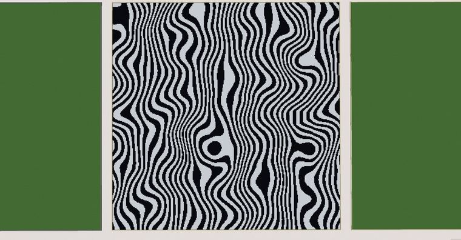

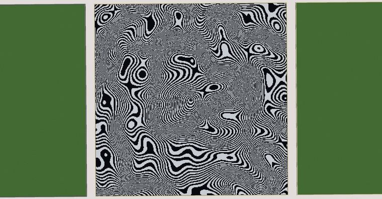

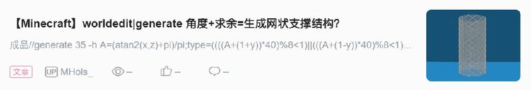


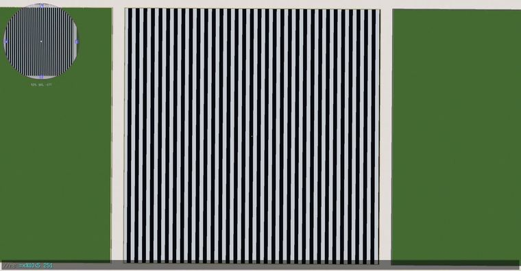

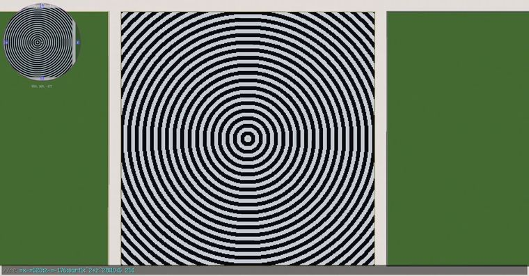

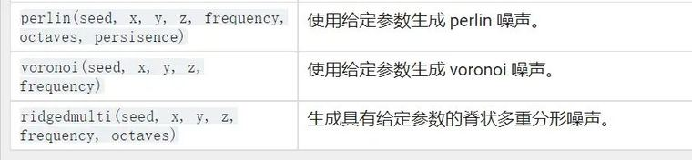

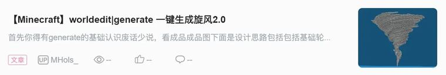

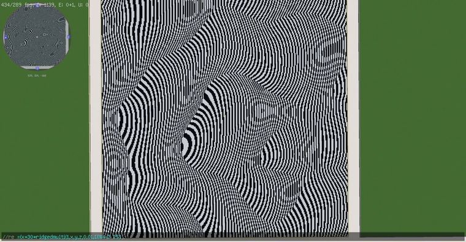

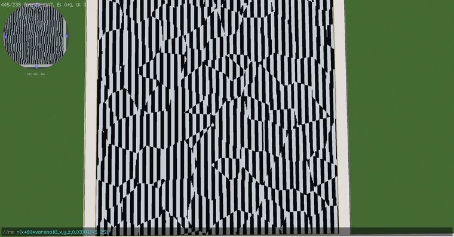

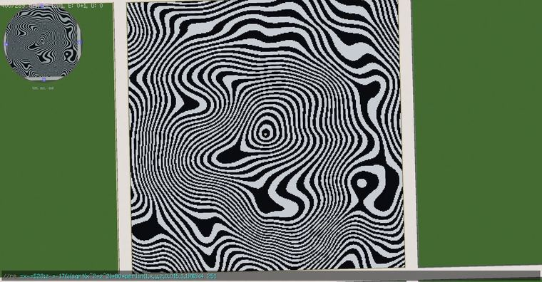

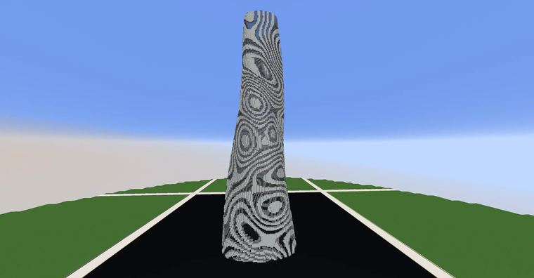

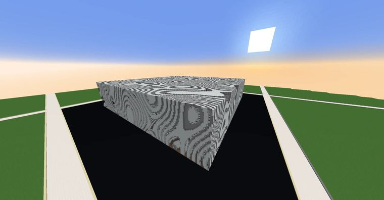

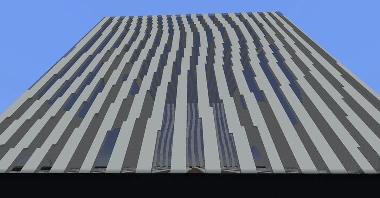


## 指令摘录

> 从原文正文/代码块中提取，可能包含作者当时的版本差异；先在测试选区运行。

```text
//re =(x+50*perlin(1,x,y,z,0.02,1,1))%10<5 251
//re =x-=528;z-=-176;(sqrt(x^2+z^2)+80*perlin(1,x,y,z,0.02,1,1))%4<2 hand
//re =x%10<5 251
//re =x-=528;z-=-176;sqrt(x^2+z^2)%10<5 251
//re =(x+30*ridgedmulti(1,x,y,z,0.01,1))%4<2 251
//re =(x+80*voronoi(1,x,y,z,0.03))%10<5 251
//re =x-=528;z-=-176;(sqrt(x^2+z^2)+80*perlin(1,x,y,z,0.015,1,1))%8<4 251
//re "=x-=528;z-=-176;(sqrt(x^2+z^2)+80*perlin(1,x,y,z,0.02,1,1))%8<4 #existing" 251
//re "=x-=528;z-=-176;(sqrt(x^2+z^2)+80*perlin(1,x,y,z,0.02,1,1))%8<4 #existing" 251，
//re "=(x+80*perlin(1,x,y,z,0.02,1,1))%8<4 #existing" 251
//re "=(x+10*perlin(1,x,y,z,0.02,1,1))%8<4 #existing" 251
```

---

图片与正文版权归 **imhols** 所有；本页只做学习索引，原文链接见上。
