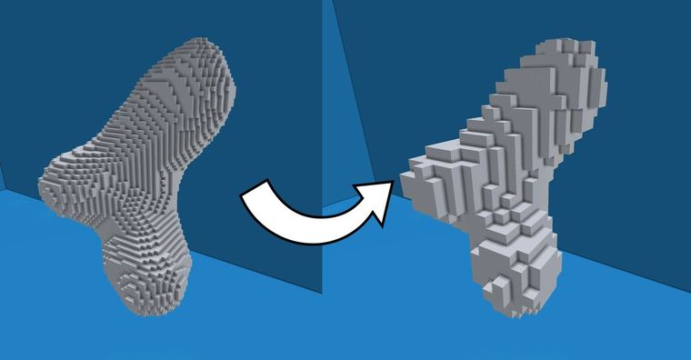
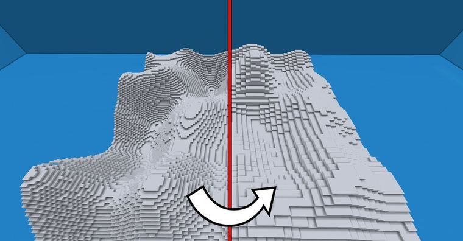
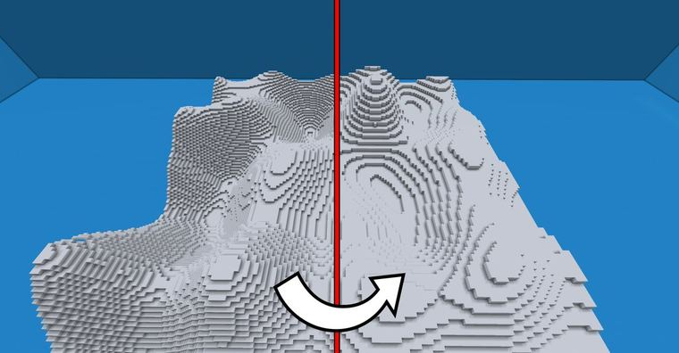
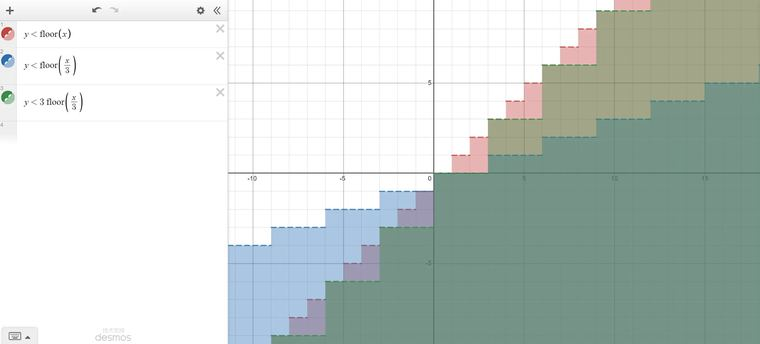
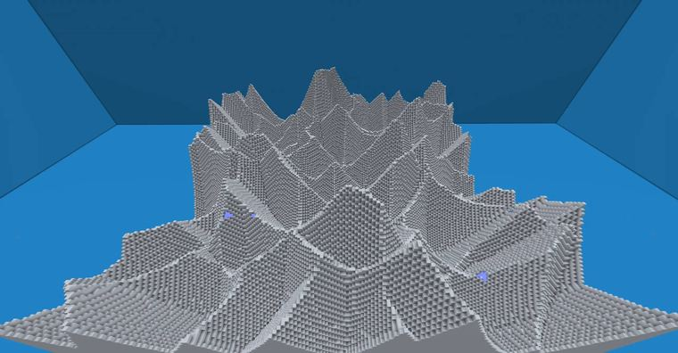
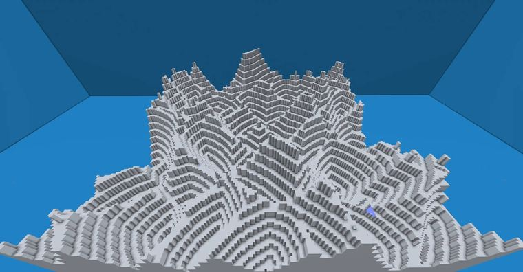
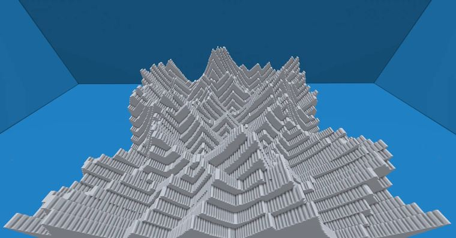
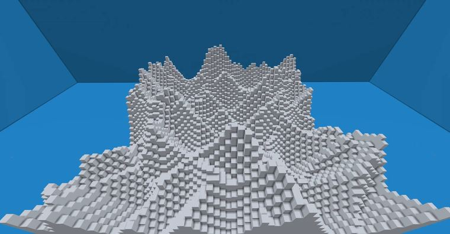

# 【Minecraft】worldedit|deform&generate 利用floor函数实现“二次体素化”

> 作者：**imhols**（UID 632698683） · 发布：2022-12-12 · 原文：[B站专栏](https://www.bilibili.com/read/cv20436896)

## 摘要

成品//deform -c x=3*floor(x/3);z=3*floor(z/3);y=3*floor(y/3)//generate -c 251 X=3*floor(x/3);Z=3*floor(z/3);y+60<40*perlin(1,x,1,z,0.03,1,1)//generate -c 251 Y=2*floor(y/2);Y+60<40*perlin(1,x,1,z,0.03,1,1)想必也注意到了 ，这里只是用了新的X，Y，Z替换了本来的x，y，zX=a*floor(x/b)

## 作者补充说明

- 想必也注意到了 ，这里只是用了新的X，Y，Z替换了本来的x，y，z
- 这个函数在我做砖块纹理时也用过
- 因为在使用世界坐标的情况下，如generate -c 或deform，每一格的坐标都是整数，如果直接用x=floor(x),是没有任何作用，因为本来x的步长就是整数1，floor也就不起到作用，（下图红色部分）所以就要在floor括号里的x除以一个数字b，如x=floor(x/3)，此时x的步长就变成了3，每3格子长跳1位（下图蓝色部分），这时又出现了一个问题，只跳1不行啊，为了和原曲线的走势或斜率一致，在floor前面乘以个系数a，跳的高度a最好与x所除的数字保持一致，即x=3*floor(x/3);就如下图演示的绿色部分。（如果不想按原图的趋势也可以用其他数）
- 这样子替换xyz，不仅可以用应用在generate生成形状上，也可以用deform对选区内已有的形状进行变换，如把刷出的地形变成阶梯状，或者什么形状
- 同时对x，z替换：
- 也可以如成品的后两个直接用generate生成阶梯状的地形，至于噪声生成地形的用法，我这正在考虑是否要做一期详解。

## 图片



















## 指令摘录

> 从原文正文/代码块中提取，可能包含作者当时的版本差异；先在测试选区运行。

```text
//deform -c x=3*floor(x/3);z=3*floor(z/3);y=3*floor(y/3)
//generate -c 251 X=3*floor(x/3);Z=3*floor(z/3);y+60<40*perlin(1,x,1,z,0.03,1,1)
//generate -c 251 Y=2*floor(y/2);Y+60<40*perlin(1,x,1,z,0.03,1,1)
//deform -c y=3*floor(y/3)
//deform -c x=3*floor(x/3)
//deform -c x=3*floor(x/3);z=3*floor(z/3)
```

---

图片与正文版权归 **imhols** 所有；本页只做学习索引，原文链接见上。
