# 【Minecraft】worldedit&FAWE 你可能需要知道的指令

> 作者：**imhols**（UID 632698683） · 发布：2022-12-31 · 原文：[B站专栏](https://www.bilibili.com/read/cv20869663)

## 摘要

前言：本来我是不想做这类查wiki就知道的教程，但是经常看到有些人并不知道一些指令的用法，这个专栏将介绍we中非常好用的能大幅提高效率的指令，可能以后会接着补充。教程使用的均为服务器插件版we和fawemask和pattern这个属于前置的知识，并不是指令，你需要知道这两者的意思。众所周知，we指令中有两个重要的概念，一个是蒙版mask，一个是图案pattern，如replace指令中第一个参数就是mask蒙版，第二个是pattern图案，mask决定你要在哪个位置上执行命令，pattern决定你执行时所

## 图片


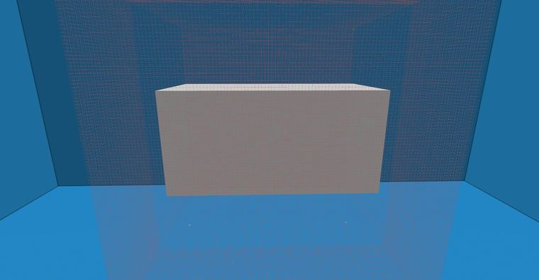

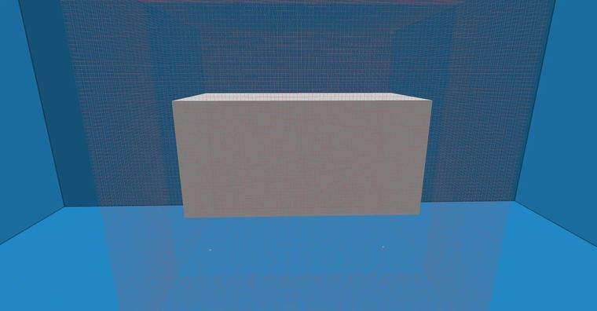

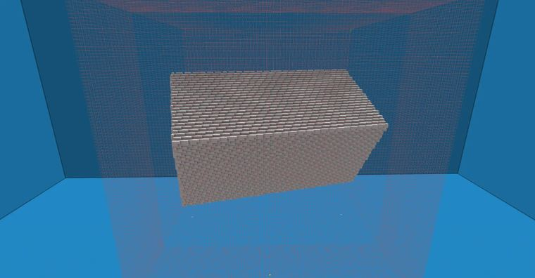

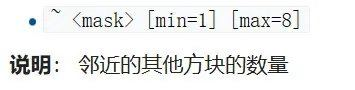

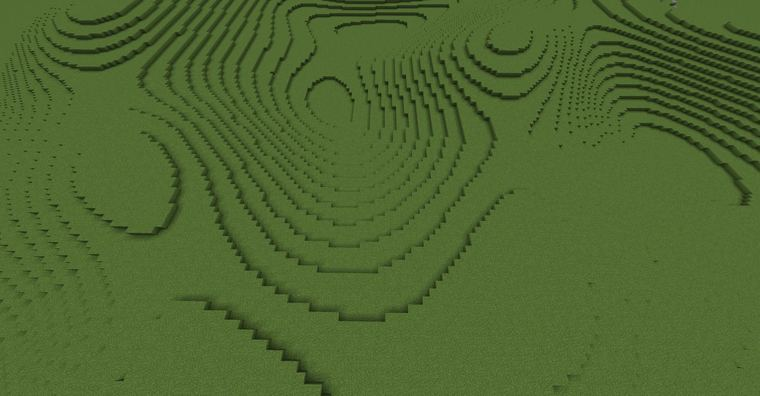

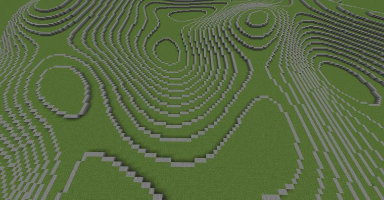

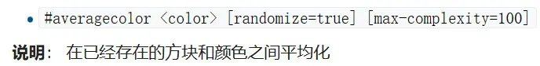

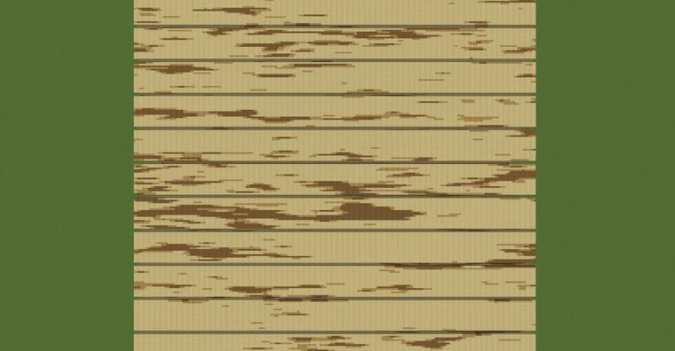

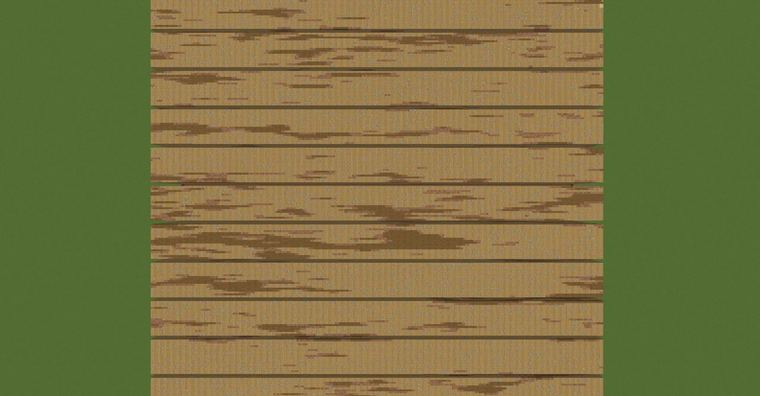

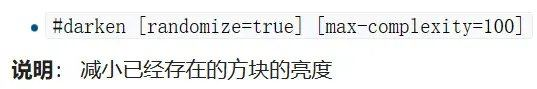

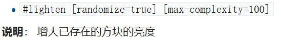

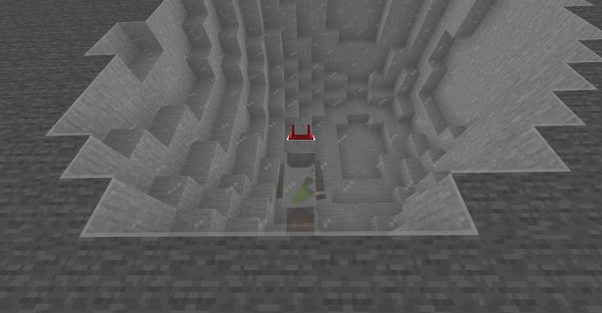


## 指令摘录

> 从原文正文/代码块中提取，可能包含作者当时的版本差异；先在测试选区运行。

```text
//set hand 执行结果就是在选区中set手上拿着的方块
//replace slot1 slot2 执行结果就是把选区中的物品栏中第一格的方块替换成物品栏中第二格中的方块
//copy -m hand 进行copy操作时，蒙版方块为此时手上的方块，结果就是只复制了蒙版中的方块，在paste操作中也只能粘贴出这个蒙版中的方块
//paste -m hand 和上面同理，只粘贴剪贴板中-m后面的蒙版方块，即hand手上拿的方块
//move 20 -m hand 和//stack 20 -m hand 同理，不必多说
//deform rotate
//deform -c rotate(x,z,pi/12);rotate(x,y,pi/3)
//re "~[0][2][3] 2" 1
//re #averagecolor[121][89][51][255]，如图：
//re #averagecolor[121][89][51][255]
//deform 后面跟的是表达式或函数，其中rotate()是we中自带的函数，之前的generate教程专栏多次使用，相比//rotate x y z的优势是不会容易出现漏洞破损
```

---

图片与正文版权归 **imhols** 所有；本页只做学习索引，原文链接见上。
