# 【Minecraft】worldedit|generate 探索神奇的噪声——从原理到应用

> 作者：**imhols**（UID 632698683） · 发布：2023-03-15 · 原文：[B站专栏](https://www.bilibili.com/read/cv22408344)

## 摘要

本专栏教程旨在为mc玩家打开一扇新的大门，看完让你掌握噪声的原理和基础运用一、详解原理1.1格式https://worldedit.enginehub.org/en/latest/usage/other/expressions/我们现在先只拿perlin噪声作为例子，其中各个参数概念这里不做过多介绍，这里推荐蓝鸡的视频介绍1.2函数概念在我们写表达式时，we给我们提供了很多的函数，形式如 “函数名()”，比如常用的sqrt()、abs()、atan2()、min()、max()等等,你在括号中输入进参数，

## 作者补充说明

- 我们现在先只拿perlin噪声作为例子，其中各个参数概念这里不做过多介绍，这里推荐蓝鸡的视频介绍
- 在我们写表达式时，we给我们提供了很多的函数，形式如 “函数名()”，比如常用的sqrt()、abs()、atan2()、min()、max()等等,你在括号中输入进参数，经过这些函数的运算，会返回一个结果，比如min(1,2,3)这个整体在表达式中的值就是1（取最小）。
- 同理，三个噪声也是函数，输入对应参数（种子，坐标，频率等），经过特殊的计算（想了解具体计算过程？我也不知道）返回一个数值，返回的范围是0~1，知道这个很重要。
- 1.3生成原理/过程
- 具体生成过程是什么呢？当你选择了一个选区之后，输入的一串的generate指令后，系统会对选区内的每个位置都进行一次运算，而每个位置之间有什么差别呢？每个位置都有自己独一无二的坐标 (x,y,z)，也就是说，每个位置是否生成，完全取决于它的坐标那三个数xyz带入到表达式中是否成立，为什么说完全取绝于呢？因为每个位置有且仅有坐标的"信息"。举个例子，比如我们写一个 x^2+z^2+y^2<1，回车之后，服务器开始对你的选区每个位置进行计算，把每个位置独一无二的坐标带入进去，结果满足返回true则生成方块，不满足返回false就保持原样。
- 知道了生成过程，我们再看一下perlin噪声的形式
- 我们看到参数里是有放xyz的地方的，也就是说，这个函数是与我们选区内各个位置xyz坐标信息相关的，也就是说每个点经过计算得到的值与x y z都有关（记好这里，待会要用）
- 程序开发中总会用到随机方法,一般的随机方法虽然通用,但是产生的随机数又因为过于"随机",不适合用来生成平滑连续的随机数据(譬如自然地形的高度),这个时候我们便需要使用特殊的随机方法了, Perlin 噪声便是一种能够产生平滑(随机)数值的随机方法.
- 我们为什么要用perlin噪声，这要说一下perlin噪声的特点，它返回的值是"平滑的"，意思是当坐标相距很近或相邻，差别不大时，得到的值不会突变，比如在一定频率下(x,y,z)返回的值与(x+0.01,y,z)得到的值是很接近的，这使得我们最终得到的结果是一个“平滑的”形状。
- 我会根据上面讲到的知识来讲下具体要怎么把perlin噪声函数通过变换添加到我们的表达式中
- 2.1限制取值范围
- 上图是一个最简单的应用，首先再回顾一下它原理，把坐标信息代入返回一个值，值的范围为0~1，如果我们仅仅写一个 perlin(1,x,y,z,1,1,1) 会发生什么
- 是实心的，因为在we的规则里只要是大于0不包括0，就代表true，生成方块，而perlin()返回值在0~1间，所以要想使其有意义，我们需要一个范围，让结果值满足这个范围的的位置生成方块，不满足的不生成，这里就要用一个比较符号> 或 <，满足返回true，不满足返回false，所以我们改改，换成 perlin(1,x,y,z,1,1,1)<0.5，让值小于0.5的位置满足表达式，生成方块，又因为perlin噪声是平滑的，所以得到的就是一个这样连续平滑的形状
- 2.2调整坐标参数个数
- 这里再与前面的知识联动下，perlin噪声有三个参数位置是用来放坐标信息的，在三维空间中，三个坐标xyz就可以独一无二来表示一个位置，那如果我们把其中一个坐标信息给舍弃掉，换成一个常数，比如我们只要xz，如 perlin(1,x,1,z,1,1,1)，这么一来，在三维空间中，当xz的值一样时，不同y值之间得到的结果是没有差别的，在游戏里看下
- 如果只有一个坐标信息x呢？，情况就是，当x的值一样时，不管它的z和y是多少，结果都是一样的
- 由此我们引出一个具体的应用——地形生成，基础表达式为 perlin(1,x,1,z,1,1,1)<0.5，如果后面的0.5的取值范围换成与y相关的数呢，比如 y+1<perlin(1,x,1,z,1,1,1)，能想象出来吗？
- 当y=-1这一层时，此时表达式就如同0<perlin(1,x,1,z,1,1,1)，几乎全部满足，往上增加，perlin()的取值范围会变窄，最终当y=0时，范围彻底没了，即1<perlin(1,x,1,z,1,1,1)。
- 如果你明白了，恭喜你学会了在取值范围上做文章的能力，以上的例子只是与y线性相关，如果是y^2、e^y、floor(y)会是什么样的效果，但要注意的是你要让这个f(y)中y在-1~1中得到的值域与perlin噪声的值域相交，这样才会有意义。我再举个例子
- 这里加了-c，就使用世界坐标的尺度，每一格代表1，所以对应的频率也要改变（选区大小为100*100*100）
- 2.3对参数进行变换/替换
- perlin噪声标准形式形如 perlin(1,x,y,z,1,1,1)，如果我们对内部的坐标参数进行一些变换，如拉伸，收缩
- 为了更好的展示纹理的应用，我这里只在一个水平面上生成，此时的y的存在就可有可无了
- 适当调整频率、取值范围和其他参数，我们就会得到木制纹理（当然也可以用在其他场景）
- 接下来我要讲的是替换，标准格式的perlin()是与x，y，z三个相关的，如果我们把其中一个比如y替换成sqrt(x^2+z^2)会发生什么
- sqrt(x^2+z^2)代表的是什么？是每个点与（0，0）的距离，我们称这个距离格式称为“欧氏距离”，所以在选区内的每个位置要带入perlin噪声的值就成了x，z和与原点的距离，即这个生成图案与x有关，与z有关，也与到原点的欧式距离有关
- 如果我们只留一个sqrt(x^2+z^2)会发生什么？
- 这里插入一个知识，有欧氏距离sqrt(x^2+z^2)，还有街区距离abs(x)+abs(z)和棋盘距离max(abs(x),abs(z))，感兴趣的可以去搜搜
- 当然，我们可以在这三个位置填入任何变量，这取决于你想要的效果与什么量有关
- 再插入一个重要的技巧，你要按perlin的值上色的话，要把不同的值分开，用data=p*n%n，n是我把perlin的范围扩展了一下，如果n为5，那么范围就变成了0~5，然后再用5对其取余，让不同的值得到不同的data，就把perlin的值按大小分成了5个

## 图片


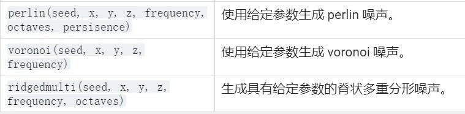

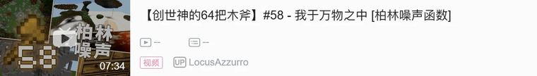

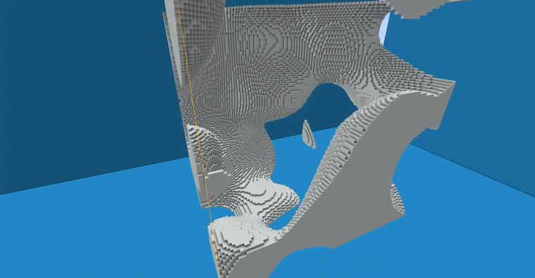

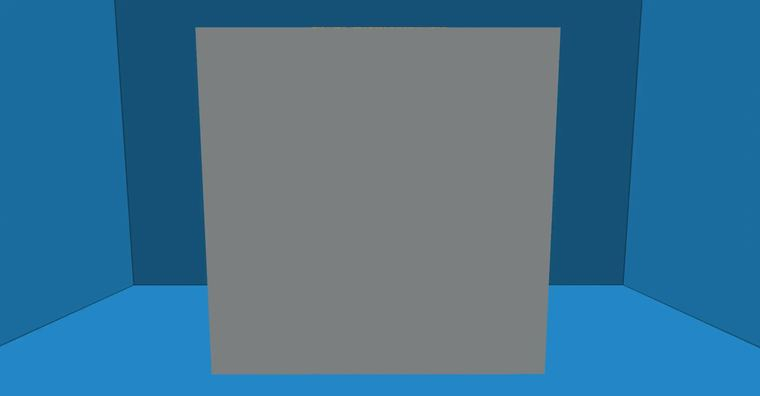

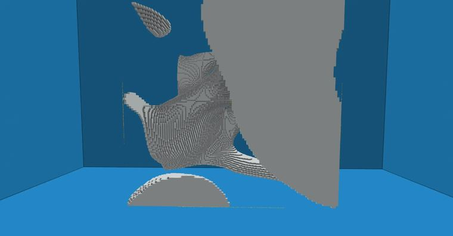

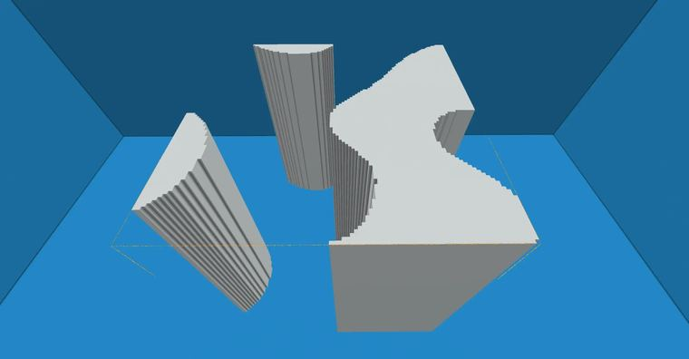

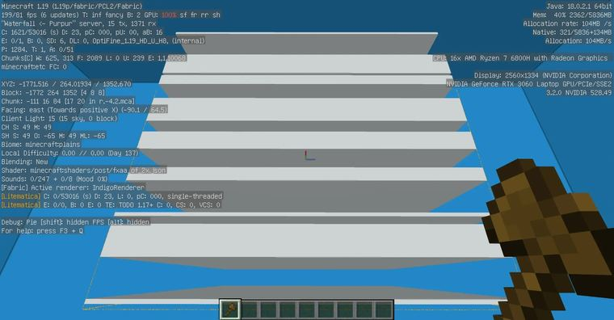

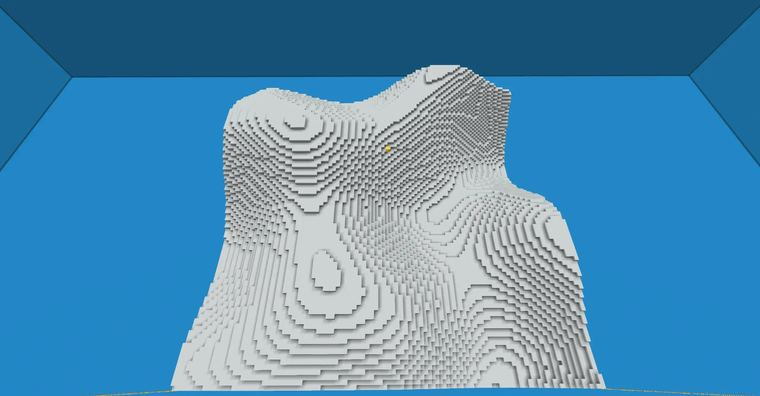

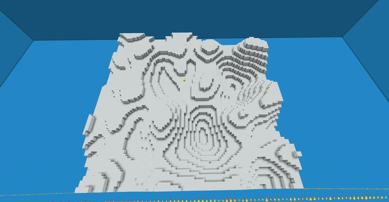

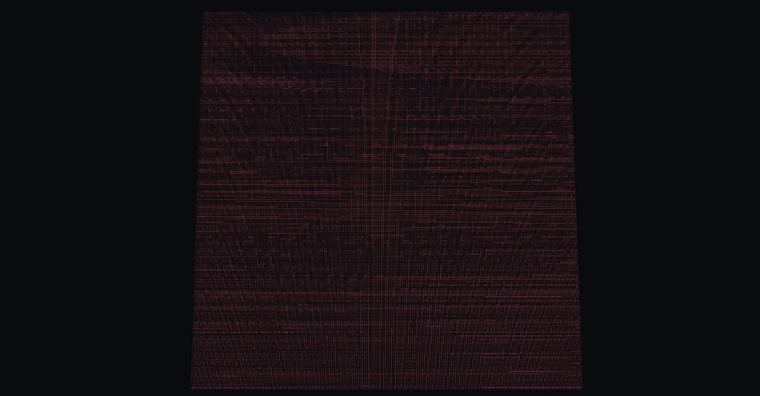

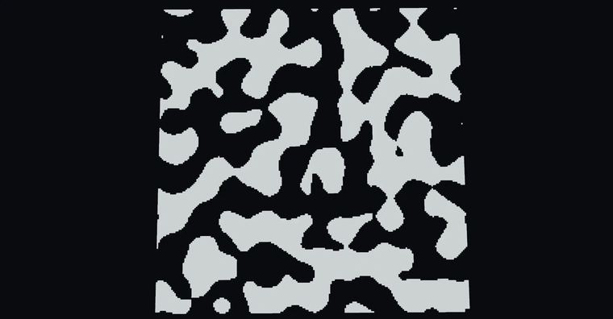

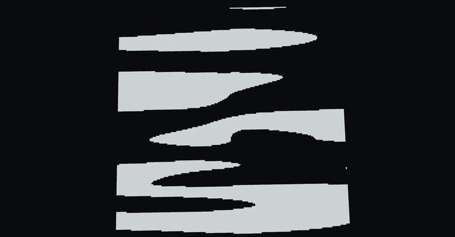

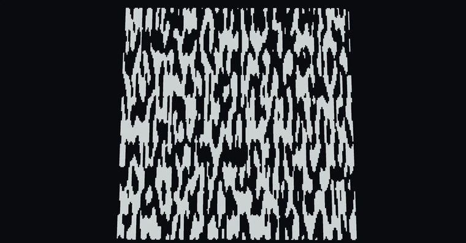

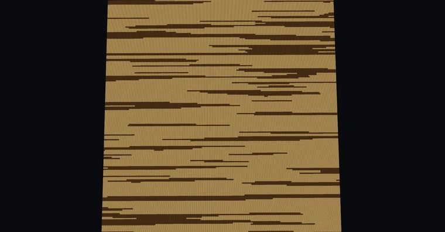

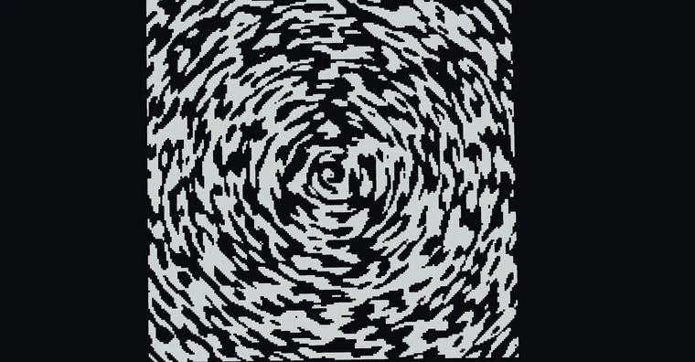

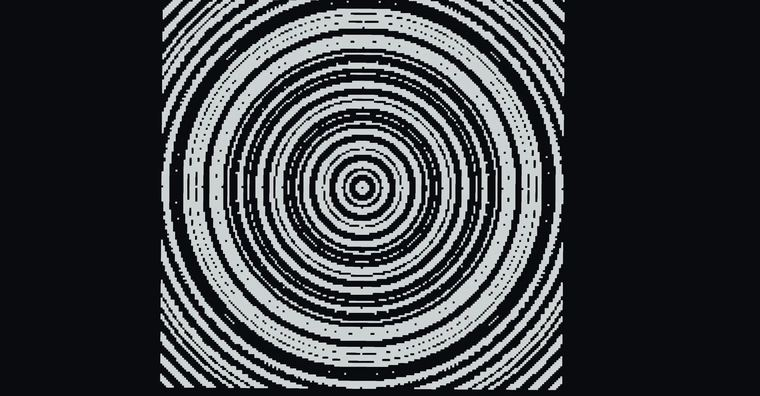

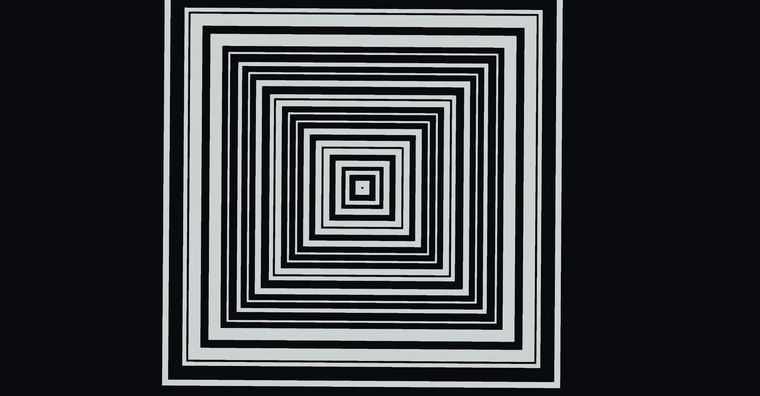

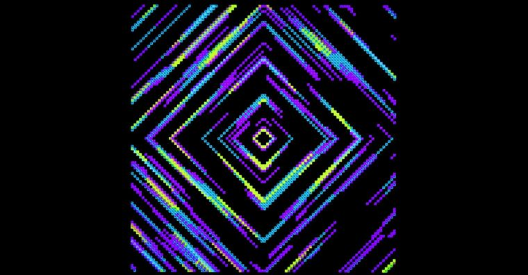

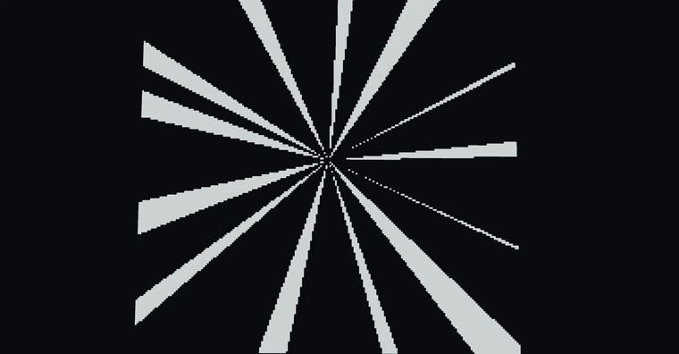

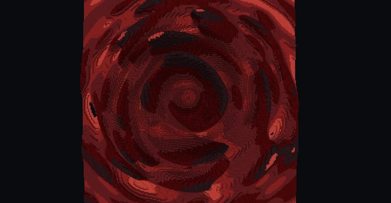

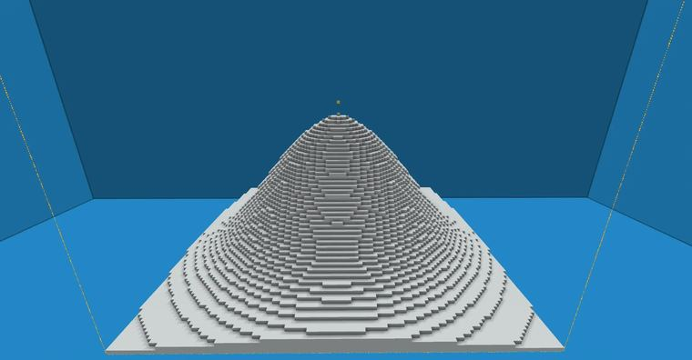

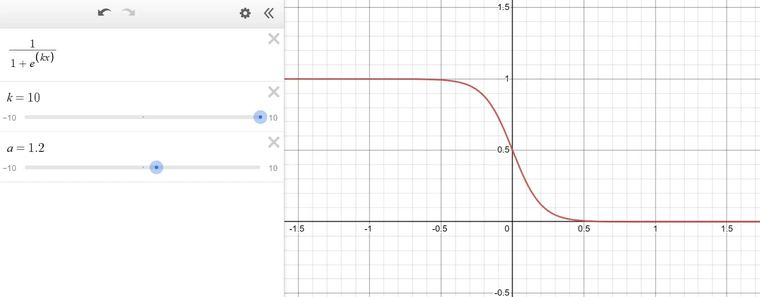

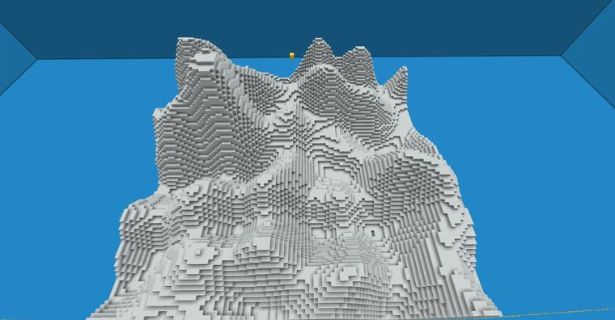

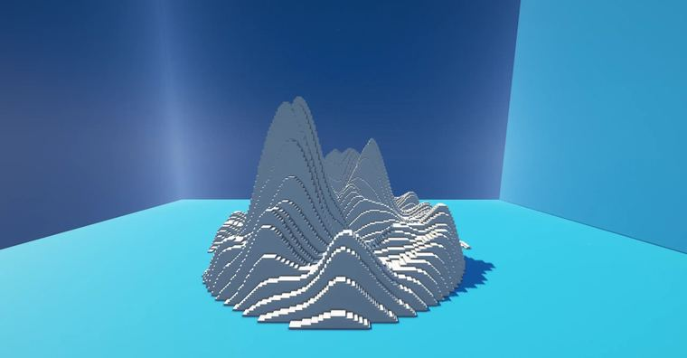

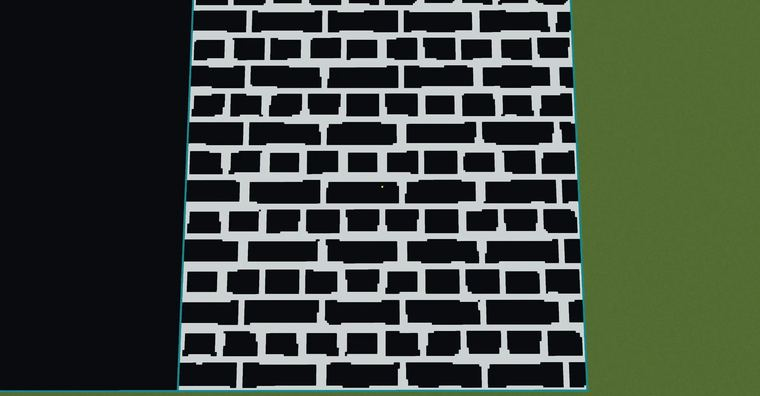

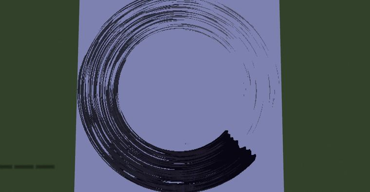

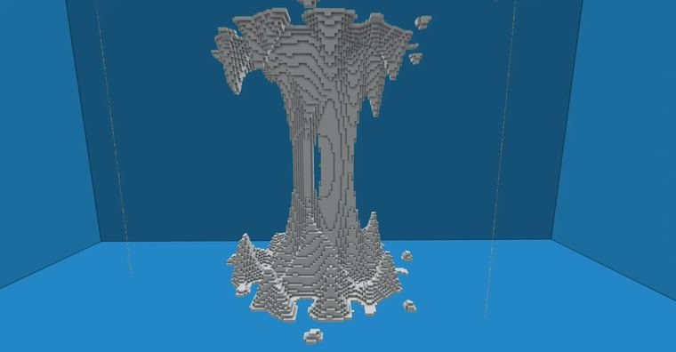

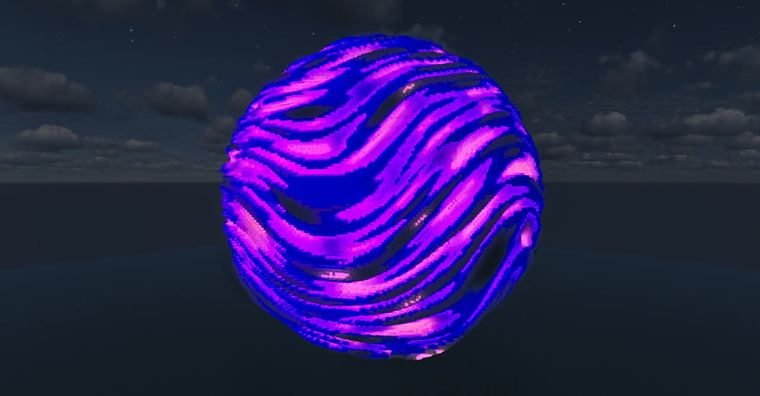


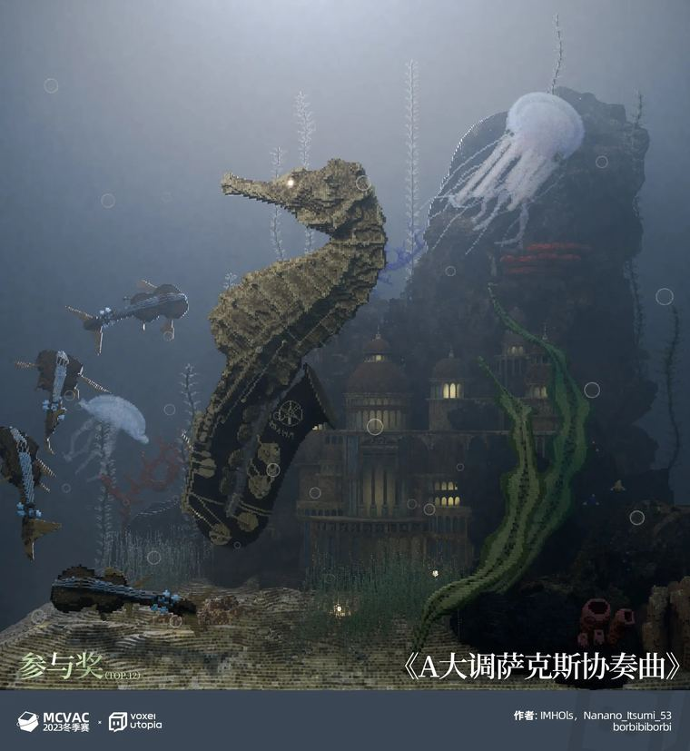

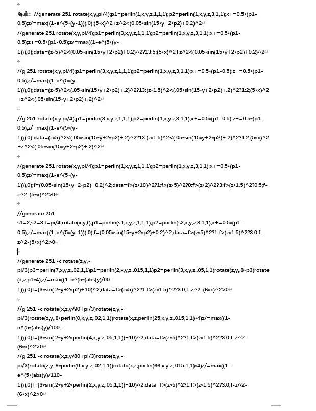


## 指令摘录

> 从原文正文/代码块中提取，可能包含作者当时的版本差异；先在测试选区运行。

```text
//generate 251 perlin(0,x,y,z,1,1,1)<0.5
//generate 251 perlin(1,x,y,z,1,1,1)
//generate 251 perlin(1,x,y,z,1,1,1)<0.5
//generate 251 perlin(1,x,1,z,1,1,1)<0.5
//generate 251 perlin(1,x,1,1,5,1,1)<0.5
//generate 251 y+1<perlin(1,x,1,z,1,1,1)
//generate 251 -c floor(y/3)*3+25<25*perlin(1,x,1,z,0.05,1,1)
//generate 251 perlin(1,x,y,z,5,1,1)<0.5
//generate 251 perlin(1,x,y,z/10,5,1,1)<0.5
//generate 251 perlin(1,x,y,z*5,5,1,1)<0.5
//generate 251 perlin(1,x*2,y,z/20,10,2,1)<0.3
//generate 251 perlin(1,x,3*sqrt(x^2+z^2),z,10,1,1)<0.5
//generate 251 perlin(1,1,3*sqrt(x^2+z^2),1,10,1,1)<0.5
//generate 251 perlin(1,1,3*max(abs(x),abs(z)),1,10,1,1)<0.5
//generate 251 p=perlin(1,x,20*(abs(x)+abs(z)),z,1,1,1);data=p*10%4;p<0.4
//generate 251 perlin(1,1,atan2(x,z),1,5,1,1)<0.4
//generate 251 rotate(x,z,2*y);p=perlin(1,x,3*sqrt(x^2+z^2),z,3,1,1);data=p*5%5;y+1<p*(1/(1+e^(5*(sqrt(x^2+z^2)-0.5))))
//generate 251 y+1<1/(1+e^(5*(sqrt(x^2+z^2)-0.5)))
//generate 251 p1=perlin(1,x,1,z,1,1,1);p2=perlin(2,x,1,z,3,1,1);y+1<p1*p2
//generate 251 y+1<2*perlin(23,x*2,1,z,3,1,1)*(perlin(2,x,1,z,2,1,1)-0.2)*(1-sqrt(x^2+z^2)^8)
//deform -c x=3*floor(x/3);
//generate 251 -c s=200;x+=s;z+=s;a=15;b=20;d=1;k=2;p=k*perlin(1,x,y,z,0.05,1,1);f=d+p;(x%(2*a)<a?(z%b<f||z%b>(b-f)):((z+b/2)%(2*b)<f||(z+b/2)%(2*b)>(2*b-f)))||(x%a<f||x%a>(a-f))
//generate 35 rotate(x,z,pi/4);m=0.6;n=0.4;p1=perlin(1,x,50*sqrt(x^2+z^2),z,2.5,1,1);p2=perlin(1,x,20*sqrt(x^2+z^2),z,1.5,1,1);rotate(x,z,p2/10);t=atan2(z,x)/pi+1;data=(t*p1+p1*0.2)*5%15+5;abs((sqrt(x^2+z^2)-(m+n/2)))<(n/2)&&(p1-t/2)
//generate 251 p=perlin(1,x,1,z,5,1,1);L=(p+1)/2-sqrt(x^2+z^2);1-y^2<2*p*L
//generate 251 p2=perlin(1,x,y,z,1,1,1);p1=perlin(1,x,y*8+p2*5,z,3,1,1);data=p1*4%4;x^2+z^2+y^2<0.85+0.15*p1
//generate 1 p=perlin(1,x,1,z,2*e^(1-0.5*z),1,1);y+0.9<p*8*((x+0.2*(p-0.5))^2-(x+0.2*(p-0.5))^4+0.01*(z+1))*e^(z-1)
//g 251 -c rotate(x,z,y/80+pi/3)rotate(z,y,-pi/3)rotate(z,y,.8*perlin(9,x,y,z,.02,1,1))rotate(x,z,perlin(66,x,y,z,.015,1,1)*4)z/=max((1-e^(5*(abs(y)/110-1))),0)f=(3*sin(.2*y+2*perlin(2,x,y,z,.05,1,1))+10)^2;data=f>(z*5)^2?1:f>(z*1.5)^2?3:0;f-z^2-(6*x)^2>0
```

---

图片与正文版权归 **imhols** 所有；本页只做学习索引，原文链接见上。
