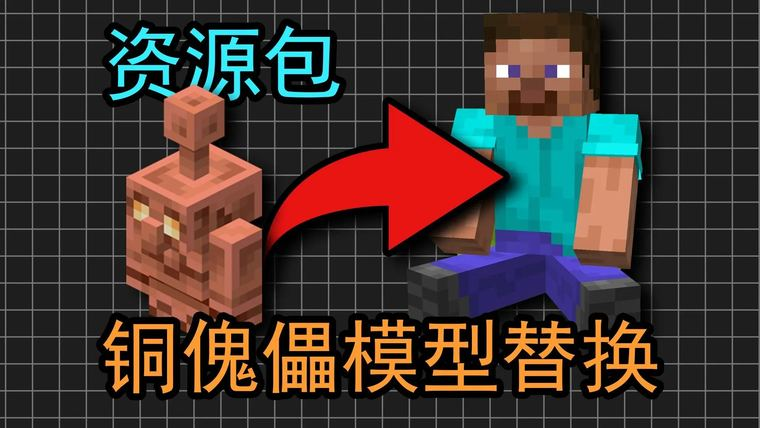

# 【Minecraft】我把铜傀儡替换成了玩家模型 | 资源包

> 作者：**imhols**（UID 632698683） · 2月5日 · 类型：`DYNAMIC_TYPE_AV` · [原动态](https://www.bilibili.com/video/BV1kxFYzyE5T)

## 动态内容

需要optifine 或者 实体模型特性（Entity model features）模组
获取 https://wwazr.lanzouu.com/iXe4D3huoqwd

## 图片

---

内容与图片版权归 **imhols** 所有；本页为作品集索引。
