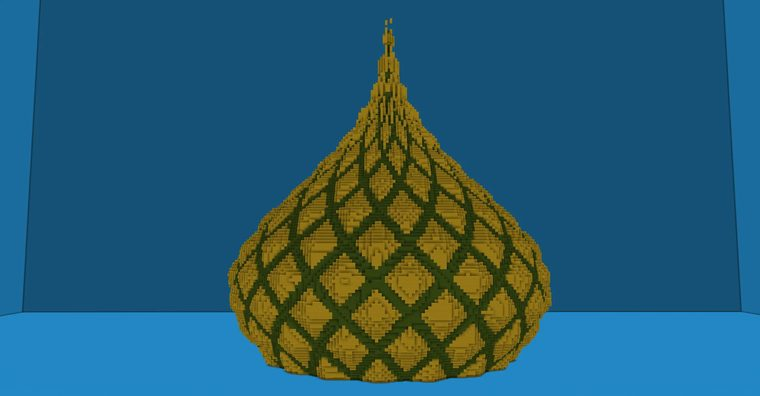
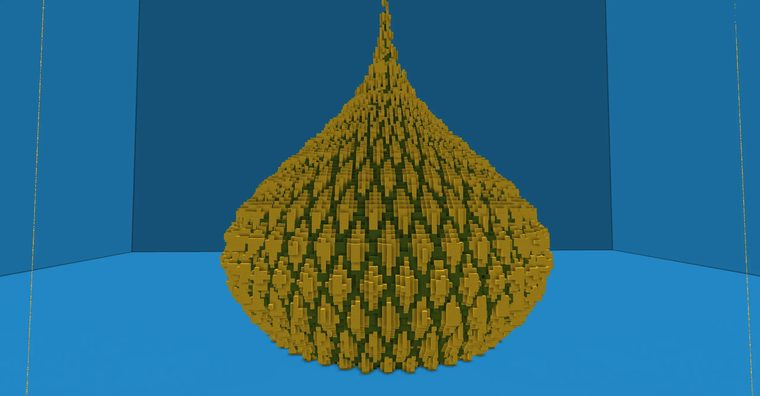
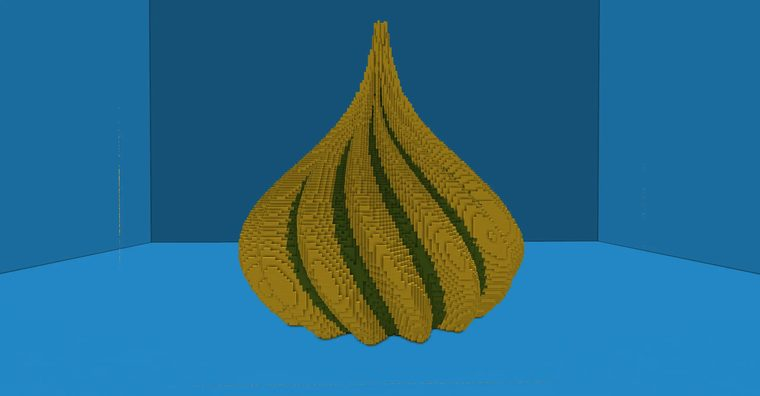

# 【Minecraft】worldedit|generate洋葱顶进阶及上色办法|包含data/type、atan2、min

> 作者：**imhols**（UID 632698683） · 2022年10月25日 · 类型：`DYNAMIC_TYPE_ARTICLE` · [原动态](https://www.bilibili.com/opus/720932083546980470)

**WorldEdit / 程序化建模相关**

## 动态内容

成品如下
[图片]
//generate 35 G=min(sin(18*atan2(x,z)+20*(y+1)),sin(18*atan2(x,z)-20*(y+1)));data=(G>(-0.7))?4:13;i=sqrt(x^2+z^2);k=0.9;a=6.5;b=0.9;m=0.6;i<k*a^(-b*(y+m)^2)+0.02*G
之前在视频里演示的不是很详细，这次将其进行了改进
【Minecraft】生成俄罗斯洋葱式圆顶（自制）generate教程#1
...

## 图片







## 指令

```text
//generate 35 G=min(sin(18*atan2(x,z)+20*(y+1)),sin(18*atan2(x,z)-20*(y+1)));data=(G>(-0.7))?4:13;i=sqrt(x^2+z^2);k=0.9;a=6.5;b=0.9;m=0.6;i<k*a^(-b*(y+m)^2)+0.02*G
```

---

内容与图片版权归 **imhols** 所有；本页为作品集索引。
