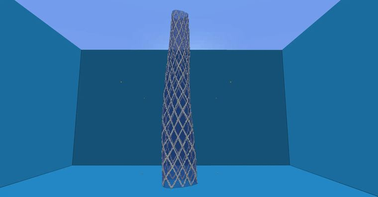
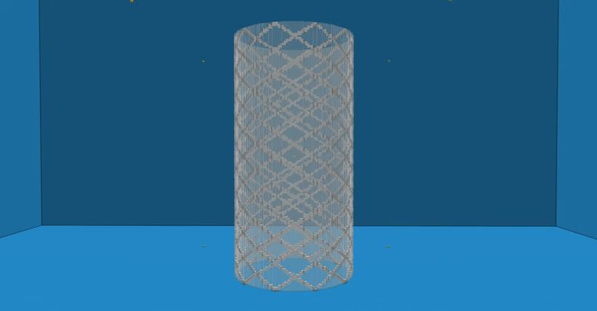

# 【Minecraft】worldedit|generate 角度+求余=生成网状支撑结构？

> 作者：**imhols**（UID 632698683） · 2022年11月8日 · 类型：`DYNAMIC_TYPE_ARTICLE` · [原动态](https://www.bilibili.com/opus/725845620621836321)

**WorldEdit / 程序化建模相关**

## 动态内容

成品
[图片]
//generate 35 -h A=(atan2(x,z)+pi)/pi;type=((((A+(1+y))*40)%8<1)||(((A+(1-y))*40)%8<1))?35:95;x^2+z^2<0.5^2
求余很好理解，就是一个除数一个被除数，求出余数，比如5%3=2，如果放入到we中，可以用在判断语句中，比如在表达式蒙版中，如果要做出相隔a距离（这里指的是空白区域）的且有b宽度的格栅的图案就可以用 //re =x%(a+b)<b 1 来实现，如图
...

## 图片





## 指令

```text
//generate 35 -h A=(atan2(x,z)+pi)/pi;type=((((A+(1+y))*40)%8<1)||(((A+(1-y))*40)%8<1))?35:95;x^2+z^2<0.5^2
//re =x%(a+b)<b 1 来实现，如图
```

---

内容与图片版权归 **imhols** 所有；本页为作品集索引。
