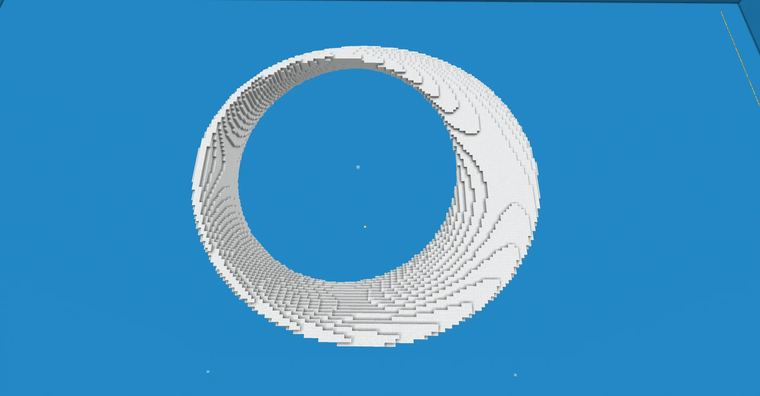

# 【Minecraft】worldedit|generate 莫比乌斯旋转模型

> 作者：**imhols**（UID 632698683） · 2022年11月12日 · 类型：`DYNAMIC_TYPE_ARTICLE` · [原动态](https://www.bilibili.com/opus/727603499190190217)

**WorldEdit / 程序化建模相关**

## 动态内容

成品
[图片]
//generate 35 a=atan2(x,z)*2;x1=sqrt(x^2+z^2)-0.7;X=x1*cos(a)-y*sin(a);Y=x1*sin(a)+y*cos(a);data=(X0?1:2):(Y<0?3:4);(abs(X)-0.1)^2+(abs(Y)-0.1)^2<0.1^2
[图片]
//generate 35 a=atan2(x,z)/2;x1=sqrt(x^2+(z)^2)-0.7;X=x1*cos(a)-y*sin(a);Y=x1*sin(a)+y*cos(a);(X)^2+15*Y^2<0.2^2
...

## 图片




## 指令

```text
//generate 35 a=atan2(x,z)*2;x1=sqrt(x^2+z^2)-0.7;X=x1*cos(a)-y*sin(a);Y=x1*sin(a)+y*cos(a);data=(X0?1:2):(Y<0?3:4);(abs(X)-0.1)^2+(abs(Y)-0.1)^2<0.1^2
//generate 35 a=atan2(x,z)/2;x1=sqrt(x^2+(z)^2)-0.7;X=x1*cos(a)-y*sin(a);Y=x1*sin(a)+y*cos(a);(X)^2+15*Y^2<0.2^2
```

---

内容与图片版权归 **imhols** 所有；本页为作品集索引。
