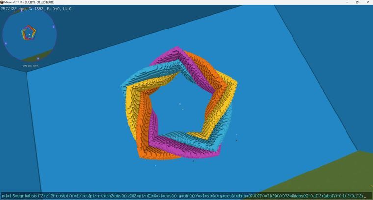

# 正多边形+莫比乌斯环  //generate 35 a=atan2(x,z)*2;n=5;x1=1.5*sqrt(abs(x)^2+z^2)-cos(pi/n)

> 作者：**imhols**（UID 632698683） · 2022年11月24日 · 类型：`DYNAMIC_TYPE_DRAW` · [原动态](https://www.bilibili.com/opus/732060756134068247)

**WorldEdit / 程序化建模相关**

## 动态内容

正多边形+莫比乌斯环  //generate 35 a=atan2(x,z)*2;n=5;x1=1.5*sqrt(abs(x)^2+z^2)-cos(pi/n)*(1/cos(pi/n-(atan2(abs(x),z)%(2*pi/n))));X=x1*cos(a)-y*sin(a);Y=x1*sin(a)+y*cos(a);data=(X0?1:2):(Y<0?3:4);(abs(X)-0.1)^2+(abs(Y)-0.1)^2<0.1^2


## 图片



## 指令

```text
//generate 35 a=atan2(x,z)*2;n=5;x1=1.5*sqrt(abs(x)^2+z^2)-cos(pi/n)*(1/cos(pi/n-(atan2(abs(x),z)%(2*pi/n))));X=x1*cos(a)-y*sin(a);Y=x1*sin(a)+y*cos(a);data=(X0?1:2):(Y<0?3:4);(abs(X)-0.1)^2+(abs(Y)-0.1)^2<0.1^2
```

---

内容与图片版权归 **imhols** 所有；本页为作品集索引。
