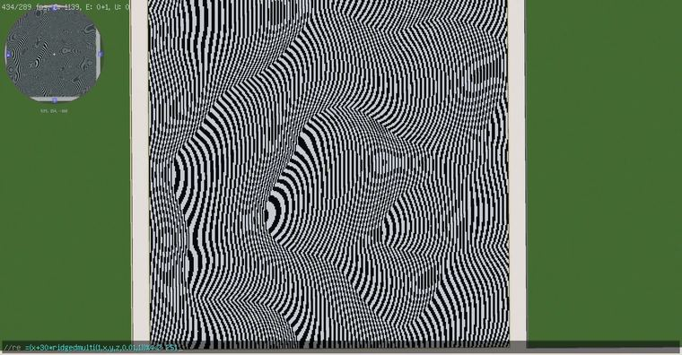
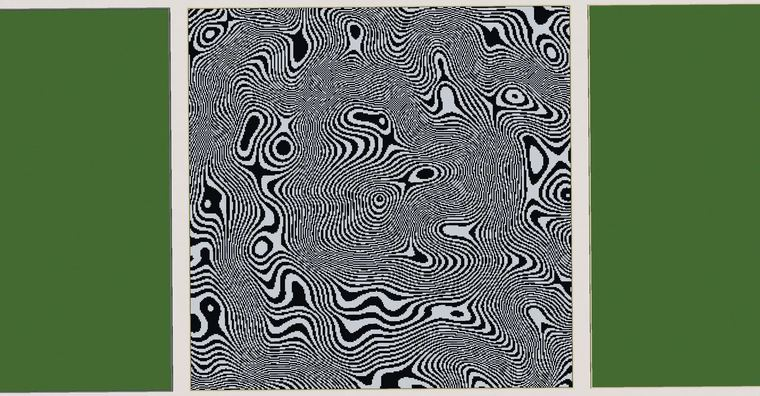

# 【Minecraft】worldedit|表达式蒙版 噪声+条纹=人造摩尔纹？

> 作者：**imhols**（UID 632698683） · 2022年11月27日 · 类型：`DYNAMIC_TYPE_ARTICLE` · [原动态](https://www.bilibili.com/opus/733181734006292530)

**WorldEdit / 程序化建模相关**

## 动态内容

成品
[图片]
//re =(x+50*perlin(1,x,y,z,0.02,1,1))%10<5 251
[图片]
//re =x-=528;z-=-176;(sqrt(x^2+z^2)+80*perlin(1,x,y,z,0.02,1,1))%4<2 hand
表达式蒙版里使用的是世界坐标，在之前的专栏里也提到过求余的操作，可以先看一下这一篇
【Minecraft】worldedit|generate 角度+求余=生成网状支撑结构？
...

## 图片





## 指令

```text
//re =(x+50*perlin(1,x,y,z,0.02,1,1))%10<5 251
//re =x-=528;z-=-176;(sqrt(x^2+z^2)+80*perlin(1,x,y,z,0.02,1,1))%4<2 hand
```

---

内容与图片版权归 **imhols** 所有；本页为作品集索引。
