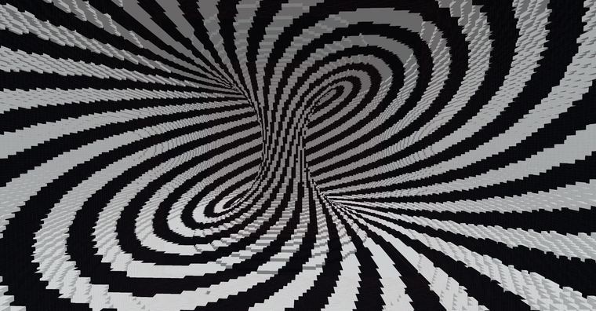

# 视错觉  角度求余+莫比乌斯环   //generate 251 -h a=atan2(x,z);x1=sqrt(x^2+(z)^2)-0.5;X=x1*cos

> 作者：**imhols**（UID 632698683） · 2022年11月29日 · 类型：`DYNAMIC_TYPE_DRAW` · [原动态](https://www.bilibili.com/opus/733837085880877081)

**WorldEdit / 程序化建模相关**

## 动态内容

视错觉  角度求余+莫比乌斯环   //generate 251 -h a=atan2(x,z);x1=sqrt(x^2+(z)^2)-0.5;X=x1*cos(a)-y*sin(a);Y=x1*sin(a)+y*cos(a);data=((18*(atan2(X,Y)+pi)/pi)%2<1)?0:15;(X)^2+Y^2<0.4^2


## 图片



## 指令

```text
//generate 251 -h a=atan2(x,z);x1=sqrt(x^2+(z)^2)-0.5;X=x1*cos(a)-y*sin(a);Y=x1*sin(a)+y*cos(a);data=((18*(atan2(X,Y)+pi)/pi)%2<1)?0:15;(X)^2+Y^2<0.4^2
```

---

内容与图片版权归 **imhols** 所有；本页为作品集索引。
