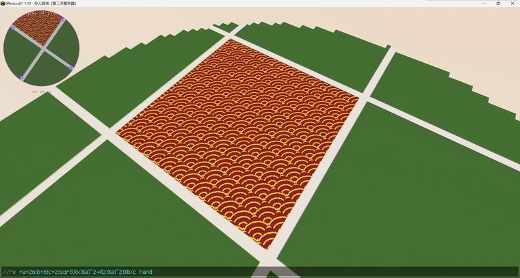

# 祥云 有瑕​  //re =a=26;b=8;c=2;sqrt(((x)%a)^2+((z)%a)^2)%b<c 41

> 作者：**imhols**（UID 632698683） · 2022年11月29日 · 类型：`DYNAMIC_TYPE_DRAW` · [原动态](https://www.bilibili.com/opus/733932468506198017)

**WorldEdit / 程序化建模相关**

## 动态内容

祥云 有瑕​  //re =a=26;b=8;c=2;sqrt(((x)%a)^2+((z)%a)^2)%b<c 41


## 图片



## 指令

```text
//re =a=26;b=8;c=2;sqrt(((x)%a)^2+((z)%a)^2)%b<c 41
```

---

内容与图片版权归 **imhols** 所有；本页为作品集索引。
