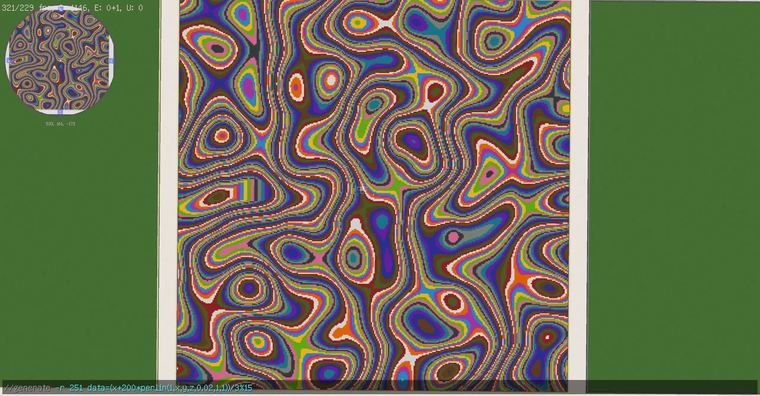

# 油污   //generate -r 251 data=(x+200*perlin(1,x,y,z,0.02,1,1))/3%15

> 作者：**imhols**（UID 632698683） · 2022年11月30日 · 类型：`DYNAMIC_TYPE_DRAW` · [原动态](https://www.bilibili.com/opus/734357575792853081)

**WorldEdit / 程序化建模相关**

## 动态内容

油污   //generate -r 251 data=(x+200*perlin(1,x,y,z,0.02,1,1))/3%15


## 图片



## 指令

```text
//generate -r 251 data=(x+200*perlin(1,x,y,z,0.02,1,1))/3%15
```

---

内容与图片版权归 **imhols** 所有；本页为作品集索引。
