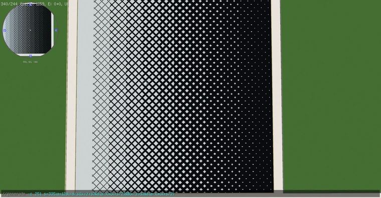
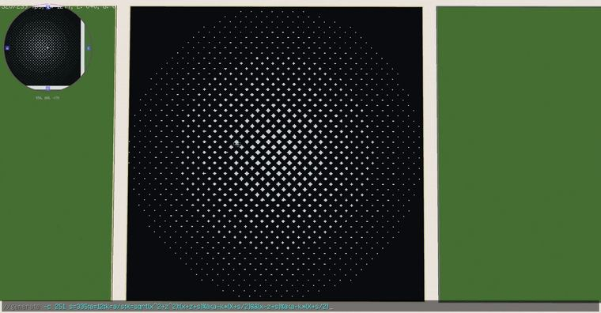

# 轴向菱形渐变 ：  //generate -c 251 s=201;a=12;k=a/s;(x+z+s)%a<a-k*(x+s/2)&&(x-z+s)%a<a-

> 作者：**imhols**（UID 632698683） · 2022年12月2日 · 类型：`DYNAMIC_TYPE_DRAW` · [原动态](https://www.bilibili.com/opus/734996830115332167)

**WorldEdit / 程序化建模相关**

## 动态内容

轴向菱形渐变 ：  //generate -c 251 s=201;a=12;k=a/s;(x+z+s)%a<a-k*(x+s/2)&&(x-z+s)%a<a-k*(x+s/2)  s为选区内要渐变方向的大小（这里为x轴方向）； a控制密度； k为a/s时渐变填满s大小的区域   拓展：径向菱形渐变：  //generate -c 251 s=335;a=12;k=a/s;X=sqrt(x^2+z^2);(x+z+s)%a<a-k*(X+s/2)&&(x-z+s)%a<a-k*(X+s/2)   


## 图片





## 指令

```text
//generate -c 251 s=201;a=12;k=a/s;(x+z+s)%a<a-k*(x+s/2)&&(x-z+s)%a<a-k*(x+s/2) s为选区内要渐变方向的大小（这里为x轴方向）； a控制密度； k为a/s时渐变填满s大小的区域 拓展：径向菱形渐变： //generate -c 251 s=335;a=12;k=a/s;X=sqrt(x^2+z^2);(x+z+s)%a<a-k*(X+s/2)&&(x-z+s)%a<a-k*(X+s/2)
```

---

内容与图片版权归 **imhols** 所有；本页为作品集索引。
