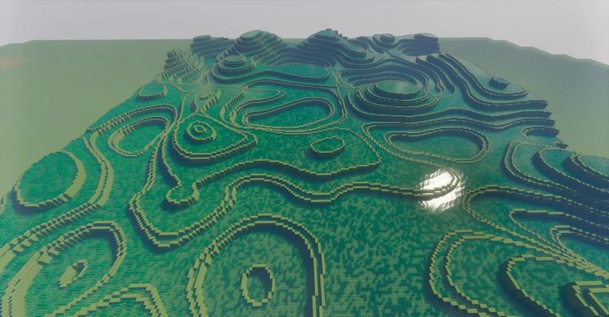

# 梯田    generate+smear+deform+replace    size:301× 51×301    //generate 251 -c (y+

> 作者：**imhols**（UID 632698683） · 2022年12月5日 · 类型：`DYNAMIC_TYPE_DRAW` · [原动态](https://www.bilibili.com/opus/736194700784959509)

**WorldEdit / 程序化建模相关**

## 动态内容

梯田    generate+smear+deform+replace    size:301× 51×301    //generate 251 -c (y+25)%5<2&&(y+25)<50*perlin(1,x,1,z,0.02,1,1)   //smear 3 d   //deform -c y*=1.5;y+=51*(1-1/1.5)   //re "~[0][1] 251 <0" 9   ....


## 图片



## 指令

```text
//generate 251 -c (y+25)%5<2&&(y+25)<50*perlin(1,x,1,z,0.02,1,1) //smear 3 d //deform -c y*=1.5;y+=51*(1-1/1.5) //re "~[0][1] 251 <0" 9 ....
```

---

内容与图片版权归 **imhols** 所有；本页为作品集索引。
