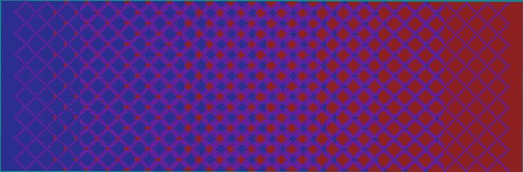

# 蓝->紫<-红  size:199,1,65  //generate -c 251:11 s=199;a=8;k=a/s;(x+z+s+2)%a<a-k*(x+

> 作者：**imhols**（UID 632698683） · 2022年12月8日 · 类型：`DYNAMIC_TYPE_DRAW` · [原动态](https://www.bilibili.com/opus/737338721163018272)

**WorldEdit / 程序化建模相关**

## 动态内容

蓝->紫<-红  size:199,1,65  //generate -c 251:11 s=199;a=8;k=a/s;(x+z+s+2)%a<a-k*(x+20+s/2)&&(x-z+s+2)%a<a-k*(x+20+s/2)   //generate -c 25:14 x=-x;z-=4;s=199;a=8;k=a/s;(x+z+s+2)%a<a-k*(x+20+s/2)&&(x-z+s+2)%a<a-k*(x+20+s/2)


## 图片



## 指令

```text
//generate -c 251:11 s=199;a=8;k=a/s;(x+z+s+2)%a<a-k*(x+20+s/2)&&(x-z+s+2)%a<a-k*(x+20+s/2) //generate -c 25:14 x=-x;z-=4;s=199;a=8;k=a/s;(x+z+s+2)%a<a-k*(x+20+s/2)&&(x-z+s+2)%a<a-k*(x+20+s/2)
```

---

内容与图片版权归 **imhols** 所有；本页为作品集索引。
