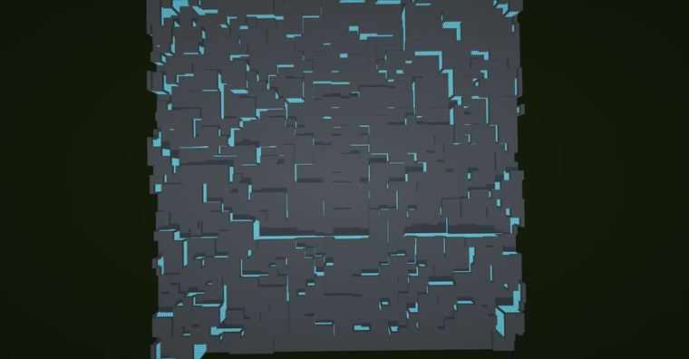
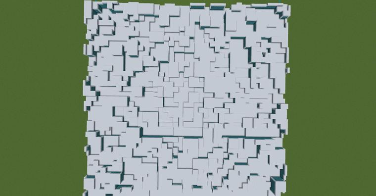

# 科幻​  （使用光影更佳）  size:199,50,199  //generate 251 y+0.5<0.5*voronoi(1,x,1,z,50)  //

> 作者：**imhols**（UID 632698683） · 2022年12月10日 · 类型：`DYNAMIC_TYPE_DRAW` · [原动态](https://www.bilibili.com/opus/738052763786674273)

**WorldEdit / 程序化建模相关**

## 动态内容

科幻​  （使用光影更佳）  size:199,50,199  //generate 251 y+0.5<0.5*voronoi(1,x,1,z,50)  //deform -c x/=5;z/=5;y*=2;y+=50*(1-1/2)  //re "~[0][1] <251" 244


## 图片





## 指令

```text
//generate 251 y+0.5<0.5*voronoi(1,x,1,z,50) //deform -c x/=5;z/=5;y*=2;y+=50*(1-1/2) //re "~[0][1] <251" 244
```

---

内容与图片版权归 **imhols** 所有；本页为作品集索引。
