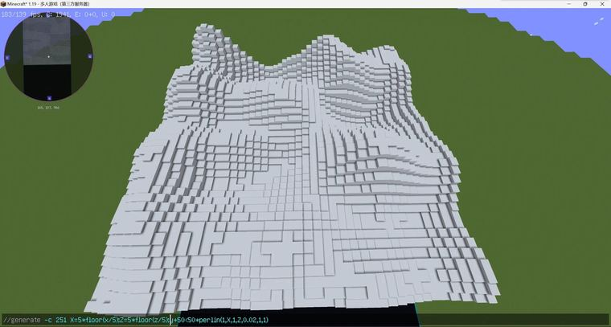
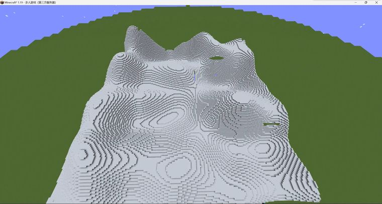

# 再次体素化   //generate -c 251 X=5*floor(x/5);Z=5*floor(z/5);y+50<50*perlin(1,X,1,Z,0

> 作者：**imhols**（UID 632698683） · 2022年12月11日 · 类型：`DYNAMIC_TYPE_DRAW` · [原动态](https://www.bilibili.com/opus/738443223551180804)

**WorldEdit / 程序化建模相关**

## 动态内容

再次体素化   //generate -c 251 X=5*floor(x/5);Z=5*floor(z/5);y+50<50*perlin(1,X,1,Z,0.02,1,1)  


## 图片





## 指令

```text
//generate -c 251 X=5*floor(x/5);Z=5*floor(z/5);y+50<50*perlin(1,X,1,Z,0.02,1,1)
```

---

内容与图片版权归 **imhols** 所有；本页为作品集索引。
