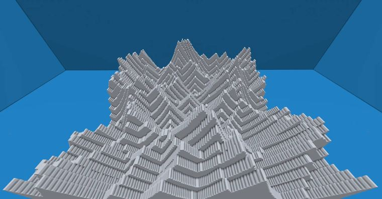
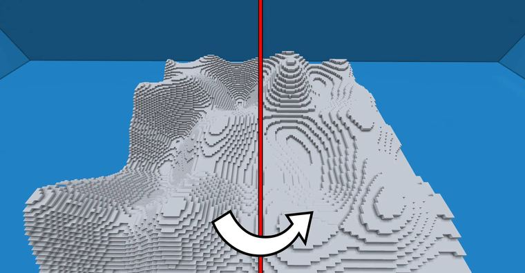

# 【Minecraft】worldedit|deform&generate 利用floor函数实现“二次体素化”

> 作者：**imhols**（UID 632698683） · 2022年12月12日 · 类型：`DYNAMIC_TYPE_ARTICLE` · [原动态](https://www.bilibili.com/opus/738700651006001202)

**WorldEdit / 程序化建模相关**

## 动态内容

成品
[图片]
//deform -c x=3*floor(x/3);z=3*floor(z/3);y=3*floor(y/3)
[图片]
//generate -c 251 X=3*floor(x/3);Z=3*floor(z/3);y+60<40*perlin(1,x,1,z,0.03,1,1)
[图片]
//generate -c 251 Y=2*floor(y/2);Y+60<40*perlin(1,x,1,z,0.03,1,1)
...

## 图片





## 指令

```text
//deform -c x=3*floor(x/3);z=3*floor(z/3);y=3*floor(y/3)
//generate -c 251 X=3*floor(x/3);Z=3*floor(z/3);y+60<40*perlin(1,x,1,z,0.03,1,1)
//generate -c 251 Y=2*floor(y/2);Y+60<40*perlin(1,x,1,z,0.03,1,1)
```

---

内容与图片版权归 **imhols** 所有；本页为作品集索引。
