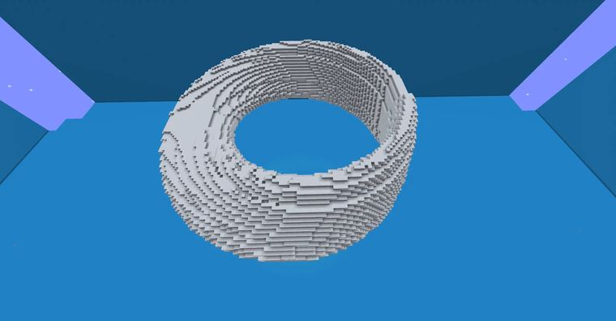
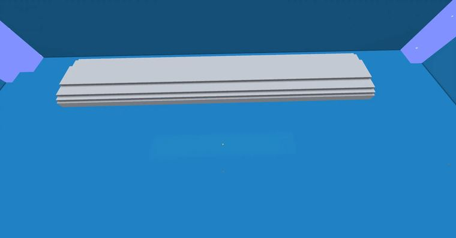

# deform实现选区里的莫比乌斯环的变换   注： 原形状为沿着z轴的形状，即图2的圆柱的中心轴为z轴方向 选区为正方体 r为旋转的半径，保证选区里的形状的宽度

> 作者：**imhols**（UID 632698683） · 2022年12月13日 · 类型：`DYNAMIC_TYPE_DRAW` · [原动态](https://www.bilibili.com/opus/739160891123040258)

**WorldEdit / 程序化建模相关**

## 动态内容

deform实现选区里的莫比乌斯环的变换   注： 原形状为沿着z轴的形状，即图2的圆柱的中心轴为z轴方向 选区为正方体 r为旋转的半径，保证选区里的形状的宽度的一半加半径不超选区边长的一半，不然会超出选区 生成的形状较粗糙 具体还请看之前的专栏  //deform -c r=40;a=atan2(x,z)/2;x=sqrt(x^2+z^2)-r;Y=x*sin(a)+y*cos(a);X=x*cos(a)-y*sin(a);swap(X,x);swap(Y,y)  


## 图片





## 指令

```text
//deform -c r=40;a=atan2(x,z)/2;x=sqrt(x^2+z^2)-r;Y=x*sin(a)+y*cos(a);X=x*cos(a)-y*sin(a);swap(X,x);swap(Y,y)
```

---

内容与图片版权归 **imhols** 所有；本页为作品集索引。
