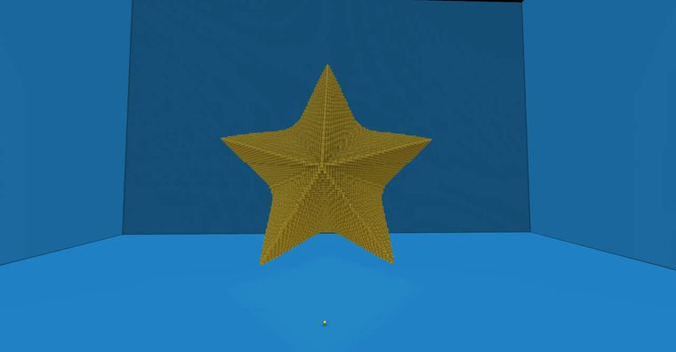

# 五角星

> 作者：**imhols**（UID 632698683） · 2022年12月14日 · 类型：`DYNAMIC_TYPE_DRAW` · [原动态](https://www.bilibili.com/opus/739563484196372499)

**WorldEdit / 程序化建模相关**

## 动态内容

五角星

在多边形的基础上做点改变，详情见专栏

//generate 41 b=1.5;L=1-abs(z);x/=L;y/=L;X=abs(x);n=5;sqrt(x^2+y^2)<(1+b)*cos(pi/n)/cos(pi/n-(atan2(X,y)%(2*pi/n)))-b


## 图片



## 指令

```text
//generate 41 b=1.5;L=1-abs(z);x/=L;y/=L;X=abs(x);n=5;sqrt(x^2+y^2)<(1+b)*cos(pi/n)/cos(pi/n-(atan2(X,y)%(2*pi/n)))-b
```

---

内容与图片版权归 **imhols** 所有；本页为作品集索引。
