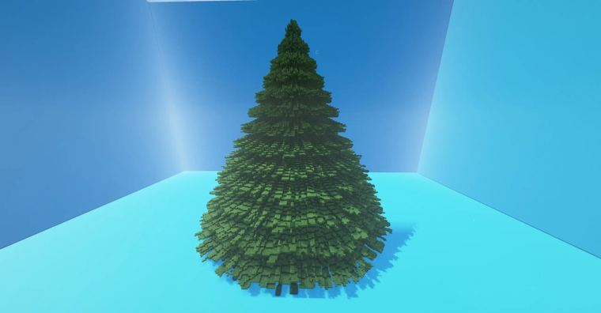

# 圣诞树

> 作者：**imhols**（UID 632698683） · 2022年12月17日 · 类型：`DYNAMIC_TYPE_DRAW` · [原动态](https://www.bilibili.com/opus/740625191509426263)

**WorldEdit / 程序化建模相关**

## 动态内容

圣诞树

desmos模拟
https://www.desmos.com/calculator/oc6pihbr6n?lang=zh-CN 

//generate 18:1 y+=0.08*(voronoi(1,x,5*atan2(x,z),z,5)-1);c=3.1;a=0.15;n=0.2;c*((1-y)%a)*sqrt(x^2+z^2)-n*(y-1)>sqrt(x^2+z^2)


## 图片



## 指令

```text
//generate 18:1 y+=0.08*(voronoi(1,x,5*atan2(x,z),z,5)-1);c=3.1;a=0.15;n=0.2;c*((1-y)%a)*sqrt(x^2+z^2)-n*(y-1)>sqrt(x^2+z^2)
```

---

内容与图片版权归 **imhols** 所有；本页为作品集索引。
