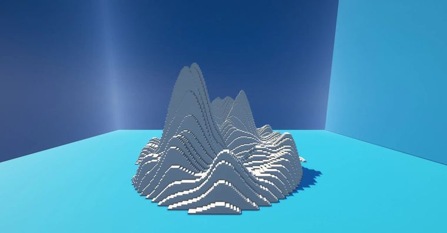
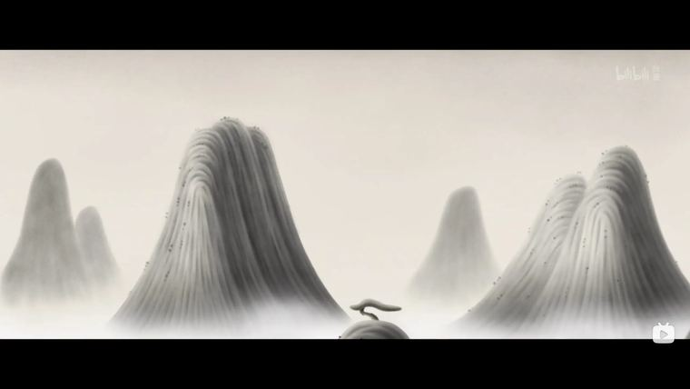

# 山

> 作者：**imhols**（UID 632698683） · 2023年1月5日 · 类型：`DYNAMIC_TYPE_DRAW` · [原动态](https://www.bilibili.com/opus/747655863994417236)

**WorldEdit / 程序化建模相关**

## 动态内容

山

看《中国奇谭》来的灵感，简单尝试一下
两个噪声相乘叠加，再与一个梯台相乘叠加达到淡出边缘的效果

//generate 251 y+1<2*perlin(23,x*2,1,z,3,1,1)*(perlin(2,x,1,z,2,1,1)-0.2)*(1-sqrt(x^2+z^2)^8) 

//deform -c x=3*floor(x/3);


## 图片





## 指令

```text
//generate 251 y+1<2*perlin(23,x*2,1,z,3,1,1)*(perlin(2,x,1,z,2,1,1)-0.2)*(1-sqrt(x^2+z^2)^8)
//deform -c x=3*floor(x/3);
```

---

内容与图片版权归 **imhols** 所有；本页为作品集索引。
