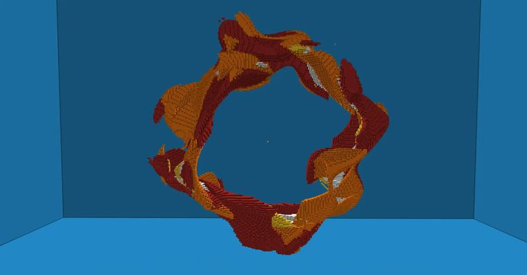

# 火环

> 作者：**imhols**（UID 632698683） · 2023年1月6日 · 类型：`DYNAMIC_TYPE_DRAW` · [原动态](https://www.bilibili.com/opus/747746603766382611)

**WorldEdit / 程序化建模相关**

## 动态内容

火环

基础圆环，环半径R加perlin噪声形成不规则的外形，为使不被rotate()影响，在perlin噪声定义后再旋转rotate(),接着再定义voronoi噪声，用voronoi噪声作为圆环的小半径r形成不规则的火焰效果

//generate 251 R=0.85;r=0.15;k=0.5;p=perlin(1,x,y,z,2.5,1,1);rotate(z,y,x*pi);v=2*voronoi(1,x,y,z,6)-1;data=(4*(v+1)/2)%4;(sqrt(z^2+y^2)-(R-k)-k*p)^2+(x/2)^2<(r*v)^2


## 图片



## 指令

```text
//generate 251 R=0.85;r=0.15;k=0.5;p=perlin(1,x,y,z,2.5,1,1);rotate(z,y,x*pi);v=2*voronoi(1,x,y,z,6)-1;data=(4*(v+1)/2)%4;(sqrt(z^2+y^2)-(R-k)-k*p)^2+(x/2)^2<(r*v)^2
```

---

内容与图片版权归 **imhols** 所有；本页为作品集索引。
