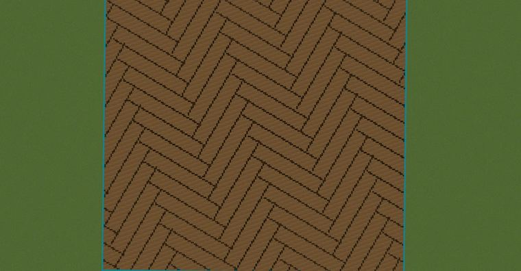
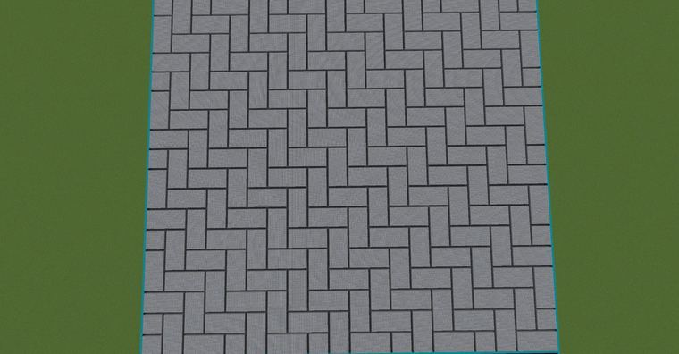
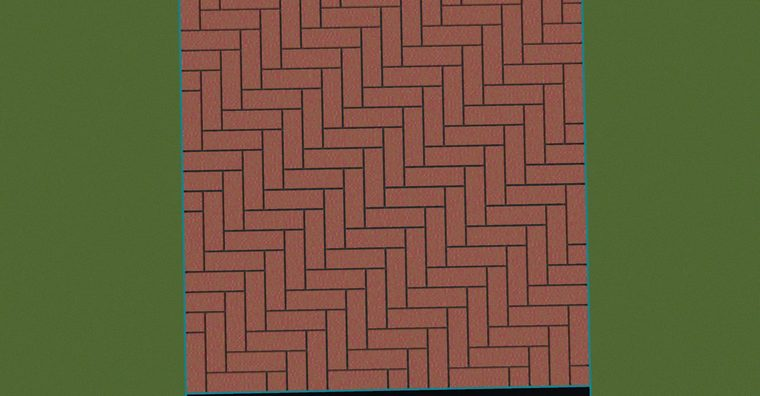

# 鱼脊地板（Herringbone Flooring）

> 作者：**imhols**（UID 632698683） · 2023年1月8日 · 类型：`DYNAMIC_TYPE_DRAW` · [原动态](https://www.bilibili.com/opus/748777202658574371)

**WorldEdit / 程序化建模相关**

## 动态内容

鱼脊地板（Herringbone Flooring）

旋转在最前面加个rotate()函数，比如 rotate(x,z,pi/3)；s越大越好，最好大于选区边长，目的是把被除数调成正数；a为宽度；k为长宽比

图1 ：//generate 1 -c rotate(x,z,pi/3);s=500;k=5;a=10;(x+s)%a((k-1)*a)||(z+s)%a((k-1)*a)||(z+s)%a((k-1)*a)||(z+s)%a<1&&(z+x+2*s)%(2*k*a)<((k+1)*a)


## 图片







## 指令

```text
//generate 1 -c rotate(x,z,pi/3);s=500;k=5;a=10;(x+s)%a((k-1)*a)||(z+s)%a((k-1)*a)||(z+s)%a((k-1)*a)||(z+s)%a<1&&(z+x+2*s)%(2*k*a)<((k+1)*a)
```

---

内容与图片版权归 **imhols** 所有；本页为作品集索引。
