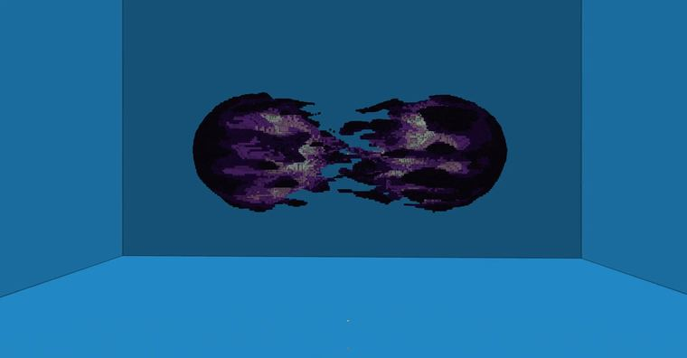

# 融球

> 作者：**imhols**（UID 632698683） · 2023年1月9日 · 类型：`DYNAMIC_TYPE_DRAW` · [原动态](https://www.bilibili.com/opus/748870661133303809)

**WorldEdit / 程序化建模相关**

## 动态内容

融球

abs(z)-1)^2 限定噪声的值，z=0时为1达到最大，perlin()里的z用z/3代替，在z方向上拉伸；
部分函数图像：https://www.desmos.com/calculator/pnsytkbwll?lang=zh-CN 

//generate 251 p=(abs(z)-1)^2*perlin(1,x,y,z/3,10,2,1);data=15*p%15;((z+0.6)^2+x^2+y^2)*((z-0.6)^2+x^2+y^2)<(0.65-0.3*p)^4


## 图片



## 指令

```text
//generate 251 p=(abs(z)-1)^2*perlin(1,x,y,z/3,10,2,1);data=15*p%15;((z+0.6)^2+x^2+y^2)*((z-0.6)^2+x^2+y^2)<(0.65-0.3*p)^4
```

---

内容与图片版权归 **imhols** 所有；本页为作品集索引。
