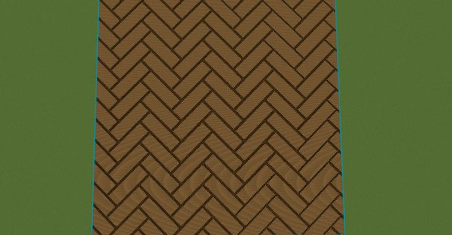

# 鱼脊地板​

> 作者：**imhols**（UID 632698683） · 2023年1月10日 · 类型：`DYNAMIC_TYPE_DRAW` · [原动态](https://www.bilibili.com/opus/749254158772600867)

**WorldEdit / 程序化建模相关**

## 动态内容

鱼脊地板​

对应之前的动态，修改了一下主体部分，并支持控制纹理宽度d，要求是d为a的 因数，这个限制应该无大碍，先这样用着吧，能用就行，安心睡觉[doge]

//generate 0 -c rotate(x,z,pi/4);d=2;a=10;k=3;s=500;a=(a+d)/d;x=floor(x/d);z=floor(z/d);(x+s)%a<1&&(x+z+2*s+a*k)%(2*k*a)<((k+1)*a)||(z+s)%a<1&&(z+x+2*s)%(2*k*a)<((k+1)*a)


## 图片



## 指令

```text
//generate 0 -c rotate(x,z,pi/4);d=2;a=10;k=3;s=500;a=(a+d)/d;x=floor(x/d);z=floor(z/d);(x+s)%a<1&&(x+z+2*s+a*k)%(2*k*a)<((k+1)*a)||(z+s)%a<1&&(z+x+2*s)%(2*k*a)<((k+1)*a)
```

---

内容与图片版权归 **imhols** 所有；本页为作品集索引。
