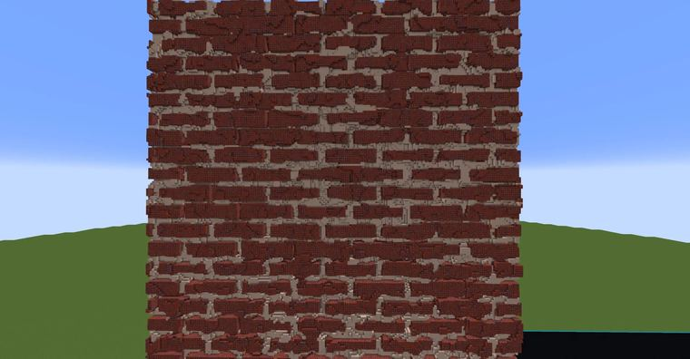

# 破损砖墙

> 作者：**imhols**（UID 632698683） · 2023年1月25日 · 类型：`DYNAMIC_TYPE_DRAW` · [原动态](https://www.bilibili.com/opus/755102641513562116)

**WorldEdit / 程序化建模相关**

## 动态内容

破损砖墙

未加噪声：
//generate 251 -c a=15;b=10;d=1;s=500;x+=s;z+=s;y+=s;Ly=y;Lz=(z+a*floor(y/b));(Lz%(2*a))(2*a-f)||Ly%b>(b-f)

稍微说明一下吧，a,b控制砖的长宽；d控制纹理的基础宽度；k控制噪声的幅值；c为一个0到1的数，控制纹理的显示程度，越大越少；s使被除数为正，大于选区边长一半，越大越好
如果想换方向可以在式子最前面加个swap()，如swap(z,y)就是把y与z调换，纹理就成了水平的地砖，也可以再swap(x,z)x与z调换；当然也可以用rotate()

附加：
//gmask 251
//deform -c x/=1-0.3*perlin(1,x,y,z,0.1,2,1)
//gmask !251
//deform -c x/=1-0.1*perlin(2,x,y,z,0.1,2,1)


## 图片



## 指令

```text
//generate 251 -c a=15;b=10;d=1;s=500;x+=s;z+=s;y+=s;Ly=y;Lz=(z+a*floor(y/b));(Lz%(2*a))(2*a-f)||Ly%b>(b-f)
//deform -c x/=1-0.3*perlin(1,x,y,z,0.1,2,1)
//deform -c x/=1-0.1*perlin(2,x,y,z,0.1,2,1)
```

---

内容与图片版权归 **imhols** 所有；本页为作品集索引。
