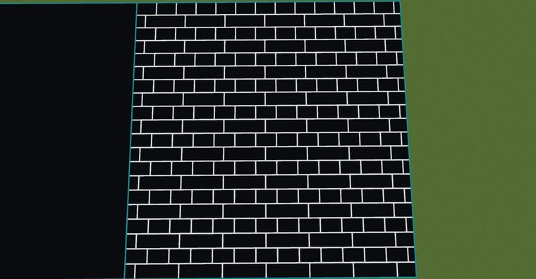
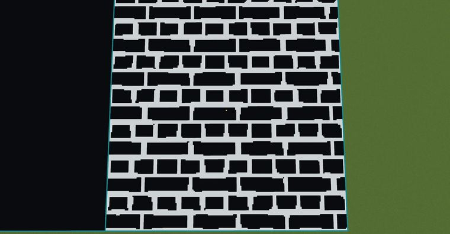

# 砖块纹理2

> 作者：**imhols**（UID 632698683） · 2023年1月28日 · 类型：`DYNAMIC_TYPE_DRAW` · [原动态](https://www.bilibili.com/opus/756199631990292521)

**WorldEdit / 程序化建模相关**

## 动态内容

砖块纹理2

未加噪声：//generate 251 -c s=200;z+=s;x+=s;a=10;b=15;d=1;(x%(2*a)(b-f)):((z+b/2)%(2*b)(2*b-f)))||(x%a(a-f))


## 图片





## 指令

```text
//generate 251 -c s=200;z+=s;x+=s;a=10;b=15;d=1;(x%(2*a)(b-f)):((z+b/2)%(2*b)(2*b-f)))||(x%a(a-f))
```

---

内容与图片版权归 **imhols** 所有；本页为作品集索引。
