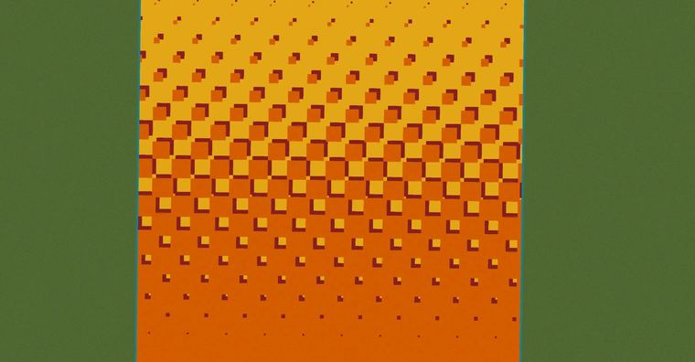

# 棋盘渐变

> 作者：**imhols**（UID 632698683） · 2023年1月31日 · 类型：`DYNAMIC_TYPE_DRAW` · [原动态](https://www.bilibili.com/opus/757314648454201385)

**WorldEdit / 程序化建模相关**

## 动态内容

棋盘渐变

a为中心初始方形的边长，s为选区边长一半，指最长边的个长度的一半（如果你的选区为长方形的话），保证整个选区内都有效，k指的是在渐变方向上方形各边每次递进时缩进几格，当为s/a^2时占满选区，不管怎样，要满足a为s的因数，不然会对不齐

//generate 251:2 -c s=100;a=10;k=1;b=a-floor(x/a)*k;(x+s)%(2*a)<b&&(z+s)%(2*a)<b||(x+s+a)%(2*a)<b&&(z+s+a)%(2*a)<b


## 图片




## 指令

```text
//generate 251:2 -c s=100;a=10;k=1;b=a-floor(x/a)*k;(x+s)%(2*a)<b&&(z+s)%(2*a)<b||(x+s+a)%(2*a)<b&&(z+s+a)%(2*a)<b
```

---

内容与图片版权归 **imhols** 所有；本页为作品集索引。
