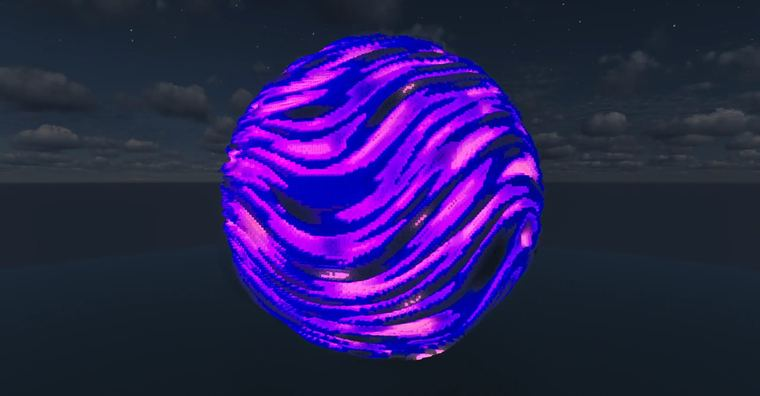

# 星球

> 作者：**imhols**（UID 632698683） · 2023年2月27日 · 类型：`DYNAMIC_TYPE_DRAW` · [原动态](https://www.bilibili.com/opus/767303355107115024)

**WorldEdit / 程序化建模相关**

## 动态内容

星球

嵌套噪声 先在p1里把y轴压缩（y*8），形成水平的条纹，再用另一个噪声p2，对其进行相加，使条纹不再只是水平
//generate 251 p2=perlin(1,x,y,z,1,1,1);p1=perlin(1,x,y*8+p2*5,z,3,1,1);data=p1*4%4;x^2+z^2+y^2<0.85+0.15*p1


## 图片



## 指令

```text
//generate 251 p2=perlin(1,x,y,z,1,1,1);p1=perlin(1,x,y*8+p2*5,z,3,1,1);data=p1*4%4;x^2+z^2+y^2<0.85+0.15*p1
```

---

内容与图片版权归 **imhols** 所有；本页为作品集索引。
