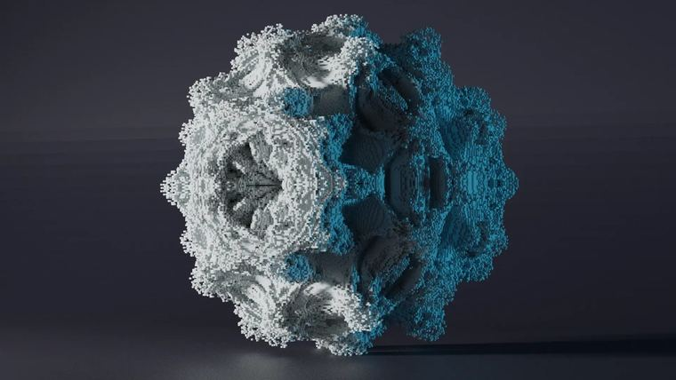
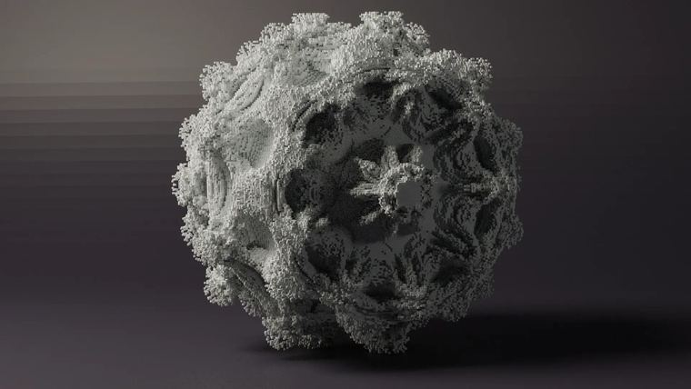

# 曼德尔球Mandelbulb

> 作者：**imhols**（UID 632698683） · 2023年3月1日 · 类型：`DYNAMIC_TYPE_DRAW` · [原动态](https://www.bilibili.com/opus/767788171043799105)

**WorldEdit / 程序化建模相关**

## 动态内容

曼德尔球Mandelbulb

//generate 251 n=8;a=0b=0c=0for(k=0,5){r=sqrt(a^2+b^2+c^2);p=atan2(a,b);t=atan2(sqrt(a^2+b^2),c);na=r^n*sin(n*t)*cos(n*p);nb=r^n*sin(n*t)*sin(n*p);nc=r^n*cos(n*t);a=na+x;b=nb+y;c=nc+z}r<1


## 图片





## 指令

```text
//generate 251 n=8;a=0b=0c=0for(k=0,5){r=sqrt(a^2+b^2+c^2);p=atan2(a,b);t=atan2(sqrt(a^2+b^2),c);na=r^n*sin(n*t)*cos(n*p);nb=r^n*sin(n*t)*sin(n*p);nc=r^n*cos(n*t);a=na+x;b=nb+y;c=nc+z}r<1
```

---

内容与图片版权归 **imhols** 所有；本页为作品集索引。
