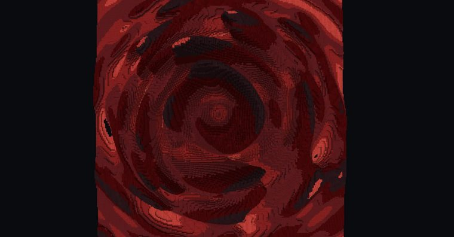

# 【Minecraft】worldedit|generate 探索神奇的噪声——从原理到应用

> 作者：**imhols**（UID 632698683） · 2023年3月15日 · 类型：`DYNAMIC_TYPE_ARTICLE` · [原动态](https://www.bilibili.com/opus/773117349286903808)

**WorldEdit / 程序化建模相关**

## 动态内容

本专栏教程旨在为mc玩家打开一扇新的大门，看完让你掌握噪声的原理和基础运用
[图片]
一、详解原理
1.1格式
[图片]
https://worldedit.enginehub.org/en/latest/usage/other/expressions/
我们现在先只拿perlin噪声作为例子，其中各个参数概念这里不做过多介绍，这里推荐蓝鸡的视频介绍
【创世神的64把木斧】#58 - 我于万物之中 [柏林噪声函数]
...

## 图片

---

内容与图片版权归 **imhols** 所有；本页为作品集索引。
