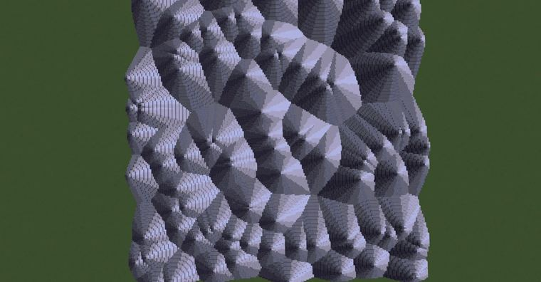
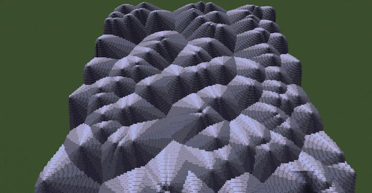

# Voronoi Mountain

> 作者：**imhols**（UID 632698683） · 2023年3月18日 · 类型：`DYNAMIC_TYPE_DRAW` · [原动态](https://www.bilibili.com/opus/774422684335341593)

**WorldEdit / 程序化建模相关**

## 动态内容

Voronoi Mountain

1,随机生成100组随机坐标
//calc n=100;for(i=0,255)for(j=0;jn*3){break;}gmegabuf(k,1-2*random());gmegabuf(k+2,1-2*random())}1

2，生成山，并按与最近点之间的角度取data
//generate 251 n=100;c=gclosest(x,y,z,0,n,3);a=x-gmegabuf(c);b=z-gmegabuf(c+2);data=(atan2(a,b)/pi+1)/2*16%16;y<1-5*sqrt(a^2+b^2)


## 图片





## 指令

```text
//calc n=100;for(i=0,255)for(j=0;jn*3){break;}gmegabuf(k,1-2*random());gmegabuf(k+2,1-2*random())}1
//generate 251 n=100;c=gclosest(x,y,z,0,n,3);a=x-gmegabuf(c);b=z-gmegabuf(c+2);data=(atan2(a,b)/pi+1)/2*16%16;y<1-5*sqrt(a^2+b^2)
```

---

内容与图片版权归 **imhols** 所有；本页为作品集索引。
