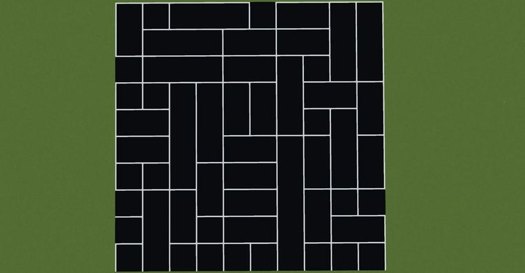
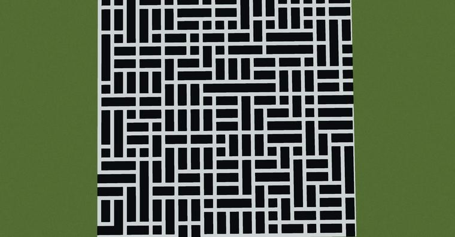
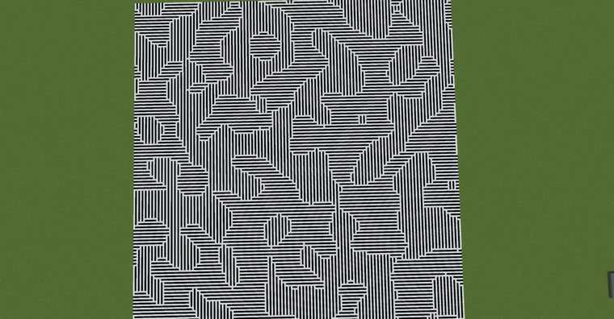
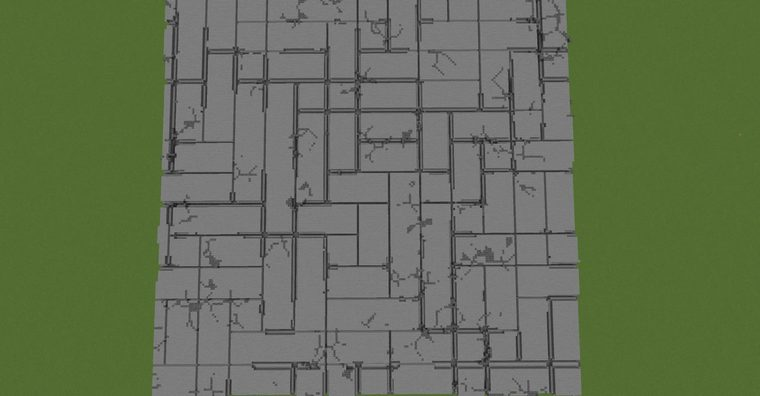

# 基于柏林噪声的随机矩形生成

> 作者：**imhols**（UID 632698683） · 2023年3月24日 · 类型：`DYNAMIC_TYPE_DRAW` · [原动态](https://www.bilibili.com/opus/776527166771822595)

**WorldEdit / 程序化建模相关**

## 动态内容


基于柏林噪声的随机矩形生成

//generate 251 -c f=0.05;a=10;c=2;S=1;s=500;x+=s;z+=s;X=floor(x/a)*a;Z=floor(z/a)*a;p=perlin(S,X,1,Z,f,1,1);pz=perlin(S,X,1,Z+a,f,1,1);px=perlin(S,X+a,1,Z,f,1,1);b=((pz0.5)||(p>0.5))?c:0;x%a<b||z%a<d 

f:频率a:网格基础边长c:线宽S:种子s：越大越好


## 图片









## 指令

```text
//generate 251 -c f=0.05;a=10;c=2;S=1;s=500;x+=s;z+=s;X=floor(x/a)*a;Z=floor(z/a)*a;p=perlin(S,X,1,Z,f,1,1);pz=perlin(S,X,1,Z+a,f,1,1);px=perlin(S,X+a,1,Z,f,1,1);b=((pz0.5)||(p>0.5))?c:0;x%a<b||z%a<d
```

---

内容与图片版权归 **imhols** 所有；本页为作品集索引。
