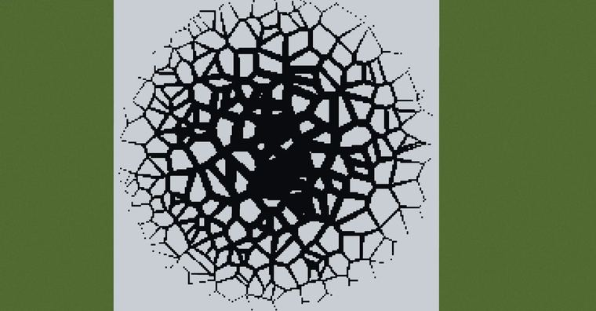
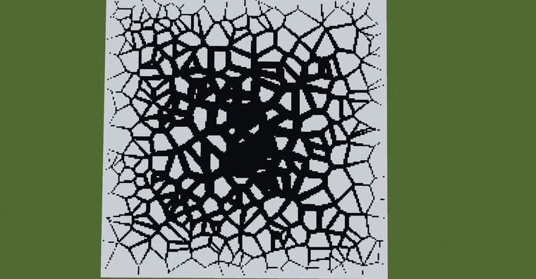

# 寻找voronoi边缘附近的一个办法

> 作者：**imhols**（UID 632698683） · 2023年3月30日 · 类型：`DYNAMIC_TYPE_DRAW` · [原动态](https://www.bilibili.com/opus/778762632823832596)

**WorldEdit / 程序化建模相关**

## 动态内容

寻找voronoi边缘附近的一个办法

首先还是随机取1000个点备用
//calc n=1000;for(i=0,255)for(j=0;jn*3)break;gmegabuf(k,2*random()-1);gmegabuf(k+1,0);gmegabuf(k+2,2*random()-1)}1 
以第一个圆形为例
//generate 251 
n=300;
d=min(0,0.05*sqrt(x^2+z^2)-0.05);
i=gclosest(x,y,z,0,n,3)
i1=gclosest(x+d,y,z,0,n,3)
i2=gclosest(x-d,y,z,0,n,3)
i3=gclosest(x,y,z+d,0,n,3)
i4=gclosest(x,y,z-d,0,n,3);
if(i1==i2&&i2==i3&&i3==i4)1 

为了判断该点是否在边缘附近，只要判断与它相隔"d"的位置处的索引是否与它自己的相同


## 图片





## 指令

```text
//calc n=1000;for(i=0,255)for(j=0;jn*3)break;gmegabuf(k,2*random()-1);gmegabuf(k+1,0);gmegabuf(k+2,2*random()-1)}1
//generate 251
```

---

内容与图片版权归 **imhols** 所有；本页为作品集索引。
