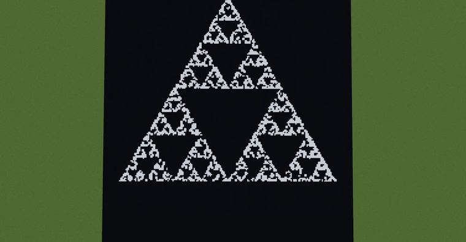
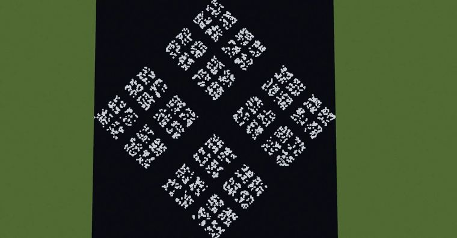

# 二维谢尔宾斯基集Sierpinski

> 作者：**imhols**（UID 632698683） · 2023年3月31日 · 类型：`DYNAMIC_TYPE_DRAW` · [原动态](https://www.bilibili.com/opus/779149862779224084)

**WorldEdit / 程序化建模相关**

## 动态内容

二维谢尔宾斯基集Sierpinski 

以谢尔宾斯基六边形为例：
1.生成初始正多边形顶点
//calc n=6;t=2*pi/n;for(i=3;i(I+n+1)*3)break;q=randint(n)*3+3;gmegabuf(k,gmegabuf(p)*(1-s)+gmegabuf(q)*s);gmegabuf(k+2,gmegabuf(p+2)*(1-s)+gmegabuf(q+2)*s)p=k}1 

3.生成点
//generate 251 I=8000;i=gclosest(x,0,z,3,I,3);(x-gmegabuf(i))^2+(z-gmegabuf(i+2))^2<0.01^2 

下图对应的n和s分别是
n=3;s=1/2 
n=4;s=4/7 
n=5;s=3/5 
n=6;s=2/3 
n=7;s=13/19 
n=8;s=14/19


## 图片





## 指令

```text
//calc n=6;t=2*pi/n;for(i=3;i(I+n+1)*3)break;q=randint(n)*3+3;gmegabuf(k,gmegabuf(p)*(1-s)+gmegabuf(q)*s);gmegabuf(k+2,gmegabuf(p+2)*(1-s)+gmegabuf(q+2)*s)p=k}1
//generate 251 I=8000;i=gclosest(x,0,z,3,I,3);(x-gmegabuf(i))^2+(z-gmegabuf(i+2))^2<0.01^2
```

---

内容与图片版权归 **imhols** 所有；本页为作品集索引。
