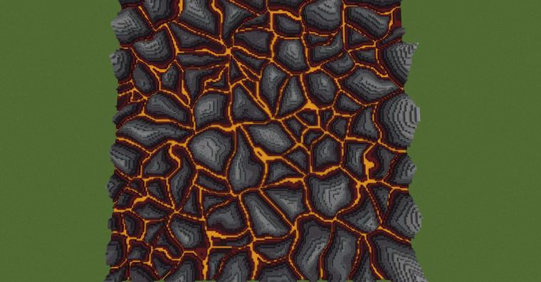
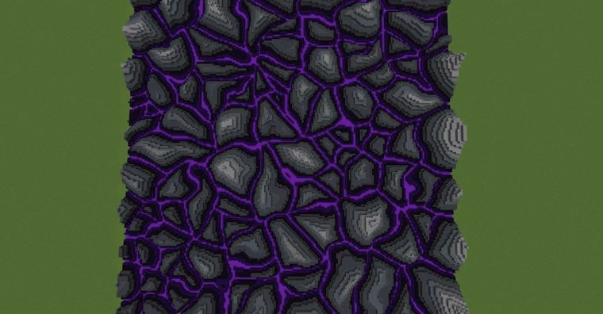

# voronoi岩石

> 作者：**imhols**（UID 632698683） · 2023年4月2日 · 类型：`DYNAMIC_TYPE_DRAW` · [原动态](https://www.bilibili.com/opus/779970034029035577)

**WorldEdit / 程序化建模相关**

## 动态内容

voronoi岩石

//calc n=1000;for(i=0,255)for(j=0;jn*3)break;gmegabuf(k,2*random()-1);gmegabuf(k+1,0);gmegabuf(k+2,2*random()-1)}1 

//g 251 
n=100;
d=0;
p=(perlin(1,x,1,z,5,2,0.3)-.5)*0.1;x+=p;z+=p;
do{
d+=0.01;i1=gclosest(x+d,y,z,0,n,3)i2=gclosest(x-d,y,z,0,n,3)i3=gclosest(x,y,z+d,0,n,3)i4=gclosest(x,y,z-d,0,n,3)
}while(i1==i2&&i2==i3&&i3==i4)
data=d*70;
y+1<d*10 

接上个动态，我想获得d的值而不是提前给d赋值，用一个while循环，每次步长0.01当没达到要求时退出就得到了d（顺便加了个xz方向的柏林噪声


## 图片





## 指令

```text
//calc n=1000;for(i=0,255)for(j=0;jn*3)break;gmegabuf(k,2*random()-1);gmegabuf(k+1,0);gmegabuf(k+2,2*random()-1)}1
//g 251
```

---

内容与图片版权归 **imhols** 所有；本页为作品集索引。
