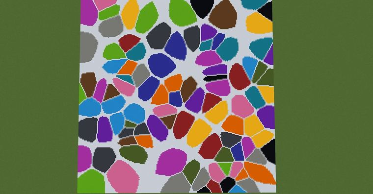
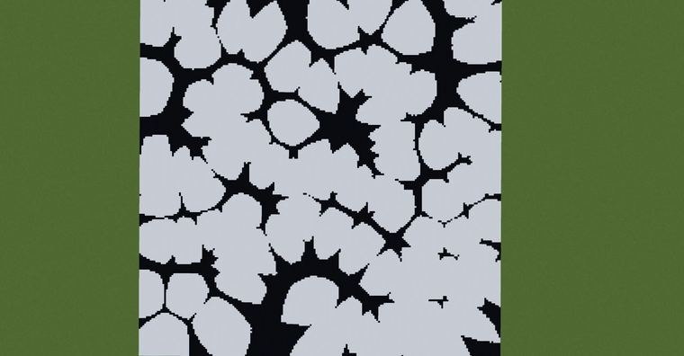

# 有点圆角的voronoi

> 作者：**imhols**（UID 632698683） · 2023年4月11日 · 类型：`DYNAMIC_TYPE_DRAW` · [原动态](https://www.bilibili.com/opus/783321865137422377)

**WorldEdit / 程序化建模相关**

## 动态内容

有点圆角的voronoi

//calc n=1000;for(i=0,255)for(j=0;jn*3)break;gmegabuf(k,2*random()-1);gmegabuf(k+1,0);gmegabuf(k+2,2*random()-1)}1 

//g 251 
n=100d=0i=gclosest(x,y,z,0,n,3)
do{d+=.005
j=gclosest(x+d,y,z,0,n,3)k=gclosest(x-d,y,z,0,n,3)l=gclosest(x,y,z+d,0,n,3)m=gclosest(x,y,z-d,0,n,3)}
while(j==k&&k==l&&l==m)
r=sqrt((x-gmegabuf(i))^2+(z-gmegabuf(i+2))^2)
data=i/3%15+1;
d>max(.005,.8*(r-.1)) 
我尝试把与边缘距离与与样点的距离结合，意外达到了圆角的效果（似乎点间有种引力一样在吸引）当r的权重变大时，就会更圆润


## 图片





## 指令

```text
//calc n=1000;for(i=0,255)for(j=0;jn*3)break;gmegabuf(k,2*random()-1);gmegabuf(k+1,0);gmegabuf(k+2,2*random()-1)}1
//g 251
```

---

内容与图片版权归 **imhols** 所有；本页为作品集索引。
