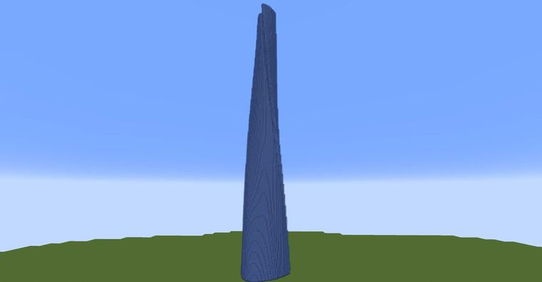

# 上海中心大厦

> 作者：**imhols**（UID 632698683） · 2023年4月14日 · 类型：`DYNAMIC_TYPE_DRAW` · [原动态](https://www.bilibili.com/opus/784377847313596436)

**WorldEdit / 程序化建模相关**

## 动态内容

上海中心大厦

//generate 251 -h s=e^(0.345*(y+1));x*=s;z*=s;rotate(x,z,-(1+y)*pi/3);a=0.18;r=sqrt(x^2+z^2);t=atan2(x,z)+pi;L=1-a+a*sin(3/2*t)^4;r<L&&z<tan(95/360*pi)*abs(x)+0.82

//generate 0 h=0.1;rotate(x,z,(1-y)*pi/3+pi/3)t=atan2(x,z);1-y<h*(t+pi)/pi/2 

选区大小：61x375x61
比例和一些数值不太准确，比如h


## 图片



## 指令

```text
//generate 251 -h s=e^(0.345*(y+1));x*=s;z*=s;rotate(x,z,-(1+y)*pi/3);a=0.18;r=sqrt(x^2+z^2);t=atan2(x,z)+pi;L=1-a+a*sin(3/2*t)^4;r<L&&z<tan(95/360*pi)*abs(x)+0.82
//generate 0 h=0.1;rotate(x,z,(1-y)*pi/3+pi/3)t=atan2(x,z);1-y<h*(t+pi)/pi/2
```

---

内容与图片版权归 **imhols** 所有；本页为作品集索引。
